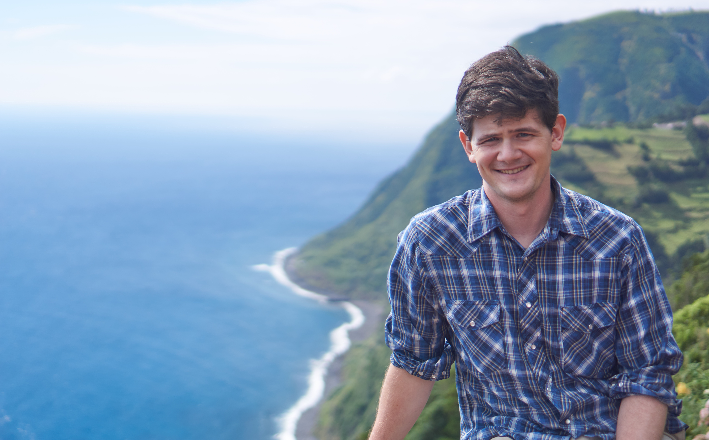

::: {.column-screen}
  
:::  

I'm a scientist in Brooklyn, NY. I use Python to analyze scientific data, combining my own measurements (spectroscopy, micro-CT, electron microprobe and SIMS) with published datasets and physical models to answer research questions.

Most recently I was a postdoctoral fellow at the Gemological Institute of America (2023 to 2025), where I built data pipelines for FTIR and Raman spectra of diamonds. Before that I did my PhD at Columbia University's Lamont-Doherty Earth Observatory on how mantle rocks change on their way to the surface, and before graduate school I ran micro-CT and electron microscopy at the American Museum of Natural History.

I'm looking for data science roles in New York City and am also open to imaging and geoscience work. The posts below cover my research and code; my software is on [GitHub](https://github.com/whtowbin).

