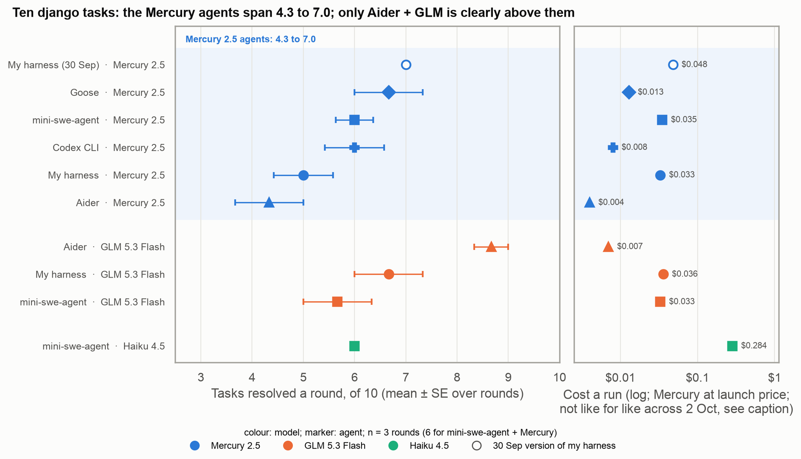
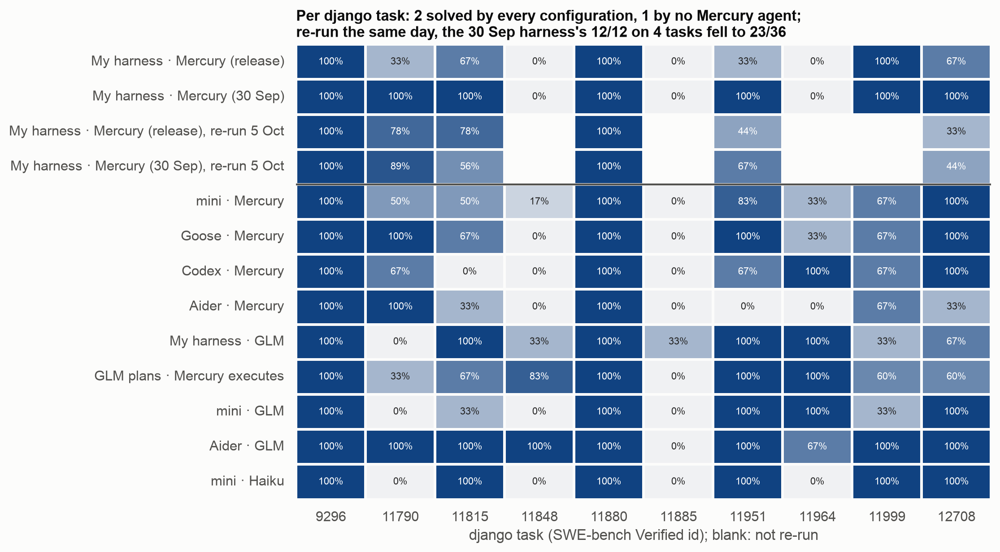
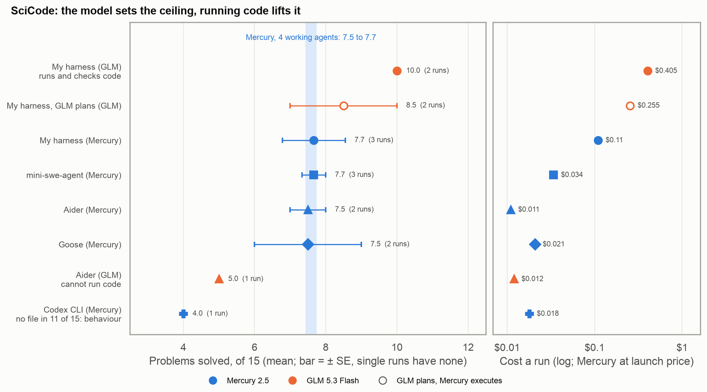

*Tables and figures behind [Mercury 2.5: a cheap diffusion LLM with a hard ceiling](../../posts/2026-mercury-coding-agent/index.qmd). A section number (§) refers to the project's [design log](https://github.com/whtowbin/mercury-harness/blob/main/DESIGN-LOG.md).*

## The findings, by list

Likely from diffusion decoding or from how Inception serves Mercury:

<!-- gt:findings-diffusion (generated by scripts/analysis/post_tables.py from docs/posts/tables/data/findings-diffusion.csv; edit the CSV, not this block) -->
```{=html}
<div id="xdazaeltuu" style="padding-left:0px;padding-right:0px;padding-top:10px;padding-bottom:10px;overflow-x:auto;overflow-y:auto;width:auto;height:auto;">
<table class="gt_table" style="font-family: -apple-system, BlinkMacSystemFont, 'Segoe UI', Roboto, Oxygen, Ubuntu, Cantarell, 'Helvetica Neue', 'Fira Sans', 'Droid Sans', Arial, sans-serif;-webkit-font-smoothing: antialiased;-moz-osx-font-smoothing: grayscale;display: table;border-collapse: collapse;line-height: normal;margin-left: auto;margin-right: auto;color: #0b0b0b;font-size: 13px;font-weight: normal;font-style: normal;background-color: #FFFFFF;border-top-style: solid;border-top-width: 2px;border-top-color: #0b0b0b;border-right-style: none;border-right-width: 2px;border-right-color: #D3D3D3;border-bottom-style: solid;border-bottom-width: 2px;border-bottom-color: #0b0b0b;border-left-style: none;border-left-width: 2px;border-left-color: #D3D3D3;table-layout: fixed;width: 100%" data-quarto-bootstrap="false" data-quarto-disable-processing="false">
<colgroup>
  <col style="width:22%;">
  <col style="width:38%;">
  <col style="width:30%;">
  <col style="width:10%;">
</colgroup>
<thead style="border-style: none;">
  <tr class="gt_heading" style="border-style: none;background-color: #FFFFFF;text-align: left;border-bottom-color: #FFFFFF;border-left-style: none;border-left-width: 1px;border-left-color: #D3D3D3;border-right-style: none;border-right-width: 1px;border-right-color: #D3D3D3;">
    <td class="gt_heading gt_title gt_font_normal" colspan="4" style="border-style: none;color: #0b0b0b;font-size: 15px;font-weight: normal;padding-top: 4px;padding-bottom: 4px;padding-left: 5px;padding-right: 5px;border-bottom-color: #FFFFFF;border-bottom-width: 0;background-color: #FFFFFF;text-align: left;border-left-style: none;border-left-width: 1px;border-left-color: #D3D3D3;border-right-style: none;border-right-width: 1px;border-right-color: #D3D3D3;">Likely from diffusion decoding or from how Inception serves Mercury</td>
  </tr>
<tr class="gt_col_headings" style="border-style: none;background-color: transparent;border-top-style: solid;border-top-width: 2px;border-top-color: #D3D3D3;border-bottom-style: solid;border-bottom-width: 2px;border-bottom-color: #D3D3D3;border-left-style: none;border-left-width: 1px;border-left-color: #D3D3D3;border-right-style: none;border-right-width: 1px;border-right-color: #D3D3D3;">
  <th class="gt_col_heading gt_columns_bottom_border gt_left" id="Finding" rowspan="1" colspan="1" scope="col" style="border-style: none;color: #0b0b0b;background-color: #f4f3ef;font-size: 100%;font-weight: bold;text-transform: inherit;border-left-style: none;border-left-width: 1px;border-left-color: #D3D3D3;border-right-style: none;border-right-width: 1px;border-right-color: #D3D3D3;vertical-align: bottom;padding-top: 5px;padding-bottom: 5px;padding-left: 5px;padding-right: 5px;overflow-x: hidden;text-align: left;">Finding</th>
  <th class="gt_col_heading gt_columns_bottom_border gt_left" id="What-it-means" rowspan="1" colspan="1" scope="col" style="border-style: none;color: #0b0b0b;background-color: #f4f3ef;font-size: 100%;font-weight: bold;text-transform: inherit;border-left-style: none;border-left-width: 1px;border-left-color: #D3D3D3;border-right-style: none;border-right-width: 1px;border-right-color: #D3D3D3;vertical-align: bottom;padding-top: 5px;padding-bottom: 5px;padding-left: 5px;padding-right: 5px;overflow-x: hidden;text-align: left;">What it means</th>
  <th class="gt_col_heading gt_columns_bottom_border gt_left" id="Number" rowspan="1" colspan="1" scope="col" style="border-style: none;color: #0b0b0b;background-color: #f4f3ef;font-size: 100%;font-weight: bold;text-transform: inherit;border-left-style: none;border-left-width: 1px;border-left-color: #D3D3D3;border-right-style: none;border-right-width: 1px;border-right-color: #D3D3D3;vertical-align: bottom;padding-top: 5px;padding-bottom: 5px;padding-left: 5px;padding-right: 5px;overflow-x: hidden;text-align: left;">Number</th>
  <th class="gt_col_heading gt_columns_bottom_border gt_left" id="Source" rowspan="1" colspan="1" scope="col" style="border-style: none;color: #0b0b0b;background-color: #f4f3ef;font-size: 100%;font-weight: bold;text-transform: inherit;border-left-style: none;border-left-width: 1px;border-left-color: #D3D3D3;border-right-style: none;border-right-width: 1px;border-right-color: #D3D3D3;vertical-align: bottom;padding-top: 5px;padding-bottom: 5px;padding-left: 5px;padding-right: 5px;overflow-x: hidden;text-align: left;">Source</th>
</tr>
</thead>
<tbody class="gt_table_body" style="border-style: none;border-top-style: solid;border-top-width: 2px;border-top-color: #D3D3D3;border-bottom-style: solid;border-bottom-width: 2px;border-bottom-color: #D3D3D3;">
  <tr style="border-style: none;background-color: transparent;">
    <td class="gt_row gt_left" style="border-style: none;padding-top: 5px;padding-bottom: 5px;padding-left: 5px;padding-right: 5px;margin: 10px;border-top-style: solid;border-top-width: 1px;border-top-color: #e6e5e0;border-left-style: none;border-left-width: 1px;border-left-color: #D3D3D3;border-right-style: none;border-right-width: 1px;border-right-color: #D3D3D3;vertical-align: middle;overflow-x: hidden;text-align: left;color: #0b0b0b;font-weight: bold">A call is mostly the wait for the first token</td>
    <td class="gt_row gt_left" style="border-style: none;padding-top: 5px;padding-bottom: 5px;padding-left: 5px;padding-right: 5px;margin: 10px;border-top-style: solid;border-top-width: 1px;border-top-color: #e6e5e0;border-left-style: none;border-left-width: 1px;border-left-color: #D3D3D3;border-right-style: none;border-right-width: 1px;border-right-color: #D3D3D3;vertical-align: middle;overflow-x: hidden;text-align: left;color: #52514e;font-size: 12px">Decoding is fast, but each call waits on a round trip before any text arrives, so the number of calls sets a run's time</td>
    <td class="gt_row gt_left" style="border-style: none;padding-top: 5px;padding-bottom: 5px;padding-left: 5px;padding-right: 5px;margin: 10px;border-top-style: solid;border-top-width: 1px;border-top-color: #e6e5e0;border-left-style: none;border-left-width: 1px;border-left-color: #D3D3D3;border-right-style: none;border-right-width: 1px;border-right-color: #D3D3D3;vertical-align: middle;overflow-x: hidden;text-align: left;">generation 0.16 s of a 1.46 s call</td>
    <td class="gt_row gt_left" style="border-style: none;padding-top: 5px;padding-bottom: 5px;padding-left: 5px;padding-right: 5px;margin: 10px;border-top-style: solid;border-top-width: 1px;border-top-color: #e6e5e0;border-left-style: none;border-left-width: 1px;border-left-color: #D3D3D3;border-right-style: none;border-right-width: 1px;border-right-color: #D3D3D3;vertical-align: middle;overflow-x: hidden;text-align: left;">§1, §7</td>
  </tr>
  <tr style="border-style: none;background-color: transparent;">
    <td class="gt_row gt_left" style="border-style: none;padding-top: 5px;padding-bottom: 5px;padding-left: 5px;padding-right: 5px;margin: 10px;border-top-style: solid;border-top-width: 1px;border-top-color: #e6e5e0;border-left-style: none;border-left-width: 1px;border-left-color: #D3D3D3;border-right-style: none;border-right-width: 1px;border-right-color: #D3D3D3;vertical-align: middle;overflow-x: hidden;text-align: left;color: #0b0b0b;font-weight: bold">Stalls hide behind keep-alives</td>
    <td class="gt_row gt_left" style="border-style: none;padding-top: 5px;padding-bottom: 5px;padding-left: 5px;padding-right: 5px;margin: 10px;border-top-style: solid;border-top-width: 1px;border-top-color: #e6e5e0;border-left-style: none;border-left-width: 1px;border-left-color: #D3D3D3;border-right-style: none;border-right-width: 1px;border-right-color: #D3D3D3;vertical-align: middle;overflow-x: hidden;text-align: left;color: #52514e;font-size: 12px">Some calls never start, but the router sends a "still processing" signal at once, so a first-byte timeout never fires</td>
    <td class="gt_row gt_left" style="border-style: none;padding-top: 5px;padding-bottom: 5px;padding-left: 5px;padding-right: 5px;margin: 10px;border-top-style: solid;border-top-width: 1px;border-top-color: #e6e5e0;border-left-style: none;border-left-width: 1px;border-left-color: #D3D3D3;border-right-style: none;border-right-width: 1px;border-right-color: #D3D3D3;vertical-align: middle;overflow-x: hidden;text-align: left;">330 of 50,924 calls silent until a 504 at ~120 s; median first content 1.15 s, p99 11.7 s</td>
    <td class="gt_row gt_left" style="border-style: none;padding-top: 5px;padding-bottom: 5px;padding-left: 5px;padding-right: 5px;margin: 10px;border-top-style: solid;border-top-width: 1px;border-top-color: #e6e5e0;border-left-style: none;border-left-width: 1px;border-left-color: #D3D3D3;border-right-style: none;border-right-width: 1px;border-right-color: #D3D3D3;vertical-align: middle;overflow-x: hidden;text-align: left;">§69</td>
  </tr>
  <tr style="border-style: none;background-color: transparent;">
    <td class="gt_row gt_left" style="border-style: none;padding-top: 5px;padding-bottom: 5px;padding-left: 5px;padding-right: 5px;margin: 10px;border-top-style: solid;border-top-width: 1px;border-top-color: #e6e5e0;border-left-style: none;border-left-width: 1px;border-left-color: #D3D3D3;border-right-style: none;border-right-width: 1px;border-right-color: #D3D3D3;vertical-align: middle;overflow-x: hidden;text-align: left;color: #0b0b0b;font-weight: bold">Every call ran at temperature 1.0</td>
    <td class="gt_row gt_left" style="border-style: none;padding-top: 5px;padding-bottom: 5px;padding-left: 5px;padding-right: 5px;margin: 10px;border-top-style: solid;border-top-width: 1px;border-top-color: #e6e5e0;border-left-style: none;border-left-width: 1px;border-left-color: #D3D3D3;border-right-style: none;border-right-width: 1px;border-right-color: #D3D3D3;vertical-align: middle;overflow-x: hidden;text-align: left;color: #52514e;font-size: 12px">The harness asked for low, near-deterministic sampling; the provider silently replaced it with its most random setting</td>
    <td class="gt_row gt_left" style="border-style: none;padding-top: 5px;padding-bottom: 5px;padding-left: 5px;padding-right: 5px;margin: 10px;border-top-style: solid;border-top-width: 1px;border-top-color: #e6e5e0;border-left-style: none;border-left-width: 1px;border-left-color: #D3D3D3;border-right-style: none;border-right-width: 1px;border-right-color: #D3D3D3;vertical-align: middle;overflow-x: hidden;text-align: left;">asked for 0.0-0.3; Inception resets anything outside 0.5-1.0</td>
    <td class="gt_row gt_left" style="border-style: none;padding-top: 5px;padding-bottom: 5px;padding-left: 5px;padding-right: 5px;margin: 10px;border-top-style: solid;border-top-width: 1px;border-top-color: #e6e5e0;border-left-style: none;border-left-width: 1px;border-left-color: #D3D3D3;border-right-style: none;border-right-width: 1px;border-right-color: #D3D3D3;vertical-align: middle;overflow-x: hidden;text-align: left;">§85</td>
  </tr>
  <tr style="border-style: none;background-color: transparent;">
    <td class="gt_row gt_left" style="border-style: none;padding-top: 5px;padding-bottom: 5px;padding-left: 5px;padding-right: 5px;margin: 10px;border-top-style: solid;border-top-width: 1px;border-top-color: #e6e5e0;border-left-style: none;border-left-width: 1px;border-left-color: #D3D3D3;border-right-style: none;border-right-width: 1px;border-right-color: #D3D3D3;vertical-align: middle;overflow-x: hidden;text-align: left;color: #0b0b0b;font-weight: bold">Temperature 0.5, tested</td>
    <td class="gt_row gt_left" style="border-style: none;padding-top: 5px;padding-bottom: 5px;padding-left: 5px;padding-right: 5px;margin: 10px;border-top-style: solid;border-top-width: 1px;border-top-color: #e6e5e0;border-left-style: none;border-left-width: 1px;border-left-color: #D3D3D3;border-right-style: none;border-right-width: 1px;border-right-color: #D3D3D3;vertical-align: middle;overflow-x: hidden;text-align: left;color: #52514e;font-size: 12px">A lower setting the provider does accept, tried against the 1.0 every run had used</td>
    <td class="gt_row gt_left" style="border-style: none;padding-top: 5px;padding-bottom: 5px;padding-left: 5px;padding-right: 5px;margin: 10px;border-top-style: solid;border-top-width: 1px;border-top-color: #e6e5e0;border-left-style: none;border-left-width: 1px;border-left-color: #D3D3D3;border-right-style: none;border-right-width: 1px;border-right-color: #D3D3D3;vertical-align: middle;overflow-x: hidden;text-align: left;">32 runs a side, not distinguishable, leaned worse</td>
    <td class="gt_row gt_left" style="border-style: none;padding-top: 5px;padding-bottom: 5px;padding-left: 5px;padding-right: 5px;margin: 10px;border-top-style: solid;border-top-width: 1px;border-top-color: #e6e5e0;border-left-style: none;border-left-width: 1px;border-left-color: #D3D3D3;border-right-style: none;border-right-width: 1px;border-right-color: #D3D3D3;vertical-align: middle;overflow-x: hidden;text-align: left;">§82.2</td>
  </tr>
  <tr style="border-style: none;background-color: transparent;">
    <td class="gt_row gt_left" style="border-style: none;padding-top: 5px;padding-bottom: 5px;padding-left: 5px;padding-right: 5px;margin: 10px;border-top-style: solid;border-top-width: 1px;border-top-color: #e6e5e0;border-left-style: none;border-left-width: 1px;border-left-color: #D3D3D3;border-right-style: none;border-right-width: 1px;border-right-color: #D3D3D3;vertical-align: middle;overflow-x: hidden;text-align: left;color: #0b0b0b;font-weight: bold">Hidden reasoning</td>
    <td class="gt_row gt_left" style="border-style: none;padding-top: 5px;padding-bottom: 5px;padding-left: 5px;padding-right: 5px;margin: 10px;border-top-style: solid;border-top-width: 1px;border-top-color: #e6e5e0;border-left-style: none;border-left-width: 1px;border-left-color: #D3D3D3;border-right-style: none;border-right-width: 1px;border-right-color: #D3D3D3;vertical-align: middle;overflow-x: hidden;text-align: left;color: #52514e;font-size: 12px">Mercury thinks in tokens the API never returns; only their count comes back</td>
    <td class="gt_row gt_left" style="border-style: none;padding-top: 5px;padding-bottom: 5px;padding-left: 5px;padding-right: 5px;margin: 10px;border-top-style: solid;border-top-width: 1px;border-top-color: #e6e5e0;border-left-style: none;border-left-width: 1px;border-left-color: #D3D3D3;border-right-style: none;border-right-width: 1px;border-right-color: #D3D3D3;vertical-align: middle;overflow-x: hidden;text-align: left;">~96% of output tokens (95.9% over 93,312 calls)</td>
    <td class="gt_row gt_left" style="border-style: none;padding-top: 5px;padding-bottom: 5px;padding-left: 5px;padding-right: 5px;margin: 10px;border-top-style: solid;border-top-width: 1px;border-top-color: #e6e5e0;border-left-style: none;border-left-width: 1px;border-left-color: #D3D3D3;border-right-style: none;border-right-width: 1px;border-right-color: #D3D3D3;vertical-align: middle;overflow-x: hidden;text-align: left;">§53, §82.1</td>
  </tr>
  <tr style="border-style: none;background-color: transparent;">
    <td class="gt_row gt_left" style="border-style: none;padding-top: 5px;padding-bottom: 5px;padding-left: 5px;padding-right: 5px;margin: 10px;border-top-style: solid;border-top-width: 1px;border-top-color: #e6e5e0;border-left-style: none;border-left-width: 1px;border-left-color: #D3D3D3;border-right-style: none;border-right-width: 1px;border-right-color: #D3D3D3;vertical-align: middle;overflow-x: hidden;text-align: left;color: #0b0b0b;font-weight: bold">More effort, fewer calls</td>
    <td class="gt_row gt_left" style="border-style: none;padding-top: 5px;padding-bottom: 5px;padding-left: 5px;padding-right: 5px;margin: 10px;border-top-style: solid;border-top-width: 1px;border-top-color: #e6e5e0;border-left-style: none;border-left-width: 1px;border-left-color: #D3D3D3;border-right-style: none;border-right-width: 1px;border-right-color: #D3D3D3;vertical-align: middle;overflow-x: hidden;text-align: left;color: #52514e;font-size: 12px">Lowering the executor's reasoning effort did not save reasoning; it spread it over more calls</td>
    <td class="gt_row gt_left" style="border-style: none;padding-top: 5px;padding-bottom: 5px;padding-left: 5px;padding-right: 5px;margin: 10px;border-top-style: solid;border-top-width: 1px;border-top-color: #e6e5e0;border-left-style: none;border-left-width: 1px;border-left-color: #D3D3D3;border-right-style: none;border-right-width: 1px;border-right-color: #D3D3D3;vertical-align: middle;overflow-x: hidden;text-align: left;">12.8 calls a run at high; 14.9, 18.4, 18.3 at medium, low, none</td>
    <td class="gt_row gt_left" style="border-style: none;padding-top: 5px;padding-bottom: 5px;padding-left: 5px;padding-right: 5px;margin: 10px;border-top-style: solid;border-top-width: 1px;border-top-color: #e6e5e0;border-left-style: none;border-left-width: 1px;border-left-color: #D3D3D3;border-right-style: none;border-right-width: 1px;border-right-color: #D3D3D3;vertical-align: middle;overflow-x: hidden;text-align: left;">§53.2</td>
  </tr>
  <tr style="border-style: none;background-color: transparent;">
    <td class="gt_row gt_left" style="border-style: none;padding-top: 5px;padding-bottom: 5px;padding-left: 5px;padding-right: 5px;margin: 10px;border-top-style: solid;border-top-width: 1px;border-top-color: #e6e5e0;border-left-style: none;border-left-width: 1px;border-left-color: #D3D3D3;border-right-style: none;border-right-width: 1px;border-right-color: #D3D3D3;vertical-align: middle;overflow-x: hidden;text-align: left;color: #0b0b0b;font-weight: bold">Runaway reasoning</td>
    <td class="gt_row gt_left" style="border-style: none;padding-top: 5px;padding-bottom: 5px;padding-left: 5px;padding-right: 5px;margin: 10px;border-top-style: solid;border-top-width: 1px;border-top-color: #e6e5e0;border-left-style: none;border-left-width: 1px;border-left-color: #D3D3D3;border-right-style: none;border-right-width: 1px;border-right-color: #D3D3D3;vertical-align: middle;overflow-x: hidden;text-align: left;color: #52514e;font-size: 12px">A rare call reasons for over a minute before a short answer; an output cap stops it</td>
    <td class="gt_row gt_left" style="border-style: none;padding-top: 5px;padding-bottom: 5px;padding-left: 5px;padding-right: 5px;margin: 10px;border-top-style: solid;border-top-width: 1px;border-top-color: #e6e5e0;border-left-style: none;border-left-width: 1px;border-left-color: #D3D3D3;border-right-style: none;border-right-width: 1px;border-right-color: #D3D3D3;vertical-align: middle;overflow-x: hidden;text-align: left;">~1% of SciCode calls, ~62,000 hidden tokens, 77 s; a 16k cap cut model time 30%</td>
    <td class="gt_row gt_left" style="border-style: none;padding-top: 5px;padding-bottom: 5px;padding-left: 5px;padding-right: 5px;margin: 10px;border-top-style: solid;border-top-width: 1px;border-top-color: #e6e5e0;border-left-style: none;border-left-width: 1px;border-left-color: #D3D3D3;border-right-style: none;border-right-width: 1px;border-right-color: #D3D3D3;vertical-align: middle;overflow-x: hidden;text-align: left;">§95, §95.1</td>
  </tr>
  <tr style="border-style: none;background-color: transparent;">
    <td class="gt_row gt_left" style="border-style: none;padding-top: 5px;padding-bottom: 5px;padding-left: 5px;padding-right: 5px;margin: 10px;border-top-style: solid;border-top-width: 1px;border-top-color: #e6e5e0;border-left-style: none;border-left-width: 1px;border-left-color: #D3D3D3;border-right-style: none;border-right-width: 1px;border-right-color: #D3D3D3;vertical-align: middle;overflow-x: hidden;text-align: left;color: #0b0b0b;font-weight: bold">Intermittent prompt cache</td>
    <td class="gt_row gt_left" style="border-style: none;padding-top: 5px;padding-bottom: 5px;padding-left: 5px;padding-right: 5px;margin: 10px;border-top-style: solid;border-top-width: 1px;border-top-color: #e6e5e0;border-left-style: none;border-left-width: 1px;border-left-color: #D3D3D3;border-right-style: none;border-right-width: 1px;border-right-color: #D3D3D3;vertical-align: middle;overflow-x: hidden;text-align: left;color: #52514e;font-size: 12px">The provider's cache of the repeated start of each prompt engaged on some calls and not others</td>
    <td class="gt_row gt_left" style="border-style: none;padding-top: 5px;padding-bottom: 5px;padding-left: 5px;padding-right: 5px;margin: 10px;border-top-style: solid;border-top-width: 1px;border-top-color: #e6e5e0;border-left-style: none;border-left-width: 1px;border-left-color: #D3D3D3;border-right-style: none;border-right-width: 1px;border-right-color: #D3D3D3;vertical-align: middle;overflow-x: hidden;text-align: left;">20% (SciCode night) to 67% (game project) of calls cached nothing</td>
    <td class="gt_row gt_left" style="border-style: none;padding-top: 5px;padding-bottom: 5px;padding-left: 5px;padding-right: 5px;margin: 10px;border-top-style: solid;border-top-width: 1px;border-top-color: #e6e5e0;border-left-style: none;border-left-width: 1px;border-left-color: #D3D3D3;border-right-style: none;border-right-width: 1px;border-right-color: #D3D3D3;vertical-align: middle;overflow-x: hidden;text-align: left;">§95.2</td>
  </tr>
  <tr style="border-style: none;background-color: transparent;">
    <td class="gt_row gt_left" style="border-style: none;padding-top: 5px;padding-bottom: 5px;padding-left: 5px;padding-right: 5px;margin: 10px;border-top-style: solid;border-top-width: 1px;border-top-color: #e6e5e0;border-left-style: none;border-left-width: 1px;border-left-color: #D3D3D3;border-right-style: none;border-right-width: 1px;border-right-color: #D3D3D3;vertical-align: middle;overflow-x: hidden;text-align: left;color: #0b0b0b;font-weight: bold">Provider slowdown</td>
    <td class="gt_row gt_left" style="border-style: none;padding-top: 5px;padding-bottom: 5px;padding-left: 5px;padding-right: 5px;margin: 10px;border-top-style: solid;border-top-width: 1px;border-top-color: #e6e5e0;border-left-style: none;border-left-width: 1px;border-left-color: #D3D3D3;border-right-style: none;border-right-width: 1px;border-right-color: #D3D3D3;vertical-align: middle;overflow-x: hidden;text-align: left;color: #52514e;font-size: 12px">The same prompts got slower over the month with no change on my side</td>
    <td class="gt_row gt_left" style="border-style: none;padding-top: 5px;padding-bottom: 5px;padding-left: 5px;padding-right: 5px;margin: 10px;border-top-style: solid;border-top-width: 1px;border-top-color: #e6e5e0;border-left-style: none;border-left-width: 1px;border-left-color: #D3D3D3;border-right-style: none;border-right-width: 1px;border-right-color: #D3D3D3;vertical-align: middle;overflow-x: hidden;text-align: left;">first token 28-45% later, decode ~1,640 to ~1,310 tokens/s over September</td>
    <td class="gt_row gt_left" style="border-style: none;padding-top: 5px;padding-bottom: 5px;padding-left: 5px;padding-right: 5px;margin: 10px;border-top-style: solid;border-top-width: 1px;border-top-color: #e6e5e0;border-left-style: none;border-left-width: 1px;border-left-color: #D3D3D3;border-right-style: none;border-right-width: 1px;border-right-color: #D3D3D3;vertical-align: middle;overflow-x: hidden;text-align: left;">§95, §114</td>
  </tr>
</tbody>
</table>
</div>
```
<!-- /gt:findings-diffusion -->

Could come from any cheap model:

<!-- gt:findings-any-model (generated by scripts/analysis/post_tables.py from docs/posts/tables/data/findings-any-model.csv; edit the CSV, not this block) -->
```{=html}
<div id="dfqqojkwhq" style="padding-left:0px;padding-right:0px;padding-top:10px;padding-bottom:10px;overflow-x:auto;overflow-y:auto;width:auto;height:auto;">
<table class="gt_table" style="font-family: -apple-system, BlinkMacSystemFont, 'Segoe UI', Roboto, Oxygen, Ubuntu, Cantarell, 'Helvetica Neue', 'Fira Sans', 'Droid Sans', Arial, sans-serif;-webkit-font-smoothing: antialiased;-moz-osx-font-smoothing: grayscale;display: table;border-collapse: collapse;line-height: normal;margin-left: auto;margin-right: auto;color: #0b0b0b;font-size: 13px;font-weight: normal;font-style: normal;background-color: #FFFFFF;border-top-style: solid;border-top-width: 2px;border-top-color: #0b0b0b;border-right-style: none;border-right-width: 2px;border-right-color: #D3D3D3;border-bottom-style: solid;border-bottom-width: 2px;border-bottom-color: #0b0b0b;border-left-style: none;border-left-width: 2px;border-left-color: #D3D3D3;table-layout: fixed;width: 100%" data-quarto-bootstrap="false" data-quarto-disable-processing="false">
<colgroup>
  <col style="width:22%;">
  <col style="width:38%;">
  <col style="width:30%;">
  <col style="width:10%;">
</colgroup>
<thead style="border-style: none;">
  <tr class="gt_heading" style="border-style: none;background-color: #FFFFFF;text-align: left;border-bottom-color: #FFFFFF;border-left-style: none;border-left-width: 1px;border-left-color: #D3D3D3;border-right-style: none;border-right-width: 1px;border-right-color: #D3D3D3;">
    <td class="gt_heading gt_title gt_font_normal" colspan="4" style="border-style: none;color: #0b0b0b;font-size: 15px;font-weight: normal;padding-top: 4px;padding-bottom: 4px;padding-left: 5px;padding-right: 5px;border-bottom-color: #FFFFFF;border-bottom-width: 0;background-color: #FFFFFF;text-align: left;border-left-style: none;border-left-width: 1px;border-left-color: #D3D3D3;border-right-style: none;border-right-width: 1px;border-right-color: #D3D3D3;">Could come from any cheap model</td>
  </tr>
<tr class="gt_col_headings" style="border-style: none;background-color: transparent;border-top-style: solid;border-top-width: 2px;border-top-color: #D3D3D3;border-bottom-style: solid;border-bottom-width: 2px;border-bottom-color: #D3D3D3;border-left-style: none;border-left-width: 1px;border-left-color: #D3D3D3;border-right-style: none;border-right-width: 1px;border-right-color: #D3D3D3;">
  <th class="gt_col_heading gt_columns_bottom_border gt_left" id="Finding" rowspan="1" colspan="1" scope="col" style="border-style: none;color: #0b0b0b;background-color: #f4f3ef;font-size: 100%;font-weight: bold;text-transform: inherit;border-left-style: none;border-left-width: 1px;border-left-color: #D3D3D3;border-right-style: none;border-right-width: 1px;border-right-color: #D3D3D3;vertical-align: bottom;padding-top: 5px;padding-bottom: 5px;padding-left: 5px;padding-right: 5px;overflow-x: hidden;text-align: left;">Finding</th>
  <th class="gt_col_heading gt_columns_bottom_border gt_left" id="What-it-means" rowspan="1" colspan="1" scope="col" style="border-style: none;color: #0b0b0b;background-color: #f4f3ef;font-size: 100%;font-weight: bold;text-transform: inherit;border-left-style: none;border-left-width: 1px;border-left-color: #D3D3D3;border-right-style: none;border-right-width: 1px;border-right-color: #D3D3D3;vertical-align: bottom;padding-top: 5px;padding-bottom: 5px;padding-left: 5px;padding-right: 5px;overflow-x: hidden;text-align: left;">What it means</th>
  <th class="gt_col_heading gt_columns_bottom_border gt_left" id="Number" rowspan="1" colspan="1" scope="col" style="border-style: none;color: #0b0b0b;background-color: #f4f3ef;font-size: 100%;font-weight: bold;text-transform: inherit;border-left-style: none;border-left-width: 1px;border-left-color: #D3D3D3;border-right-style: none;border-right-width: 1px;border-right-color: #D3D3D3;vertical-align: bottom;padding-top: 5px;padding-bottom: 5px;padding-left: 5px;padding-right: 5px;overflow-x: hidden;text-align: left;">Number</th>
  <th class="gt_col_heading gt_columns_bottom_border gt_left" id="Source" rowspan="1" colspan="1" scope="col" style="border-style: none;color: #0b0b0b;background-color: #f4f3ef;font-size: 100%;font-weight: bold;text-transform: inherit;border-left-style: none;border-left-width: 1px;border-left-color: #D3D3D3;border-right-style: none;border-right-width: 1px;border-right-color: #D3D3D3;vertical-align: bottom;padding-top: 5px;padding-bottom: 5px;padding-left: 5px;padding-right: 5px;overflow-x: hidden;text-align: left;">Source</th>
</tr>
</thead>
<tbody class="gt_table_body" style="border-style: none;border-top-style: solid;border-top-width: 2px;border-top-color: #D3D3D3;border-bottom-style: solid;border-bottom-width: 2px;border-bottom-color: #D3D3D3;">
  <tr style="border-style: none;background-color: transparent;">
    <td class="gt_row gt_left" style="border-style: none;padding-top: 5px;padding-bottom: 5px;padding-left: 5px;padding-right: 5px;margin: 10px;border-top-style: solid;border-top-width: 1px;border-top-color: #e6e5e0;border-left-style: none;border-left-width: 1px;border-left-color: #D3D3D3;border-right-style: none;border-right-width: 1px;border-right-color: #D3D3D3;vertical-align: middle;overflow-x: hidden;text-align: left;color: #0b0b0b;font-weight: bold">Optional tools unused</td>
    <td class="gt_row gt_left" style="border-style: none;padding-top: 5px;padding-bottom: 5px;padding-left: 5px;padding-right: 5px;margin: 10px;border-top-style: solid;border-top-width: 1px;border-top-color: #e6e5e0;border-left-style: none;border-left-width: 1px;border-left-color: #D3D3D3;border-right-style: none;border-right-width: 1px;border-right-color: #D3D3D3;vertical-align: middle;overflow-x: hidden;text-align: left;color: #52514e;font-size: 12px">Tools offered for particular jobs, such as structural renames, were almost never called</td>
    <td class="gt_row gt_left" style="border-style: none;padding-top: 5px;padding-bottom: 5px;padding-left: 5px;padding-right: 5px;margin: 10px;border-top-style: solid;border-top-width: 1px;border-top-color: #e6e5e0;border-left-style: none;border-left-width: 1px;border-left-color: #D3D3D3;border-right-style: none;border-right-width: 1px;border-right-color: #D3D3D3;vertical-align: middle;overflow-x: hidden;text-align: left;">4 calls in ~3,100 offers over 3,915 runs</td>
    <td class="gt_row gt_left" style="border-style: none;padding-top: 5px;padding-bottom: 5px;padding-left: 5px;padding-right: 5px;margin: 10px;border-top-style: solid;border-top-width: 1px;border-top-color: #e6e5e0;border-left-style: none;border-left-width: 1px;border-left-color: #D3D3D3;border-right-style: none;border-right-width: 1px;border-right-color: #D3D3D3;vertical-align: middle;overflow-x: hidden;text-align: left;">§62</td>
  </tr>
  <tr style="border-style: none;background-color: transparent;">
    <td class="gt_row gt_left" style="border-style: none;padding-top: 5px;padding-bottom: 5px;padding-left: 5px;padding-right: 5px;margin: 10px;border-top-style: solid;border-top-width: 1px;border-top-color: #e6e5e0;border-left-style: none;border-left-width: 1px;border-left-color: #D3D3D3;border-right-style: none;border-right-width: 1px;border-right-color: #D3D3D3;vertical-align: middle;overflow-x: hidden;text-align: left;color: #0b0b0b;font-weight: bold">Reference notes unused</td>
    <td class="gt_row gt_left" style="border-style: none;padding-top: 5px;padding-bottom: 5px;padding-left: 5px;padding-right: 5px;margin: 10px;border-top-style: solid;border-top-width: 1px;border-top-color: #e6e5e0;border-left-style: none;border-left-width: 1px;border-left-color: #D3D3D3;border-right-style: none;border-right-width: 1px;border-right-color: #D3D3D3;vertical-align: middle;overflow-x: hidden;text-align: left;color: #52514e;font-size: 12px">The tool for reading the reference notes written for the model was called once, while its catalog rode on every call</td>
    <td class="gt_row gt_left" style="border-style: none;padding-top: 5px;padding-bottom: 5px;padding-left: 5px;padding-right: 5px;margin: 10px;border-top-style: solid;border-top-width: 1px;border-top-color: #e6e5e0;border-left-style: none;border-left-width: 1px;border-left-color: #D3D3D3;border-right-style: none;border-right-width: 1px;border-right-color: #D3D3D3;vertical-align: middle;overflow-x: hidden;text-align: left;">1 read in 59,338 executor calls, ~420 tokens a call</td>
    <td class="gt_row gt_left" style="border-style: none;padding-top: 5px;padding-bottom: 5px;padding-left: 5px;padding-right: 5px;margin: 10px;border-top-style: solid;border-top-width: 1px;border-top-color: #e6e5e0;border-left-style: none;border-left-width: 1px;border-left-color: #D3D3D3;border-right-style: none;border-right-width: 1px;border-right-color: #D3D3D3;vertical-align: middle;overflow-x: hidden;text-align: left;">§113</td>
  </tr>
  <tr style="border-style: none;background-color: transparent;">
    <td class="gt_row gt_left" style="border-style: none;padding-top: 5px;padding-bottom: 5px;padding-left: 5px;padding-right: 5px;margin: 10px;border-top-style: solid;border-top-width: 1px;border-top-color: #e6e5e0;border-left-style: none;border-left-width: 1px;border-left-color: #D3D3D3;border-right-style: none;border-right-width: 1px;border-right-color: #D3D3D3;vertical-align: middle;overflow-x: hidden;text-align: left;color: #0b0b0b;font-weight: bold">Rules decay over a step</td>
    <td class="gt_row gt_left" style="border-style: none;padding-top: 5px;padding-bottom: 5px;padding-left: 5px;padding-right: 5px;margin: 10px;border-top-style: solid;border-top-width: 1px;border-top-color: #e6e5e0;border-left-style: none;border-left-width: 1px;border-left-color: #D3D3D3;border-right-style: none;border-right-width: 1px;border-right-color: #D3D3D3;vertical-align: middle;overflow-x: hidden;text-align: left;color: #52514e;font-size: 12px">An instruction in the system prompt is followed early in a step and ignored a few turns later</td>
    <td class="gt_row gt_left" style="border-style: none;padding-top: 5px;padding-bottom: 5px;padding-left: 5px;padding-right: 5px;margin: 10px;border-top-style: solid;border-top-width: 1px;border-top-color: #e6e5e0;border-left-style: none;border-left-width: 1px;border-left-color: #D3D3D3;border-right-style: none;border-right-width: 1px;border-right-color: #D3D3D3;vertical-align: middle;overflow-x: hidden;text-align: left;">batching 6.0% of replies on turns 0-1, 1.5%, 0.8%, 1.2% later</td>
    <td class="gt_row gt_left" style="border-style: none;padding-top: 5px;padding-bottom: 5px;padding-left: 5px;padding-right: 5px;margin: 10px;border-top-style: solid;border-top-width: 1px;border-top-color: #e6e5e0;border-left-style: none;border-left-width: 1px;border-left-color: #D3D3D3;border-right-style: none;border-right-width: 1px;border-right-color: #D3D3D3;vertical-align: middle;overflow-x: hidden;text-align: left;">§82</td>
  </tr>
  <tr style="border-style: none;background-color: transparent;">
    <td class="gt_row gt_left" style="border-style: none;padding-top: 5px;padding-bottom: 5px;padding-left: 5px;padding-right: 5px;margin: 10px;border-top-style: solid;border-top-width: 1px;border-top-color: #e6e5e0;border-left-style: none;border-left-width: 1px;border-left-color: #D3D3D3;border-right-style: none;border-right-width: 1px;border-right-color: #D3D3D3;vertical-align: middle;overflow-x: hidden;text-align: left;color: #0b0b0b;font-weight: bold">Reminder after the last message</td>
    <td class="gt_row gt_left" style="border-style: none;padding-top: 5px;padding-bottom: 5px;padding-left: 5px;padding-right: 5px;margin: 10px;border-top-style: solid;border-top-width: 1px;border-top-color: #e6e5e0;border-left-style: none;border-left-width: 1px;border-left-color: #D3D3D3;border-right-style: none;border-right-width: 1px;border-right-color: #D3D3D3;vertical-align: middle;overflow-x: hidden;text-align: left;color: #52514e;font-size: 12px">Repeating the rule after the latest message, on every call, kept it followed</td>
    <td class="gt_row gt_left" style="border-style: none;padding-top: 5px;padding-bottom: 5px;padding-left: 5px;padding-right: 5px;margin: 10px;border-top-style: solid;border-top-width: 1px;border-top-color: #e6e5e0;border-left-style: none;border-left-width: 1px;border-left-color: #D3D3D3;border-right-style: none;border-right-width: 1px;border-right-color: #D3D3D3;vertical-align: middle;overflow-x: hidden;text-align: left;">execute replies −21% (fixtures), −24% (django), calls −11% (django)</td>
    <td class="gt_row gt_left" style="border-style: none;padding-top: 5px;padding-bottom: 5px;padding-left: 5px;padding-right: 5px;margin: 10px;border-top-style: solid;border-top-width: 1px;border-top-color: #e6e5e0;border-left-style: none;border-left-width: 1px;border-left-color: #D3D3D3;border-right-style: none;border-right-width: 1px;border-right-color: #D3D3D3;vertical-align: middle;overflow-x: hidden;text-align: left;">§106.2, §107.3</td>
  </tr>
  <tr style="border-style: none;background-color: transparent;">
    <td class="gt_row gt_left" style="border-style: none;padding-top: 5px;padding-bottom: 5px;padding-left: 5px;padding-right: 5px;margin: 10px;border-top-style: solid;border-top-width: 1px;border-top-color: #e6e5e0;border-left-style: none;border-left-width: 1px;border-left-color: #D3D3D3;border-right-style: none;border-right-width: 1px;border-right-color: #D3D3D3;vertical-align: middle;overflow-x: hidden;text-align: left;color: #0b0b0b;font-weight: bold">Tool calls fail on arguments</td>
    <td class="gt_row gt_left" style="border-style: none;padding-top: 5px;padding-bottom: 5px;padding-left: 5px;padding-right: 5px;margin: 10px;border-top-style: solid;border-top-width: 1px;border-top-color: #e6e5e0;border-left-style: none;border-left-width: 1px;border-left-color: #D3D3D3;border-right-style: none;border-right-width: 1px;border-right-color: #D3D3D3;vertical-align: middle;overflow-x: hidden;text-align: left;color: #52514e;font-size: 12px">The model always named a real tool; failures were arguments that did not parse</td>
    <td class="gt_row gt_left" style="border-style: none;padding-top: 5px;padding-bottom: 5px;padding-left: 5px;padding-right: 5px;margin: 10px;border-top-style: solid;border-top-width: 1px;border-top-color: #e6e5e0;border-left-style: none;border-left-width: 1px;border-left-color: #D3D3D3;border-right-style: none;border-right-width: 1px;border-right-color: #D3D3D3;vertical-align: middle;overflow-x: hidden;text-align: left;">plan call unparsable in 12% of runs; strict schemas 0 of 432 vs 9 of 524</td>
    <td class="gt_row gt_left" style="border-style: none;padding-top: 5px;padding-bottom: 5px;padding-left: 5px;padding-right: 5px;margin: 10px;border-top-style: solid;border-top-width: 1px;border-top-color: #e6e5e0;border-left-style: none;border-left-width: 1px;border-left-color: #D3D3D3;border-right-style: none;border-right-width: 1px;border-right-color: #D3D3D3;vertical-align: middle;overflow-x: hidden;text-align: left;">§63, §63.1</td>
  </tr>
  <tr style="border-style: none;background-color: transparent;">
    <td class="gt_row gt_left" style="border-style: none;padding-top: 5px;padding-bottom: 5px;padding-left: 5px;padding-right: 5px;margin: 10px;border-top-style: solid;border-top-width: 1px;border-top-color: #e6e5e0;border-left-style: none;border-left-width: 1px;border-left-color: #D3D3D3;border-right-style: none;border-right-width: 1px;border-right-color: #D3D3D3;vertical-align: middle;overflow-x: hidden;text-align: left;color: #0b0b0b;font-weight: bold">Wrong bug reports believed</td>
    <td class="gt_row gt_left" style="border-style: none;padding-top: 5px;padding-bottom: 5px;padding-left: 5px;padding-right: 5px;margin: 10px;border-top-style: solid;border-top-width: 1px;border-top-color: #e6e5e0;border-left-style: none;border-left-width: 1px;border-left-color: #D3D3D3;border-right-style: none;border-right-width: 1px;border-right-color: #D3D3D3;vertical-align: middle;overflow-x: hidden;text-align: left;color: #52514e;font-size: 12px">On tasks whose bug report is false, the model changes the correct code instead of saying so</td>
    <td class="gt_row gt_left" style="border-style: none;padding-top: 5px;padding-bottom: 5px;padding-left: 5px;padding-right: 5px;margin: 10px;border-top-style: solid;border-top-width: 1px;border-top-color: #e6e5e0;border-left-style: none;border-left-width: 1px;border-left-color: #D3D3D3;border-right-style: none;border-right-width: 1px;border-right-color: #D3D3D3;vertical-align: middle;overflow-x: hidden;text-align: left;"><code>misreport-discount</code>, <code>misreport-documented</code> honest 0 of 3 each</td>
    <td class="gt_row gt_left" style="border-style: none;padding-top: 5px;padding-bottom: 5px;padding-left: 5px;padding-right: 5px;margin: 10px;border-top-style: solid;border-top-width: 1px;border-top-color: #e6e5e0;border-left-style: none;border-left-width: 1px;border-left-color: #D3D3D3;border-right-style: none;border-right-width: 1px;border-right-color: #D3D3D3;vertical-align: middle;overflow-x: hidden;text-align: left;">§54.3, §96.4</td>
  </tr>
  <tr style="border-style: none;background-color: transparent;">
    <td class="gt_row gt_left" style="border-style: none;padding-top: 5px;padding-bottom: 5px;padding-left: 5px;padding-right: 5px;margin: 10px;border-top-style: solid;border-top-width: 1px;border-top-color: #e6e5e0;border-left-style: none;border-left-width: 1px;border-left-color: #D3D3D3;border-right-style: none;border-right-width: 1px;border-right-color: #D3D3D3;vertical-align: middle;overflow-x: hidden;text-align: left;color: #0b0b0b;font-weight: bold">Codex CLI</td>
    <td class="gt_row gt_left" style="border-style: none;padding-top: 5px;padding-bottom: 5px;padding-left: 5px;padding-right: 5px;margin: 10px;border-top-style: solid;border-top-width: 1px;border-top-color: #e6e5e0;border-left-style: none;border-left-width: 1px;border-left-color: #D3D3D3;border-right-style: none;border-right-width: 1px;border-right-color: #D3D3D3;vertical-align: middle;overflow-x: hidden;text-align: left;color: #52514e;font-size: 12px">Inside Codex, Mercury printed its answer in the chat and never wrote the solution file</td>
    <td class="gt_row gt_left" style="border-style: none;padding-top: 5px;padding-bottom: 5px;padding-left: 5px;padding-right: 5px;margin: 10px;border-top-style: solid;border-top-width: 1px;border-top-color: #e6e5e0;border-left-style: none;border-left-width: 1px;border-left-color: #D3D3D3;border-right-style: none;border-right-width: 1px;border-right-color: #D3D3D3;vertical-align: middle;overflow-x: hidden;text-align: left;">printed the code and wrote no file in 11 of 15 SciCode problems</td>
    <td class="gt_row gt_left" style="border-style: none;padding-top: 5px;padding-bottom: 5px;padding-left: 5px;padding-right: 5px;margin: 10px;border-top-style: solid;border-top-width: 1px;border-top-color: #e6e5e0;border-left-style: none;border-left-width: 1px;border-left-color: #D3D3D3;border-right-style: none;border-right-width: 1px;border-right-color: #D3D3D3;vertical-align: middle;overflow-x: hidden;text-align: left;">§109.5</td>
  </tr>
</tbody>
</table>
</div>
```
<!-- /gt:findings-any-model -->

## Settings that worked with Mercury

<!-- gt:settings (generated by scripts/analysis/post_tables.py from docs/posts/tables/data/settings.csv; edit the CSV, not this block) -->
```{=html}
<div id="iieymgnprb" style="padding-left:0px;padding-right:0px;padding-top:10px;padding-bottom:10px;overflow-x:auto;overflow-y:auto;width:auto;height:auto;">
<table class="gt_table" data-quarto-bootstrap="false" data-quarto-disable-processing="false" style="font-family: -apple-system, BlinkMacSystemFont, 'Segoe UI', Roboto, Oxygen, Ubuntu, Cantarell, 'Helvetica Neue', 'Fira Sans', 'Droid Sans', Arial, sans-serif;-webkit-font-smoothing: antialiased;-moz-osx-font-smoothing: grayscale;display: table;border-collapse: collapse;line-height: normal;margin-left: auto;margin-right: auto;color: #0b0b0b;font-size: 13px;font-weight: normal;font-style: normal;background-color: #FFFFFF;width: 100%;border-top-style: solid;border-top-width: 2px;border-top-color: #0b0b0b;border-right-style: none;border-right-width: 2px;border-right-color: #D3D3D3;border-bottom-style: solid;border-bottom-width: 2px;border-bottom-color: #0b0b0b;border-left-style: none;border-left-width: 2px;border-left-color: #D3D3D3;">
<thead style="border-style: none;">
  <tr class="gt_heading" style="border-style: none;background-color: #FFFFFF;text-align: left;border-bottom-color: #FFFFFF;border-left-style: none;border-left-width: 1px;border-left-color: #D3D3D3;border-right-style: none;border-right-width: 1px;border-right-color: #D3D3D3;">
    <td class="gt_heading gt_title gt_font_normal" colspan="4" style="border-style: none;color: #0b0b0b;font-size: 15px;font-weight: normal;padding-top: 4px;padding-bottom: 4px;padding-left: 5px;padding-right: 5px;border-bottom-color: #FFFFFF;border-bottom-width: 0;background-color: #FFFFFF;text-align: left;border-left-style: none;border-left-width: 1px;border-left-color: #D3D3D3;border-right-style: none;border-right-width: 1px;border-right-color: #D3D3D3;">Settings that worked with Mercury</td>
  </tr>
<tr class="gt_col_headings" style="border-style: none;background-color: transparent;border-top-style: solid;border-top-width: 2px;border-top-color: #D3D3D3;border-bottom-style: solid;border-bottom-width: 2px;border-bottom-color: #D3D3D3;border-left-style: none;border-left-width: 1px;border-left-color: #D3D3D3;border-right-style: none;border-right-width: 1px;border-right-color: #D3D3D3;">
  <th class="gt_col_heading gt_columns_bottom_border gt_left" id="Setting" rowspan="1" colspan="1" scope="col" style="border-style: none;color: #0b0b0b;background-color: #f4f3ef;font-size: 100%;font-weight: bold;text-transform: inherit;border-left-style: none;border-left-width: 1px;border-left-color: #D3D3D3;border-right-style: none;border-right-width: 1px;border-right-color: #D3D3D3;vertical-align: bottom;padding-top: 5px;padding-bottom: 5px;padding-left: 5px;padding-right: 5px;overflow-x: hidden;text-align: left;">Setting</th>
  <th class="gt_col_heading gt_columns_bottom_border gt_left" id="What-it-controls" rowspan="1" colspan="1" scope="col" style="border-style: none;color: #0b0b0b;background-color: #f4f3ef;font-size: 100%;font-weight: bold;text-transform: inherit;border-left-style: none;border-left-width: 1px;border-left-color: #D3D3D3;border-right-style: none;border-right-width: 1px;border-right-color: #D3D3D3;vertical-align: bottom;padding-top: 5px;padding-bottom: 5px;padding-left: 5px;padding-right: 5px;overflow-x: hidden;text-align: left;">What it controls</th>
  <th class="gt_col_heading gt_columns_bottom_border gt_left" id="What-happened-without-it" rowspan="1" colspan="1" scope="col" style="border-style: none;color: #0b0b0b;background-color: #f4f3ef;font-size: 100%;font-weight: bold;text-transform: inherit;border-left-style: none;border-left-width: 1px;border-left-color: #D3D3D3;border-right-style: none;border-right-width: 1px;border-right-color: #D3D3D3;vertical-align: bottom;padding-top: 5px;padding-bottom: 5px;padding-left: 5px;padding-right: 5px;overflow-x: hidden;text-align: left;">What happened without it</th>
  <th class="gt_col_heading gt_columns_bottom_border gt_left" id="Use" rowspan="1" colspan="1" scope="col" style="border-style: none;color: #0b0b0b;background-color: #f4f3ef;font-size: 100%;font-weight: bold;text-transform: inherit;border-left-style: none;border-left-width: 1px;border-left-color: #D3D3D3;border-right-style: none;border-right-width: 1px;border-right-color: #D3D3D3;vertical-align: bottom;padding-top: 5px;padding-bottom: 5px;padding-left: 5px;padding-right: 5px;overflow-x: hidden;text-align: left;">Use</th>
</tr>
</thead>
<tbody class="gt_table_body" style="border-style: none;border-top-style: solid;border-top-width: 2px;border-top-color: #D3D3D3;border-bottom-style: solid;border-bottom-width: 2px;border-bottom-color: #D3D3D3;">
  <tr style="border-style: none;background-color: transparent;">
    <td class="gt_row gt_left" style="border-style: none;padding-top: 5px;padding-bottom: 5px;padding-left: 5px;padding-right: 5px;margin: 10px;border-top-style: solid;border-top-width: 1px;border-top-color: #e6e5e0;border-left-style: none;border-left-width: 1px;border-left-color: #D3D3D3;border-right-style: none;border-right-width: 1px;border-right-color: #D3D3D3;vertical-align: middle;overflow-x: hidden;text-align: left;color: #0b0b0b;font-weight: bold">Temperature</td>
    <td class="gt_row gt_left" style="border-style: none;padding-top: 5px;padding-bottom: 5px;padding-left: 5px;padding-right: 5px;margin: 10px;border-top-style: solid;border-top-width: 1px;border-top-color: #e6e5e0;border-left-style: none;border-left-width: 1px;border-left-color: #D3D3D3;border-right-style: none;border-right-width: 1px;border-right-color: #D3D3D3;vertical-align: middle;overflow-x: hidden;text-align: left;color: #52514e;font-size: 12px">How random the sampling is</td>
    <td class="gt_row gt_left" style="border-style: none;padding-top: 5px;padding-bottom: 5px;padding-left: 5px;padding-right: 5px;margin: 10px;border-top-style: solid;border-top-width: 1px;border-top-color: #e6e5e0;border-left-style: none;border-left-width: 1px;border-left-color: #D3D3D3;border-right-style: none;border-right-width: 1px;border-right-color: #D3D3D3;vertical-align: middle;overflow-x: hidden;text-align: left;">reset to 1.0 outside 0.5-1.0</td>
    <td class="gt_row gt_left" style="border-style: none;padding-top: 5px;padding-bottom: 5px;padding-left: 5px;padding-right: 5px;margin: 10px;border-top-style: solid;border-top-width: 1px;border-top-color: #e6e5e0;border-left-style: none;border-left-width: 1px;border-left-color: #D3D3D3;border-right-style: none;border-right-width: 1px;border-right-color: #D3D3D3;vertical-align: middle;overflow-x: hidden;text-align: left;">send 0.5-1.0, or nothing</td>
  </tr>
  <tr style="border-style: none;background-color: transparent;">
    <td class="gt_row gt_left" style="border-style: none;padding-top: 5px;padding-bottom: 5px;padding-left: 5px;padding-right: 5px;margin: 10px;border-top-style: solid;border-top-width: 1px;border-top-color: #e6e5e0;border-left-style: none;border-left-width: 1px;border-left-color: #D3D3D3;border-right-style: none;border-right-width: 1px;border-right-color: #D3D3D3;vertical-align: middle;overflow-x: hidden;text-align: left;color: #0b0b0b;font-weight: bold">Reasoning effort</td>
    <td class="gt_row gt_left" style="border-style: none;padding-top: 5px;padding-bottom: 5px;padding-left: 5px;padding-right: 5px;margin: 10px;border-top-style: solid;border-top-width: 1px;border-top-color: #e6e5e0;border-left-style: none;border-left-width: 1px;border-left-color: #D3D3D3;border-right-style: none;border-right-width: 1px;border-right-color: #D3D3D3;vertical-align: middle;overflow-x: hidden;text-align: left;color: #52514e;font-size: 12px">How much hidden reasoning the model does before answering</td>
    <td class="gt_row gt_left" style="border-style: none;padding-top: 5px;padding-bottom: 5px;padding-left: 5px;padding-right: 5px;margin: 10px;border-top-style: solid;border-top-width: 1px;border-top-color: #e6e5e0;border-left-style: none;border-left-width: 1px;border-left-color: #D3D3D3;border-right-style: none;border-right-width: 1px;border-right-color: #D3D3D3;vertical-align: middle;overflow-x: hidden;text-align: left;">lower effort added calls</td>
    <td class="gt_row gt_left" style="border-style: none;padding-top: 5px;padding-bottom: 5px;padding-left: 5px;padding-right: 5px;margin: 10px;border-top-style: solid;border-top-width: 1px;border-top-color: #e6e5e0;border-left-style: none;border-left-width: 1px;border-left-color: #D3D3D3;border-right-style: none;border-right-width: 1px;border-right-color: #D3D3D3;vertical-align: middle;overflow-x: hidden;text-align: left;">high for the executor</td>
  </tr>
  <tr style="border-style: none;background-color: transparent;">
    <td class="gt_row gt_left" style="border-style: none;padding-top: 5px;padding-bottom: 5px;padding-left: 5px;padding-right: 5px;margin: 10px;border-top-style: solid;border-top-width: 1px;border-top-color: #e6e5e0;border-left-style: none;border-left-width: 1px;border-left-color: #D3D3D3;border-right-style: none;border-right-width: 1px;border-right-color: #D3D3D3;vertical-align: middle;overflow-x: hidden;text-align: left;color: #0b0b0b;font-weight: bold"><code>max_tokens</code></td>
    <td class="gt_row gt_left" style="border-style: none;padding-top: 5px;padding-bottom: 5px;padding-left: 5px;padding-right: 5px;margin: 10px;border-top-style: solid;border-top-width: 1px;border-top-color: #e6e5e0;border-left-style: none;border-left-width: 1px;border-left-color: #D3D3D3;border-right-style: none;border-right-width: 1px;border-right-color: #D3D3D3;vertical-align: middle;overflow-x: hidden;text-align: left;color: #52514e;font-size: 12px">The most output tokens, hidden reasoning included, a call may produce</td>
    <td class="gt_row gt_left" style="border-style: none;padding-top: 5px;padding-bottom: 5px;padding-left: 5px;padding-right: 5px;margin: 10px;border-top-style: solid;border-top-width: 1px;border-top-color: #e6e5e0;border-left-style: none;border-left-width: 1px;border-left-color: #D3D3D3;border-right-style: none;border-right-width: 1px;border-right-color: #D3D3D3;vertical-align: middle;overflow-x: hidden;text-align: left;">rare calls reasoned for over a minute</td>
    <td class="gt_row gt_left" style="border-style: none;padding-top: 5px;padding-bottom: 5px;padding-left: 5px;padding-right: 5px;margin: 10px;border-top-style: solid;border-top-width: 1px;border-top-color: #e6e5e0;border-left-style: none;border-left-width: 1px;border-left-color: #D3D3D3;border-right-style: none;border-right-width: 1px;border-right-color: #D3D3D3;vertical-align: middle;overflow-x: hidden;text-align: left;">16,000</td>
  </tr>
  <tr style="border-style: none;background-color: transparent;">
    <td class="gt_row gt_left" style="border-style: none;padding-top: 5px;padding-bottom: 5px;padding-left: 5px;padding-right: 5px;margin: 10px;border-top-style: solid;border-top-width: 1px;border-top-color: #e6e5e0;border-left-style: none;border-left-width: 1px;border-left-color: #D3D3D3;border-right-style: none;border-right-width: 1px;border-right-color: #D3D3D3;vertical-align: middle;overflow-x: hidden;text-align: left;color: #0b0b0b;font-weight: bold">Strict tool schemas</td>
    <td class="gt_row gt_left" style="border-style: none;padding-top: 5px;padding-bottom: 5px;padding-left: 5px;padding-right: 5px;margin: 10px;border-top-style: solid;border-top-width: 1px;border-top-color: #e6e5e0;border-left-style: none;border-left-width: 1px;border-left-color: #D3D3D3;border-right-style: none;border-right-width: 1px;border-right-color: #D3D3D3;vertical-align: middle;overflow-x: hidden;text-align: left;color: #52514e;font-size: 12px">Whether the provider enforces each tool's argument format exactly</td>
    <td class="gt_row gt_left" style="border-style: none;padding-top: 5px;padding-bottom: 5px;padding-left: 5px;padding-right: 5px;margin: 10px;border-top-style: solid;border-top-width: 1px;border-top-color: #e6e5e0;border-left-style: none;border-left-width: 1px;border-left-color: #D3D3D3;border-right-style: none;border-right-width: 1px;border-right-color: #D3D3D3;vertical-align: middle;overflow-x: hidden;text-align: left;">12% of plan calls unparsable</td>
    <td class="gt_row gt_left" style="border-style: none;padding-top: 5px;padding-bottom: 5px;padding-left: 5px;padding-right: 5px;margin: 10px;border-top-style: solid;border-top-width: 1px;border-top-color: #e6e5e0;border-left-style: none;border-left-width: 1px;border-left-color: #D3D3D3;border-right-style: none;border-right-width: 1px;border-right-color: #D3D3D3;vertical-align: middle;overflow-x: hidden;text-align: left;">on for every tool</td>
  </tr>
  <tr style="border-style: none;background-color: transparent;">
    <td class="gt_row gt_left" style="border-style: none;padding-top: 5px;padding-bottom: 5px;padding-left: 5px;padding-right: 5px;margin: 10px;border-top-style: solid;border-top-width: 1px;border-top-color: #e6e5e0;border-left-style: none;border-left-width: 1px;border-left-color: #D3D3D3;border-right-style: none;border-right-width: 1px;border-right-color: #D3D3D3;vertical-align: middle;overflow-x: hidden;text-align: left;color: #0b0b0b;font-weight: bold"><code>tool_choice</code></td>
    <td class="gt_row gt_left" style="border-style: none;padding-top: 5px;padding-bottom: 5px;padding-left: 5px;padding-right: 5px;margin: 10px;border-top-style: solid;border-top-width: 1px;border-top-color: #e6e5e0;border-left-style: none;border-left-width: 1px;border-left-color: #D3D3D3;border-right-style: none;border-right-width: 1px;border-right-color: #D3D3D3;vertical-align: middle;overflow-x: hidden;text-align: left;color: #52514e;font-size: 12px">Whether a call must end in a tool call or may answer in plain text</td>
    <td class="gt_row gt_left" style="border-style: none;padding-top: 5px;padding-bottom: 5px;padding-left: 5px;padding-right: 5px;margin: 10px;border-top-style: solid;border-top-width: 1px;border-top-color: #e6e5e0;border-left-style: none;border-left-width: 1px;border-left-color: #D3D3D3;border-right-style: none;border-right-width: 1px;border-right-color: #D3D3D3;vertical-align: middle;overflow-x: hidden;text-align: left;">32 of 188 forced final calls came back as prose (§74)</td>
    <td class="gt_row gt_left" style="border-style: none;padding-top: 5px;padding-bottom: 5px;padding-left: 5px;padding-right: 5px;margin: 10px;border-top-style: solid;border-top-width: 1px;border-top-color: #e6e5e0;border-left-style: none;border-left-width: 1px;border-left-color: #D3D3D3;border-right-style: none;border-right-width: 1px;border-right-color: #D3D3D3;vertical-align: middle;overflow-x: hidden;text-align: left;">require the tool when a call must end in one</td>
  </tr>
  <tr style="border-style: none;background-color: transparent;">
    <td class="gt_row gt_left" style="border-style: none;padding-top: 5px;padding-bottom: 5px;padding-left: 5px;padding-right: 5px;margin: 10px;border-top-style: solid;border-top-width: 1px;border-top-color: #e6e5e0;border-left-style: none;border-left-width: 1px;border-left-color: #D3D3D3;border-right-style: none;border-right-width: 1px;border-right-color: #D3D3D3;vertical-align: middle;overflow-x: hidden;text-align: left;color: #0b0b0b;font-weight: bold">Where a rule sits</td>
    <td class="gt_row gt_left" style="border-style: none;padding-top: 5px;padding-bottom: 5px;padding-left: 5px;padding-right: 5px;margin: 10px;border-top-style: solid;border-top-width: 1px;border-top-color: #e6e5e0;border-left-style: none;border-left-width: 1px;border-left-color: #D3D3D3;border-right-style: none;border-right-width: 1px;border-right-color: #D3D3D3;vertical-align: middle;overflow-x: hidden;text-align: left;color: #52514e;font-size: 12px">Where in the prompt an instruction is placed</td>
    <td class="gt_row gt_left" style="border-style: none;padding-top: 5px;padding-bottom: 5px;padding-left: 5px;padding-right: 5px;margin: 10px;border-top-style: solid;border-top-width: 1px;border-top-color: #e6e5e0;border-left-style: none;border-left-width: 1px;border-left-color: #D3D3D3;border-right-style: none;border-right-width: 1px;border-right-color: #D3D3D3;vertical-align: middle;overflow-x: hidden;text-align: left;">system-prompt rules decayed</td>
    <td class="gt_row gt_left" style="border-style: none;padding-top: 5px;padding-bottom: 5px;padding-left: 5px;padding-right: 5px;margin: 10px;border-top-style: solid;border-top-width: 1px;border-top-color: #e6e5e0;border-left-style: none;border-left-width: 1px;border-left-color: #D3D3D3;border-right-style: none;border-right-width: 1px;border-right-color: #D3D3D3;vertical-align: middle;overflow-x: hidden;text-align: left;">repeat after the last message</td>
  </tr>
  <tr style="border-style: none;background-color: transparent;">
    <td class="gt_row gt_left" style="border-style: none;padding-top: 5px;padding-bottom: 5px;padding-left: 5px;padding-right: 5px;margin: 10px;border-top-style: solid;border-top-width: 1px;border-top-color: #e6e5e0;border-left-style: none;border-left-width: 1px;border-left-color: #D3D3D3;border-right-style: none;border-right-width: 1px;border-right-color: #D3D3D3;vertical-align: middle;overflow-x: hidden;text-align: left;color: #0b0b0b;font-weight: bold">A cut on silent calls</td>
    <td class="gt_row gt_left" style="border-style: none;padding-top: 5px;padding-bottom: 5px;padding-left: 5px;padding-right: 5px;margin: 10px;border-top-style: solid;border-top-width: 1px;border-top-color: #e6e5e0;border-left-style: none;border-left-width: 1px;border-left-color: #D3D3D3;border-right-style: none;border-right-width: 1px;border-right-color: #D3D3D3;vertical-align: middle;overflow-x: hidden;text-align: left;color: #52514e;font-size: 12px">How long a call may produce nothing before the harness cancels and re-sends it</td>
    <td class="gt_row gt_left" style="border-style: none;padding-top: 5px;padding-bottom: 5px;padding-left: 5px;padding-right: 5px;margin: 10px;border-top-style: solid;border-top-width: 1px;border-top-color: #e6e5e0;border-left-style: none;border-left-width: 1px;border-left-color: #D3D3D3;border-right-style: none;border-right-width: 1px;border-right-color: #D3D3D3;vertical-align: middle;overflow-x: hidden;text-align: left;">stalls ran to ~120 s</td>
    <td class="gt_row gt_left" style="border-style: none;padding-top: 5px;padding-bottom: 5px;padding-left: 5px;padding-right: 5px;margin: 10px;border-top-style: solid;border-top-width: 1px;border-top-color: #e6e5e0;border-left-style: none;border-left-width: 1px;border-left-color: #D3D3D3;border-right-style: none;border-right-width: 1px;border-right-color: #D3D3D3;vertical-align: middle;overflow-x: hidden;text-align: left;">30 s with no content</td>
  </tr>
</tbody>
</table>
</div>
```
<!-- /gt:settings -->

## The release candidate's final sweep

Every run had review on, which is now off by default (§124.10).

<!-- gt:final-sweep (generated by scripts/analysis/post_tables.py from docs/posts/tables/data/final-sweep.csv; edit the CSV, not this block) -->
```{=html}
<div id="pvgiqwtqmu" style="padding-left:0px;padding-right:0px;padding-top:10px;padding-bottom:10px;overflow-x:auto;overflow-y:auto;width:auto;height:auto;">
<table class="gt_table" data-quarto-bootstrap="false" data-quarto-disable-processing="false" style="font-family: -apple-system, BlinkMacSystemFont, 'Segoe UI', Roboto, Oxygen, Ubuntu, Cantarell, 'Helvetica Neue', 'Fira Sans', 'Droid Sans', Arial, sans-serif;-webkit-font-smoothing: antialiased;-moz-osx-font-smoothing: grayscale;display: table;border-collapse: collapse;line-height: normal;margin-left: auto;margin-right: auto;color: #0b0b0b;font-size: 13px;font-weight: normal;font-style: normal;background-color: #FFFFFF;width: 100%;border-top-style: solid;border-top-width: 2px;border-top-color: #0b0b0b;border-right-style: none;border-right-width: 2px;border-right-color: #D3D3D3;border-bottom-style: solid;border-bottom-width: 2px;border-bottom-color: #0b0b0b;border-left-style: none;border-left-width: 2px;border-left-color: #D3D3D3;">
<thead style="border-style: none;">
  <tr class="gt_heading" style="border-style: none;background-color: #FFFFFF;text-align: left;border-bottom-color: #FFFFFF;border-left-style: none;border-left-width: 1px;border-left-color: #D3D3D3;border-right-style: none;border-right-width: 1px;border-right-color: #D3D3D3;">
    <td class="gt_heading gt_title gt_font_normal" colspan="4" style="border-style: none;color: #0b0b0b;font-size: 15px;font-weight: normal;padding-top: 4px;padding-bottom: 4px;padding-left: 5px;padding-right: 5px;border-bottom-color: #FFFFFF;border-bottom-width: 0;background-color: #FFFFFF;text-align: left;border-left-style: none;border-left-width: 1px;border-left-color: #D3D3D3;border-right-style: none;border-right-width: 1px;border-right-color: #D3D3D3;">The release candidate's final sweep, 2 October</td>
  </tr>
  <tr class="gt_heading" style="border-style: none;background-color: #FFFFFF;text-align: left;border-bottom-color: #FFFFFF;border-left-style: none;border-left-width: 1px;border-left-color: #D3D3D3;border-right-style: none;border-right-width: 1px;border-right-color: #D3D3D3;">
    <td class="gt_heading gt_subtitle gt_font_normal gt_bottom_border" colspan="4" style="border-style: none;color: #0b0b0b;font-size: 12px;font-weight: normal;padding-top: 3px;padding-bottom: 5px;padding-left: 5px;padding-right: 5px;border-top-color: #FFFFFF;border-top-width: 0;background-color: #FFFFFF;text-align: left;border-bottom-color: #D3D3D3;border-left-style: none;border-left-width: 1px;border-left-color: #D3D3D3;border-right-style: none;border-right-width: 1px;border-right-color: #D3D3D3;border-bottom-style: solid;border-bottom-width: 2px;">Each suite beside a same-day control or the task's own history</td>
  </tr>
<tr class="gt_col_headings" style="border-style: none;background-color: transparent;border-top-style: solid;border-top-width: 2px;border-top-color: #D3D3D3;border-bottom-style: solid;border-bottom-width: 2px;border-bottom-color: #D3D3D3;border-left-style: none;border-left-width: 1px;border-left-color: #D3D3D3;border-right-style: none;border-right-width: 1px;border-right-color: #D3D3D3;">
  <th class="gt_col_heading gt_columns_bottom_border gt_left" id="Suite" rowspan="1" colspan="1" scope="col" style="border-style: none;color: #0b0b0b;background-color: #f4f3ef;font-size: 100%;font-weight: bold;text-transform: inherit;border-left-style: none;border-left-width: 1px;border-left-color: #D3D3D3;border-right-style: none;border-right-width: 1px;border-right-color: #D3D3D3;vertical-align: bottom;padding-top: 5px;padding-bottom: 5px;padding-left: 5px;padding-right: 5px;overflow-x: hidden;text-align: left;">Suite</th>
  <th class="gt_col_heading gt_columns_bottom_border gt_left" id="Runs" rowspan="1" colspan="1" scope="col" style="border-style: none;color: #0b0b0b;background-color: #f4f3ef;font-size: 100%;font-weight: bold;text-transform: inherit;border-left-style: none;border-left-width: 1px;border-left-color: #D3D3D3;border-right-style: none;border-right-width: 1px;border-right-color: #D3D3D3;vertical-align: bottom;padding-top: 5px;padding-bottom: 5px;padding-left: 5px;padding-right: 5px;overflow-x: hidden;text-align: left;">Runs</th>
  <th class="gt_col_heading gt_columns_bottom_border gt_left" id="Release" rowspan="1" colspan="1" scope="col" style="border-style: none;color: #0b0b0b;background-color: #f4f3ef;font-size: 100%;font-weight: bold;text-transform: inherit;border-left-style: none;border-left-width: 1px;border-left-color: #D3D3D3;border-right-style: none;border-right-width: 1px;border-right-color: #D3D3D3;vertical-align: bottom;padding-top: 5px;padding-bottom: 5px;padding-left: 5px;padding-right: 5px;overflow-x: hidden;text-align: left;">Release</th>
  <th class="gt_col_heading gt_columns_bottom_border gt_left" id="Compared-with" rowspan="1" colspan="1" scope="col" style="border-style: none;color: #0b0b0b;background-color: #f4f3ef;font-size: 100%;font-weight: bold;text-transform: inherit;border-left-style: none;border-left-width: 1px;border-left-color: #D3D3D3;border-right-style: none;border-right-width: 1px;border-right-color: #D3D3D3;vertical-align: bottom;padding-top: 5px;padding-bottom: 5px;padding-left: 5px;padding-right: 5px;overflow-x: hidden;text-align: left;">Compared with</th>
</tr>
</thead>
<tbody class="gt_table_body" style="border-style: none;border-top-style: solid;border-top-width: 2px;border-top-color: #D3D3D3;border-bottom-style: solid;border-bottom-width: 2px;border-bottom-color: #D3D3D3;">
  <tr style="border-style: none;background-color: transparent;">
    <td class="gt_row gt_left" style="border-style: none;padding-top: 5px;padding-bottom: 5px;padding-left: 5px;padding-right: 5px;margin: 10px;border-top-style: solid;border-top-width: 1px;border-top-color: #e6e5e0;border-left-style: none;border-left-width: 1px;border-left-color: #D3D3D3;border-right-style: none;border-right-width: 1px;border-right-color: #D3D3D3;vertical-align: middle;overflow-x: hidden;text-align: left;color: #0b0b0b;font-weight: bold">Seeded fixtures, 16 tasks × 3</td>
    <td class="gt_row gt_left" style="border-style: none;padding-top: 5px;padding-bottom: 5px;padding-left: 5px;padding-right: 5px;margin: 10px;border-top-style: solid;border-top-width: 1px;border-top-color: #e6e5e0;border-left-style: none;border-left-width: 1px;border-left-color: #D3D3D3;border-right-style: none;border-right-width: 1px;border-right-color: #D3D3D3;vertical-align: middle;overflow-x: hidden;text-align: left;">48</td>
    <td class="gt_row gt_left" style="border-style: none;padding-top: 5px;padding-bottom: 5px;padding-left: 5px;padding-right: 5px;margin: 10px;border-top-style: solid;border-top-width: 1px;border-top-color: #e6e5e0;border-left-style: none;border-left-width: 1px;border-left-color: #D3D3D3;border-right-style: none;border-right-width: 1px;border-right-color: #D3D3D3;vertical-align: middle;overflow-x: hidden;text-align: left;">accuracy 0.917; 38 perfect; 41 honest</td>
    <td class="gt_row gt_left" style="border-style: none;padding-top: 5px;padding-bottom: 5px;padding-left: 5px;padding-right: 5px;margin: 10px;border-top-style: solid;border-top-width: 1px;border-top-color: #e6e5e0;border-left-style: none;border-left-width: 1px;border-left-color: #D3D3D3;border-right-style: none;border-right-width: 1px;border-right-color: #D3D3D3;vertical-align: middle;overflow-x: hidden;text-align: left;">each task's own history</td>
  </tr>
  <tr style="border-style: none;background-color: transparent;">
    <td class="gt_row gt_left" style="border-style: none;padding-top: 5px;padding-bottom: 5px;padding-left: 5px;padding-right: 5px;margin: 10px;border-top-style: solid;border-top-width: 1px;border-top-color: #e6e5e0;border-left-style: none;border-left-width: 1px;border-left-color: #D3D3D3;border-right-style: none;border-right-width: 1px;border-right-color: #D3D3D3;vertical-align: middle;overflow-x: hidden;text-align: left;color: #0b0b0b;font-weight: bold">SciCode, 15 problems × 3, search off</td>
    <td class="gt_row gt_left" style="border-style: none;padding-top: 5px;padding-bottom: 5px;padding-left: 5px;padding-right: 5px;margin: 10px;border-top-style: solid;border-top-width: 1px;border-top-color: #e6e5e0;border-left-style: none;border-left-width: 1px;border-left-color: #D3D3D3;border-right-style: none;border-right-width: 1px;border-right-color: #D3D3D3;vertical-align: middle;overflow-x: hidden;text-align: left;">45</td>
    <td class="gt_row gt_left" style="border-style: none;padding-top: 5px;padding-bottom: 5px;padding-left: 5px;padding-right: 5px;margin: 10px;border-top-style: solid;border-top-width: 1px;border-top-color: #e6e5e0;border-left-style: none;border-left-width: 1px;border-left-color: #D3D3D3;border-right-style: none;border-right-width: 1px;border-right-color: #D3D3D3;vertical-align: middle;overflow-x: hidden;text-align: left;">23/45 solved (7.7 of 15 a round)</td>
    <td class="gt_row gt_left" style="border-style: none;padding-top: 5px;padding-bottom: 5px;padding-left: 5px;padding-right: 5px;margin: 10px;border-top-style: solid;border-top-width: 1px;border-top-color: #e6e5e0;border-left-style: none;border-left-width: 1px;border-left-color: #D3D3D3;border-right-style: none;border-right-width: 1px;border-right-color: #D3D3D3;vertical-align: middle;overflow-x: hidden;text-align: left;">earlier search-off rounds: 7.3 a round</td>
  </tr>
  <tr style="border-style: none;background-color: transparent;">
    <td class="gt_row gt_left" style="border-style: none;padding-top: 5px;padding-bottom: 5px;padding-left: 5px;padding-right: 5px;margin: 10px;border-top-style: solid;border-top-width: 1px;border-top-color: #e6e5e0;border-left-style: none;border-left-width: 1px;border-left-color: #D3D3D3;border-right-style: none;border-right-width: 1px;border-right-color: #D3D3D3;vertical-align: middle;overflow-x: hidden;text-align: left;color: #0b0b0b;font-weight: bold">django, 10 tasks × 3</td>
    <td class="gt_row gt_left" style="border-style: none;padding-top: 5px;padding-bottom: 5px;padding-left: 5px;padding-right: 5px;margin: 10px;border-top-style: solid;border-top-width: 1px;border-top-color: #e6e5e0;border-left-style: none;border-left-width: 1px;border-left-color: #D3D3D3;border-right-style: none;border-right-width: 1px;border-right-color: #D3D3D3;vertical-align: middle;overflow-x: hidden;text-align: left;">30</td>
    <td class="gt_row gt_left" style="border-style: none;padding-top: 5px;padding-bottom: 5px;padding-left: 5px;padding-right: 5px;margin: 10px;border-top-style: solid;border-top-width: 1px;border-top-color: #e6e5e0;border-left-style: none;border-left-width: 1px;border-left-color: #D3D3D3;border-right-style: none;border-right-width: 1px;border-right-color: #D3D3D3;vertical-align: middle;overflow-x: hidden;text-align: left;">15/30</td>
    <td class="gt_row gt_left" style="border-style: none;padding-top: 5px;padding-bottom: 5px;padding-left: 5px;padding-right: 5px;margin: 10px;border-top-style: solid;border-top-width: 1px;border-top-color: #e6e5e0;border-left-style: none;border-left-width: 1px;border-left-color: #D3D3D3;border-right-style: none;border-right-width: 1px;border-right-color: #D3D3D3;vertical-align: middle;overflow-x: hidden;text-align: left;">mini-swe-agent, same model, same day: 18/30</td>
  </tr>
  <tr style="border-style: none;background-color: transparent;">
    <td class="gt_row gt_left" style="border-style: none;padding-top: 5px;padding-bottom: 5px;padding-left: 5px;padding-right: 5px;margin: 10px;border-top-style: solid;border-top-width: 1px;border-top-color: #e6e5e0;border-left-style: none;border-left-width: 1px;border-left-color: #D3D3D3;border-right-style: none;border-right-width: 1px;border-right-color: #D3D3D3;vertical-align: middle;overflow-x: hidden;text-align: left;color: #0b0b0b;font-weight: bold">GAIA, 127 questions</td>
    <td class="gt_row gt_left" style="border-style: none;padding-top: 5px;padding-bottom: 5px;padding-left: 5px;padding-right: 5px;margin: 10px;border-top-style: solid;border-top-width: 1px;border-top-color: #e6e5e0;border-left-style: none;border-left-width: 1px;border-left-color: #D3D3D3;border-right-style: none;border-right-width: 1px;border-right-color: #D3D3D3;vertical-align: middle;overflow-x: hidden;text-align: left;">127</td>
    <td class="gt_row gt_left" style="border-style: none;padding-top: 5px;padding-bottom: 5px;padding-left: 5px;padding-right: 5px;margin: 10px;border-top-style: solid;border-top-width: 1px;border-top-color: #e6e5e0;border-left-style: none;border-left-width: 1px;border-left-color: #D3D3D3;border-right-style: none;border-right-width: 1px;border-right-color: #D3D3D3;vertical-align: middle;overflow-x: hidden;text-align: left;">59/127</td>
    <td class="gt_row gt_left" style="border-style: none;padding-top: 5px;padding-bottom: 5px;padding-left: 5px;padding-right: 5px;margin: 10px;border-top-style: solid;border-top-width: 1px;border-top-color: #e6e5e0;border-left-style: none;border-left-width: 1px;border-left-color: #D3D3D3;border-right-style: none;border-right-width: 1px;border-right-color: #D3D3D3;vertical-align: middle;overflow-x: hidden;text-align: left;">the 30 Sep harness, same day and search: 61/127</td>
  </tr>
</tbody>
</table>
</div>
```
<!-- /gt:final-sweep -->

## The same model in other agents, and other models in this harness

<!-- gt:agents (generated by scripts/analysis/post_tables.py from docs/posts/tables/data/agents.csv; edit the CSV, not this block) -->
```{=html}
<div id="xrwbwpgfsy" style="padding-left:0px;padding-right:0px;padding-top:10px;padding-bottom:10px;overflow-x:auto;overflow-y:auto;width:auto;height:auto;">
<table class="gt_table" data-quarto-bootstrap="false" data-quarto-disable-processing="false" style="font-family: -apple-system, BlinkMacSystemFont, 'Segoe UI', Roboto, Oxygen, Ubuntu, Cantarell, 'Helvetica Neue', 'Fira Sans', 'Droid Sans', Arial, sans-serif;-webkit-font-smoothing: antialiased;-moz-osx-font-smoothing: grayscale;display: table;border-collapse: collapse;line-height: normal;margin-left: auto;margin-right: auto;color: #0b0b0b;font-size: 13px;font-weight: normal;font-style: normal;background-color: #FFFFFF;width: 100%;border-top-style: solid;border-top-width: 2px;border-top-color: #0b0b0b;border-right-style: none;border-right-width: 2px;border-right-color: #D3D3D3;border-bottom-style: solid;border-bottom-width: 2px;border-bottom-color: #0b0b0b;border-left-style: none;border-left-width: 2px;border-left-color: #D3D3D3;">
<thead style="border-style: none;">
  <tr class="gt_heading" style="border-style: none;background-color: #FFFFFF;text-align: left;border-bottom-color: #FFFFFF;border-left-style: none;border-left-width: 1px;border-left-color: #D3D3D3;border-right-style: none;border-right-width: 1px;border-right-color: #D3D3D3;">
    <td class="gt_heading gt_title gt_font_normal" colspan="5" style="border-style: none;color: #0b0b0b;font-size: 15px;font-weight: normal;padding-top: 4px;padding-bottom: 4px;padding-left: 5px;padding-right: 5px;border-bottom-color: #FFFFFF;border-bottom-width: 0;background-color: #FFFFFF;text-align: left;border-left-style: none;border-left-width: 1px;border-left-color: #D3D3D3;border-right-style: none;border-right-width: 1px;border-right-color: #D3D3D3;">The same model in other agents, and other models in this harness</td>
  </tr>
  <tr class="gt_heading" style="border-style: none;background-color: #FFFFFF;text-align: left;border-bottom-color: #FFFFFF;border-left-style: none;border-left-width: 1px;border-left-color: #D3D3D3;border-right-style: none;border-right-width: 1px;border-right-color: #D3D3D3;">
    <td class="gt_heading gt_subtitle gt_font_normal gt_bottom_border" colspan="5" style="border-style: none;color: #0b0b0b;font-size: 12px;font-weight: normal;padding-top: 3px;padding-bottom: 5px;padding-left: 5px;padding-right: 5px;border-top-color: #FFFFFF;border-top-width: 0;background-color: #FFFFFF;text-align: left;border-bottom-color: #D3D3D3;border-left-style: none;border-left-width: 1px;border-left-color: #D3D3D3;border-right-style: none;border-right-width: 1px;border-right-color: #D3D3D3;border-bottom-style: solid;border-bottom-width: 2px;">Mean ± SE over rounds; a dash: not run on that suite</td>
  </tr>
<tr class="gt_col_headings" style="border-style: none;background-color: transparent;border-top-style: solid;border-top-width: 2px;border-top-color: #D3D3D3;border-bottom-style: solid;border-bottom-width: 2px;border-bottom-color: #D3D3D3;border-left-style: none;border-left-width: 1px;border-left-color: #D3D3D3;border-right-style: none;border-right-width: 1px;border-right-color: #D3D3D3;">
  <th class="gt_col_heading gt_columns_bottom_border gt_left" id="Agent" rowspan="1" colspan="1" scope="col" style="border-style: none;color: #0b0b0b;background-color: #f4f3ef;font-size: 100%;font-weight: bold;text-transform: inherit;border-left-style: none;border-left-width: 1px;border-left-color: #D3D3D3;border-right-style: none;border-right-width: 1px;border-right-color: #D3D3D3;vertical-align: bottom;padding-top: 5px;padding-bottom: 5px;padding-left: 5px;padding-right: 5px;overflow-x: hidden;text-align: left;">Agent</th>
  <th class="gt_col_heading gt_columns_bottom_border gt_left" id="django-resolved" rowspan="1" colspan="1" scope="col" style="border-style: none;color: #0b0b0b;background-color: #f4f3ef;font-size: 100%;font-weight: bold;text-transform: inherit;border-left-style: none;border-left-width: 1px;border-left-color: #D3D3D3;border-right-style: none;border-right-width: 1px;border-right-color: #D3D3D3;vertical-align: bottom;padding-top: 5px;padding-bottom: 5px;padding-left: 5px;padding-right: 5px;overflow-x: hidden;text-align: left;">django resolved</th>
  <th class="gt_col_heading gt_columns_bottom_border gt_left" id="django-$-a-run" rowspan="1" colspan="1" scope="col" style="border-style: none;color: #0b0b0b;background-color: #f4f3ef;font-size: 100%;font-weight: bold;text-transform: inherit;border-left-style: none;border-left-width: 1px;border-left-color: #D3D3D3;border-right-style: none;border-right-width: 1px;border-right-color: #D3D3D3;vertical-align: bottom;padding-top: 5px;padding-bottom: 5px;padding-left: 5px;padding-right: 5px;overflow-x: hidden;text-align: left;">django $ a run</th>
  <th class="gt_col_heading gt_columns_bottom_border gt_left" id="SciCode-solved" rowspan="1" colspan="1" scope="col" style="border-style: none;color: #0b0b0b;background-color: #f4f3ef;font-size: 100%;font-weight: bold;text-transform: inherit;border-left-style: none;border-left-width: 1px;border-left-color: #D3D3D3;border-right-style: none;border-right-width: 1px;border-right-color: #D3D3D3;vertical-align: bottom;padding-top: 5px;padding-bottom: 5px;padding-left: 5px;padding-right: 5px;overflow-x: hidden;text-align: left;">SciCode solved</th>
  <th class="gt_col_heading gt_columns_bottom_border gt_left" id="SciCode-$-a-run" rowspan="1" colspan="1" scope="col" style="border-style: none;color: #0b0b0b;background-color: #f4f3ef;font-size: 100%;font-weight: bold;text-transform: inherit;border-left-style: none;border-left-width: 1px;border-left-color: #D3D3D3;border-right-style: none;border-right-width: 1px;border-right-color: #D3D3D3;vertical-align: bottom;padding-top: 5px;padding-bottom: 5px;padding-left: 5px;padding-right: 5px;overflow-x: hidden;text-align: left;">SciCode $ a run</th>
</tr>
</thead>
<tbody class="gt_table_body" style="border-style: none;border-top-style: solid;border-top-width: 2px;border-top-color: #D3D3D3;border-bottom-style: solid;border-bottom-width: 2px;border-bottom-color: #D3D3D3;">
  <tr class="gt_group_heading_row" style="border-style: none;background-color: transparent;">
    <th class="gt_group_heading" colspan="5" style="border-style: none;padding-top: 8px;padding-bottom: 8px;padding-left: 5px;padding-right: 5px;color: #0b0b0b;background-color: #f4f3ef;font-size: 100%;font-weight: bold;text-transform: inherit;border-top-style: solid;border-top-width: 2px;border-top-color: #D3D3D3;border-bottom-style: solid;border-bottom-width: 2px;border-bottom-color: #D3D3D3;border-left-style: none;border-left-width: 1px;border-left-color: #D3D3D3;border-right-style: none;border-right-width: 1px;border-right-color: #D3D3D3;vertical-align: middle;text-align: left;">Mercury 2.5</th>
  </tr>
  <tr style="border-style: none;background-color: transparent;">
    <td class="gt_row gt_left" style="border-style: none;padding-top: 5px;padding-bottom: 5px;padding-left: 5px;padding-right: 5px;margin: 10px;border-top-style: solid;border-top-width: 1px;border-top-color: #e6e5e0;border-left-style: none;border-left-width: 1px;border-left-color: #D3D3D3;border-right-style: none;border-right-width: 1px;border-right-color: #D3D3D3;vertical-align: middle;overflow-x: hidden;text-align: left;color: #0b0b0b;font-weight: bold">My harness (30 Sep)</td>
    <td class="gt_row gt_left" style="border-style: none;padding-top: 5px;padding-bottom: 5px;padding-left: 5px;padding-right: 5px;margin: 10px;border-top-style: solid;border-top-width: 1px;border-top-color: #e6e5e0;border-left-style: none;border-left-width: 1px;border-left-color: #D3D3D3;border-right-style: none;border-right-width: 1px;border-right-color: #D3D3D3;vertical-align: middle;overflow-x: hidden;text-align: left;">7.0 ± 0.0 of 10</td>
    <td class="gt_row gt_left" style="border-style: none;padding-top: 5px;padding-bottom: 5px;padding-left: 5px;padding-right: 5px;margin: 10px;border-top-style: solid;border-top-width: 1px;border-top-color: #e6e5e0;border-left-style: none;border-left-width: 1px;border-left-color: #D3D3D3;border-right-style: none;border-right-width: 1px;border-right-color: #D3D3D3;vertical-align: middle;overflow-x: hidden;text-align: left;">$0.048</td>
    <td class="gt_row gt_left" style="border-style: none;padding-top: 5px;padding-bottom: 5px;padding-left: 5px;padding-right: 5px;margin: 10px;border-top-style: solid;border-top-width: 1px;border-top-color: #e6e5e0;border-left-style: none;border-left-width: 1px;border-left-color: #D3D3D3;border-right-style: none;border-right-width: 1px;border-right-color: #D3D3D3;vertical-align: middle;overflow-x: hidden;text-align: left;">–</td>
    <td class="gt_row gt_left" style="border-style: none;padding-top: 5px;padding-bottom: 5px;padding-left: 5px;padding-right: 5px;margin: 10px;border-top-style: solid;border-top-width: 1px;border-top-color: #e6e5e0;border-left-style: none;border-left-width: 1px;border-left-color: #D3D3D3;border-right-style: none;border-right-width: 1px;border-right-color: #D3D3D3;vertical-align: middle;overflow-x: hidden;text-align: left;">–</td>
  </tr>
  <tr style="border-style: none;background-color: transparent;">
    <td class="gt_row gt_left" style="border-style: none;padding-top: 5px;padding-bottom: 5px;padding-left: 5px;padding-right: 5px;margin: 10px;border-top-style: solid;border-top-width: 1px;border-top-color: #e6e5e0;border-left-style: none;border-left-width: 1px;border-left-color: #D3D3D3;border-right-style: none;border-right-width: 1px;border-right-color: #D3D3D3;vertical-align: middle;overflow-x: hidden;text-align: left;color: #0b0b0b;font-weight: bold">Goose</td>
    <td class="gt_row gt_left" style="border-style: none;padding-top: 5px;padding-bottom: 5px;padding-left: 5px;padding-right: 5px;margin: 10px;border-top-style: solid;border-top-width: 1px;border-top-color: #e6e5e0;border-left-style: none;border-left-width: 1px;border-left-color: #D3D3D3;border-right-style: none;border-right-width: 1px;border-right-color: #D3D3D3;vertical-align: middle;overflow-x: hidden;text-align: left;">6.7 ± 0.7 of 10</td>
    <td class="gt_row gt_left" style="border-style: none;padding-top: 5px;padding-bottom: 5px;padding-left: 5px;padding-right: 5px;margin: 10px;border-top-style: solid;border-top-width: 1px;border-top-color: #e6e5e0;border-left-style: none;border-left-width: 1px;border-left-color: #D3D3D3;border-right-style: none;border-right-width: 1px;border-right-color: #D3D3D3;vertical-align: middle;overflow-x: hidden;text-align: left;">$0.013</td>
    <td class="gt_row gt_left" style="border-style: none;padding-top: 5px;padding-bottom: 5px;padding-left: 5px;padding-right: 5px;margin: 10px;border-top-style: solid;border-top-width: 1px;border-top-color: #e6e5e0;border-left-style: none;border-left-width: 1px;border-left-color: #D3D3D3;border-right-style: none;border-right-width: 1px;border-right-color: #D3D3D3;vertical-align: middle;overflow-x: hidden;text-align: left;">7.5 ± 1.5 of 15</td>
    <td class="gt_row gt_left" style="border-style: none;padding-top: 5px;padding-bottom: 5px;padding-left: 5px;padding-right: 5px;margin: 10px;border-top-style: solid;border-top-width: 1px;border-top-color: #e6e5e0;border-left-style: none;border-left-width: 1px;border-left-color: #D3D3D3;border-right-style: none;border-right-width: 1px;border-right-color: #D3D3D3;vertical-align: middle;overflow-x: hidden;text-align: left;">$0.021</td>
  </tr>
  <tr style="border-style: none;background-color: transparent;">
    <td class="gt_row gt_left" style="border-style: none;padding-top: 5px;padding-bottom: 5px;padding-left: 5px;padding-right: 5px;margin: 10px;border-top-style: solid;border-top-width: 1px;border-top-color: #e6e5e0;border-left-style: none;border-left-width: 1px;border-left-color: #D3D3D3;border-right-style: none;border-right-width: 1px;border-right-color: #D3D3D3;vertical-align: middle;overflow-x: hidden;text-align: left;color: #0b0b0b;font-weight: bold">Codex CLI</td>
    <td class="gt_row gt_left" style="border-style: none;padding-top: 5px;padding-bottom: 5px;padding-left: 5px;padding-right: 5px;margin: 10px;border-top-style: solid;border-top-width: 1px;border-top-color: #e6e5e0;border-left-style: none;border-left-width: 1px;border-left-color: #D3D3D3;border-right-style: none;border-right-width: 1px;border-right-color: #D3D3D3;vertical-align: middle;overflow-x: hidden;text-align: left;">6.0 ± 0.6 of 10</td>
    <td class="gt_row gt_left" style="border-style: none;padding-top: 5px;padding-bottom: 5px;padding-left: 5px;padding-right: 5px;margin: 10px;border-top-style: solid;border-top-width: 1px;border-top-color: #e6e5e0;border-left-style: none;border-left-width: 1px;border-left-color: #D3D3D3;border-right-style: none;border-right-width: 1px;border-right-color: #D3D3D3;vertical-align: middle;overflow-x: hidden;text-align: left;">$0.008</td>
    <td class="gt_row gt_left" style="border-style: none;padding-top: 5px;padding-bottom: 5px;padding-left: 5px;padding-right: 5px;margin: 10px;border-top-style: solid;border-top-width: 1px;border-top-color: #e6e5e0;border-left-style: none;border-left-width: 1px;border-left-color: #D3D3D3;border-right-style: none;border-right-width: 1px;border-right-color: #D3D3D3;vertical-align: middle;overflow-x: hidden;text-align: left;">4.0 ± 0.0 of 15</td>
    <td class="gt_row gt_left" style="border-style: none;padding-top: 5px;padding-bottom: 5px;padding-left: 5px;padding-right: 5px;margin: 10px;border-top-style: solid;border-top-width: 1px;border-top-color: #e6e5e0;border-left-style: none;border-left-width: 1px;border-left-color: #D3D3D3;border-right-style: none;border-right-width: 1px;border-right-color: #D3D3D3;vertical-align: middle;overflow-x: hidden;text-align: left;">$0.018</td>
  </tr>
  <tr style="border-style: none;background-color: transparent;">
    <td class="gt_row gt_left" style="border-style: none;padding-top: 5px;padding-bottom: 5px;padding-left: 5px;padding-right: 5px;margin: 10px;border-top-style: solid;border-top-width: 1px;border-top-color: #e6e5e0;border-left-style: none;border-left-width: 1px;border-left-color: #D3D3D3;border-right-style: none;border-right-width: 1px;border-right-color: #D3D3D3;vertical-align: middle;overflow-x: hidden;text-align: left;color: #0b0b0b;font-weight: bold">mini-swe-agent</td>
    <td class="gt_row gt_left" style="border-style: none;padding-top: 5px;padding-bottom: 5px;padding-left: 5px;padding-right: 5px;margin: 10px;border-top-style: solid;border-top-width: 1px;border-top-color: #e6e5e0;border-left-style: none;border-left-width: 1px;border-left-color: #D3D3D3;border-right-style: none;border-right-width: 1px;border-right-color: #D3D3D3;vertical-align: middle;overflow-x: hidden;text-align: left;">6.0 ± 0.4 of 10</td>
    <td class="gt_row gt_left" style="border-style: none;padding-top: 5px;padding-bottom: 5px;padding-left: 5px;padding-right: 5px;margin: 10px;border-top-style: solid;border-top-width: 1px;border-top-color: #e6e5e0;border-left-style: none;border-left-width: 1px;border-left-color: #D3D3D3;border-right-style: none;border-right-width: 1px;border-right-color: #D3D3D3;vertical-align: middle;overflow-x: hidden;text-align: left;">$0.035</td>
    <td class="gt_row gt_left" style="border-style: none;padding-top: 5px;padding-bottom: 5px;padding-left: 5px;padding-right: 5px;margin: 10px;border-top-style: solid;border-top-width: 1px;border-top-color: #e6e5e0;border-left-style: none;border-left-width: 1px;border-left-color: #D3D3D3;border-right-style: none;border-right-width: 1px;border-right-color: #D3D3D3;vertical-align: middle;overflow-x: hidden;text-align: left;">7.7 ± 0.3 of 15</td>
    <td class="gt_row gt_left" style="border-style: none;padding-top: 5px;padding-bottom: 5px;padding-left: 5px;padding-right: 5px;margin: 10px;border-top-style: solid;border-top-width: 1px;border-top-color: #e6e5e0;border-left-style: none;border-left-width: 1px;border-left-color: #D3D3D3;border-right-style: none;border-right-width: 1px;border-right-color: #D3D3D3;vertical-align: middle;overflow-x: hidden;text-align: left;">$0.034</td>
  </tr>
  <tr style="border-style: none;background-color: transparent;">
    <td class="gt_row gt_left" style="border-style: none;padding-top: 5px;padding-bottom: 5px;padding-left: 5px;padding-right: 5px;margin: 10px;border-top-style: solid;border-top-width: 1px;border-top-color: #e6e5e0;border-left-style: none;border-left-width: 1px;border-left-color: #D3D3D3;border-right-style: none;border-right-width: 1px;border-right-color: #D3D3D3;vertical-align: middle;overflow-x: hidden;text-align: left;color: #0b0b0b;font-weight: bold">My harness</td>
    <td class="gt_row gt_left" style="border-style: none;padding-top: 5px;padding-bottom: 5px;padding-left: 5px;padding-right: 5px;margin: 10px;border-top-style: solid;border-top-width: 1px;border-top-color: #e6e5e0;border-left-style: none;border-left-width: 1px;border-left-color: #D3D3D3;border-right-style: none;border-right-width: 1px;border-right-color: #D3D3D3;vertical-align: middle;overflow-x: hidden;text-align: left;">5.0 ± 0.6 of 10</td>
    <td class="gt_row gt_left" style="border-style: none;padding-top: 5px;padding-bottom: 5px;padding-left: 5px;padding-right: 5px;margin: 10px;border-top-style: solid;border-top-width: 1px;border-top-color: #e6e5e0;border-left-style: none;border-left-width: 1px;border-left-color: #D3D3D3;border-right-style: none;border-right-width: 1px;border-right-color: #D3D3D3;vertical-align: middle;overflow-x: hidden;text-align: left;">$0.033</td>
    <td class="gt_row gt_left" style="border-style: none;padding-top: 5px;padding-bottom: 5px;padding-left: 5px;padding-right: 5px;margin: 10px;border-top-style: solid;border-top-width: 1px;border-top-color: #e6e5e0;border-left-style: none;border-left-width: 1px;border-left-color: #D3D3D3;border-right-style: none;border-right-width: 1px;border-right-color: #D3D3D3;vertical-align: middle;overflow-x: hidden;text-align: left;">7.7 ± 0.9 of 15</td>
    <td class="gt_row gt_left" style="border-style: none;padding-top: 5px;padding-bottom: 5px;padding-left: 5px;padding-right: 5px;margin: 10px;border-top-style: solid;border-top-width: 1px;border-top-color: #e6e5e0;border-left-style: none;border-left-width: 1px;border-left-color: #D3D3D3;border-right-style: none;border-right-width: 1px;border-right-color: #D3D3D3;vertical-align: middle;overflow-x: hidden;text-align: left;">$0.11</td>
  </tr>
  <tr style="border-style: none;background-color: transparent;">
    <td class="gt_row gt_left" style="border-style: none;padding-top: 5px;padding-bottom: 5px;padding-left: 5px;padding-right: 5px;margin: 10px;border-top-style: solid;border-top-width: 1px;border-top-color: #e6e5e0;border-left-style: none;border-left-width: 1px;border-left-color: #D3D3D3;border-right-style: none;border-right-width: 1px;border-right-color: #D3D3D3;vertical-align: middle;overflow-x: hidden;text-align: left;color: #0b0b0b;font-weight: bold">Aider</td>
    <td class="gt_row gt_left" style="border-style: none;padding-top: 5px;padding-bottom: 5px;padding-left: 5px;padding-right: 5px;margin: 10px;border-top-style: solid;border-top-width: 1px;border-top-color: #e6e5e0;border-left-style: none;border-left-width: 1px;border-left-color: #D3D3D3;border-right-style: none;border-right-width: 1px;border-right-color: #D3D3D3;vertical-align: middle;overflow-x: hidden;text-align: left;">4.3 ± 0.7 of 10</td>
    <td class="gt_row gt_left" style="border-style: none;padding-top: 5px;padding-bottom: 5px;padding-left: 5px;padding-right: 5px;margin: 10px;border-top-style: solid;border-top-width: 1px;border-top-color: #e6e5e0;border-left-style: none;border-left-width: 1px;border-left-color: #D3D3D3;border-right-style: none;border-right-width: 1px;border-right-color: #D3D3D3;vertical-align: middle;overflow-x: hidden;text-align: left;">$0.004</td>
    <td class="gt_row gt_left" style="border-style: none;padding-top: 5px;padding-bottom: 5px;padding-left: 5px;padding-right: 5px;margin: 10px;border-top-style: solid;border-top-width: 1px;border-top-color: #e6e5e0;border-left-style: none;border-left-width: 1px;border-left-color: #D3D3D3;border-right-style: none;border-right-width: 1px;border-right-color: #D3D3D3;vertical-align: middle;overflow-x: hidden;text-align: left;">7.5 ± 0.5 of 15</td>
    <td class="gt_row gt_left" style="border-style: none;padding-top: 5px;padding-bottom: 5px;padding-left: 5px;padding-right: 5px;margin: 10px;border-top-style: solid;border-top-width: 1px;border-top-color: #e6e5e0;border-left-style: none;border-left-width: 1px;border-left-color: #D3D3D3;border-right-style: none;border-right-width: 1px;border-right-color: #D3D3D3;vertical-align: middle;overflow-x: hidden;text-align: left;">$0.011</td>
  </tr>
  <tr class="gt_group_heading_row" style="border-style: none;background-color: transparent;">
    <th class="gt_group_heading" colspan="5" style="border-style: none;padding-top: 8px;padding-bottom: 8px;padding-left: 5px;padding-right: 5px;color: #0b0b0b;background-color: #f4f3ef;font-size: 100%;font-weight: bold;text-transform: inherit;border-top-style: solid;border-top-width: 2px;border-top-color: #D3D3D3;border-bottom-style: solid;border-bottom-width: 2px;border-bottom-color: #D3D3D3;border-left-style: none;border-left-width: 1px;border-left-color: #D3D3D3;border-right-style: none;border-right-width: 1px;border-right-color: #D3D3D3;vertical-align: middle;text-align: left;">GLM 5.3 Flash</th>
  </tr>
  <tr style="border-style: none;background-color: transparent;">
    <td class="gt_row gt_left" style="border-style: none;padding-top: 5px;padding-bottom: 5px;padding-left: 5px;padding-right: 5px;margin: 10px;border-top-style: solid;border-top-width: 1px;border-top-color: #e6e5e0;border-left-style: none;border-left-width: 1px;border-left-color: #D3D3D3;border-right-style: none;border-right-width: 1px;border-right-color: #D3D3D3;vertical-align: middle;overflow-x: hidden;text-align: left;color: #0b0b0b;font-weight: bold">Aider</td>
    <td class="gt_row gt_left" style="border-style: none;padding-top: 5px;padding-bottom: 5px;padding-left: 5px;padding-right: 5px;margin: 10px;border-top-style: solid;border-top-width: 1px;border-top-color: #e6e5e0;border-left-style: none;border-left-width: 1px;border-left-color: #D3D3D3;border-right-style: none;border-right-width: 1px;border-right-color: #D3D3D3;vertical-align: middle;overflow-x: hidden;text-align: left;">8.7 ± 0.3 of 10</td>
    <td class="gt_row gt_left" style="border-style: none;padding-top: 5px;padding-bottom: 5px;padding-left: 5px;padding-right: 5px;margin: 10px;border-top-style: solid;border-top-width: 1px;border-top-color: #e6e5e0;border-left-style: none;border-left-width: 1px;border-left-color: #D3D3D3;border-right-style: none;border-right-width: 1px;border-right-color: #D3D3D3;vertical-align: middle;overflow-x: hidden;text-align: left;">$0.007</td>
    <td class="gt_row gt_left" style="border-style: none;padding-top: 5px;padding-bottom: 5px;padding-left: 5px;padding-right: 5px;margin: 10px;border-top-style: solid;border-top-width: 1px;border-top-color: #e6e5e0;border-left-style: none;border-left-width: 1px;border-left-color: #D3D3D3;border-right-style: none;border-right-width: 1px;border-right-color: #D3D3D3;vertical-align: middle;overflow-x: hidden;text-align: left;">5.0 ± 0.0 of 15</td>
    <td class="gt_row gt_left" style="border-style: none;padding-top: 5px;padding-bottom: 5px;padding-left: 5px;padding-right: 5px;margin: 10px;border-top-style: solid;border-top-width: 1px;border-top-color: #e6e5e0;border-left-style: none;border-left-width: 1px;border-left-color: #D3D3D3;border-right-style: none;border-right-width: 1px;border-right-color: #D3D3D3;vertical-align: middle;overflow-x: hidden;text-align: left;">$0.012</td>
  </tr>
  <tr style="border-style: none;background-color: transparent;">
    <td class="gt_row gt_left" style="border-style: none;padding-top: 5px;padding-bottom: 5px;padding-left: 5px;padding-right: 5px;margin: 10px;border-top-style: solid;border-top-width: 1px;border-top-color: #e6e5e0;border-left-style: none;border-left-width: 1px;border-left-color: #D3D3D3;border-right-style: none;border-right-width: 1px;border-right-color: #D3D3D3;vertical-align: middle;overflow-x: hidden;text-align: left;color: #0b0b0b;font-weight: bold">My harness</td>
    <td class="gt_row gt_left" style="border-style: none;padding-top: 5px;padding-bottom: 5px;padding-left: 5px;padding-right: 5px;margin: 10px;border-top-style: solid;border-top-width: 1px;border-top-color: #e6e5e0;border-left-style: none;border-left-width: 1px;border-left-color: #D3D3D3;border-right-style: none;border-right-width: 1px;border-right-color: #D3D3D3;vertical-align: middle;overflow-x: hidden;text-align: left;">6.7 ± 0.7 of 10</td>
    <td class="gt_row gt_left" style="border-style: none;padding-top: 5px;padding-bottom: 5px;padding-left: 5px;padding-right: 5px;margin: 10px;border-top-style: solid;border-top-width: 1px;border-top-color: #e6e5e0;border-left-style: none;border-left-width: 1px;border-left-color: #D3D3D3;border-right-style: none;border-right-width: 1px;border-right-color: #D3D3D3;vertical-align: middle;overflow-x: hidden;text-align: left;">$0.036</td>
    <td class="gt_row gt_left" style="border-style: none;padding-top: 5px;padding-bottom: 5px;padding-left: 5px;padding-right: 5px;margin: 10px;border-top-style: solid;border-top-width: 1px;border-top-color: #e6e5e0;border-left-style: none;border-left-width: 1px;border-left-color: #D3D3D3;border-right-style: none;border-right-width: 1px;border-right-color: #D3D3D3;vertical-align: middle;overflow-x: hidden;text-align: left;">10.0 ± 0.0 of 15</td>
    <td class="gt_row gt_left" style="border-style: none;padding-top: 5px;padding-bottom: 5px;padding-left: 5px;padding-right: 5px;margin: 10px;border-top-style: solid;border-top-width: 1px;border-top-color: #e6e5e0;border-left-style: none;border-left-width: 1px;border-left-color: #D3D3D3;border-right-style: none;border-right-width: 1px;border-right-color: #D3D3D3;vertical-align: middle;overflow-x: hidden;text-align: left;">$0.405</td>
  </tr>
  <tr style="border-style: none;background-color: transparent;">
    <td class="gt_row gt_left" style="border-style: none;padding-top: 5px;padding-bottom: 5px;padding-left: 5px;padding-right: 5px;margin: 10px;border-top-style: solid;border-top-width: 1px;border-top-color: #e6e5e0;border-left-style: none;border-left-width: 1px;border-left-color: #D3D3D3;border-right-style: none;border-right-width: 1px;border-right-color: #D3D3D3;vertical-align: middle;overflow-x: hidden;text-align: left;color: #0b0b0b;font-weight: bold">mini-swe-agent</td>
    <td class="gt_row gt_left" style="border-style: none;padding-top: 5px;padding-bottom: 5px;padding-left: 5px;padding-right: 5px;margin: 10px;border-top-style: solid;border-top-width: 1px;border-top-color: #e6e5e0;border-left-style: none;border-left-width: 1px;border-left-color: #D3D3D3;border-right-style: none;border-right-width: 1px;border-right-color: #D3D3D3;vertical-align: middle;overflow-x: hidden;text-align: left;">5.7 ± 0.7 of 10</td>
    <td class="gt_row gt_left" style="border-style: none;padding-top: 5px;padding-bottom: 5px;padding-left: 5px;padding-right: 5px;margin: 10px;border-top-style: solid;border-top-width: 1px;border-top-color: #e6e5e0;border-left-style: none;border-left-width: 1px;border-left-color: #D3D3D3;border-right-style: none;border-right-width: 1px;border-right-color: #D3D3D3;vertical-align: middle;overflow-x: hidden;text-align: left;">$0.033</td>
    <td class="gt_row gt_left" style="border-style: none;padding-top: 5px;padding-bottom: 5px;padding-left: 5px;padding-right: 5px;margin: 10px;border-top-style: solid;border-top-width: 1px;border-top-color: #e6e5e0;border-left-style: none;border-left-width: 1px;border-left-color: #D3D3D3;border-right-style: none;border-right-width: 1px;border-right-color: #D3D3D3;vertical-align: middle;overflow-x: hidden;text-align: left;">–</td>
    <td class="gt_row gt_left" style="border-style: none;padding-top: 5px;padding-bottom: 5px;padding-left: 5px;padding-right: 5px;margin: 10px;border-top-style: solid;border-top-width: 1px;border-top-color: #e6e5e0;border-left-style: none;border-left-width: 1px;border-left-color: #D3D3D3;border-right-style: none;border-right-width: 1px;border-right-color: #D3D3D3;vertical-align: middle;overflow-x: hidden;text-align: left;">–</td>
  </tr>
  <tr style="border-style: none;background-color: transparent;">
    <td class="gt_row gt_left" style="border-style: none;padding-top: 5px;padding-bottom: 5px;padding-left: 5px;padding-right: 5px;margin: 10px;border-top-style: solid;border-top-width: 1px;border-top-color: #e6e5e0;border-left-style: none;border-left-width: 1px;border-left-color: #D3D3D3;border-right-style: none;border-right-width: 1px;border-right-color: #D3D3D3;vertical-align: middle;overflow-x: hidden;text-align: left;color: #0b0b0b;font-weight: bold">My harness, GLM plans</td>
    <td class="gt_row gt_left" style="border-style: none;padding-top: 5px;padding-bottom: 5px;padding-left: 5px;padding-right: 5px;margin: 10px;border-top-style: solid;border-top-width: 1px;border-top-color: #e6e5e0;border-left-style: none;border-left-width: 1px;border-left-color: #D3D3D3;border-right-style: none;border-right-width: 1px;border-right-color: #D3D3D3;vertical-align: middle;overflow-x: hidden;text-align: left;">–</td>
    <td class="gt_row gt_left" style="border-style: none;padding-top: 5px;padding-bottom: 5px;padding-left: 5px;padding-right: 5px;margin: 10px;border-top-style: solid;border-top-width: 1px;border-top-color: #e6e5e0;border-left-style: none;border-left-width: 1px;border-left-color: #D3D3D3;border-right-style: none;border-right-width: 1px;border-right-color: #D3D3D3;vertical-align: middle;overflow-x: hidden;text-align: left;">–</td>
    <td class="gt_row gt_left" style="border-style: none;padding-top: 5px;padding-bottom: 5px;padding-left: 5px;padding-right: 5px;margin: 10px;border-top-style: solid;border-top-width: 1px;border-top-color: #e6e5e0;border-left-style: none;border-left-width: 1px;border-left-color: #D3D3D3;border-right-style: none;border-right-width: 1px;border-right-color: #D3D3D3;vertical-align: middle;overflow-x: hidden;text-align: left;">8.5 ± 1.5 of 15</td>
    <td class="gt_row gt_left" style="border-style: none;padding-top: 5px;padding-bottom: 5px;padding-left: 5px;padding-right: 5px;margin: 10px;border-top-style: solid;border-top-width: 1px;border-top-color: #e6e5e0;border-left-style: none;border-left-width: 1px;border-left-color: #D3D3D3;border-right-style: none;border-right-width: 1px;border-right-color: #D3D3D3;vertical-align: middle;overflow-x: hidden;text-align: left;">$0.255</td>
  </tr>
  <tr class="gt_group_heading_row" style="border-style: none;background-color: transparent;">
    <th class="gt_group_heading" colspan="5" style="border-style: none;padding-top: 8px;padding-bottom: 8px;padding-left: 5px;padding-right: 5px;color: #0b0b0b;background-color: #f4f3ef;font-size: 100%;font-weight: bold;text-transform: inherit;border-top-style: solid;border-top-width: 2px;border-top-color: #D3D3D3;border-bottom-style: solid;border-bottom-width: 2px;border-bottom-color: #D3D3D3;border-left-style: none;border-left-width: 1px;border-left-color: #D3D3D3;border-right-style: none;border-right-width: 1px;border-right-color: #D3D3D3;vertical-align: middle;text-align: left;">Haiku 4.5</th>
  </tr>
  <tr style="border-style: none;background-color: transparent;">
    <td class="gt_row gt_left" style="border-style: none;padding-top: 5px;padding-bottom: 5px;padding-left: 5px;padding-right: 5px;margin: 10px;border-top-style: solid;border-top-width: 1px;border-top-color: #e6e5e0;border-left-style: none;border-left-width: 1px;border-left-color: #D3D3D3;border-right-style: none;border-right-width: 1px;border-right-color: #D3D3D3;vertical-align: middle;overflow-x: hidden;text-align: left;color: #0b0b0b;font-weight: bold">mini-swe-agent</td>
    <td class="gt_row gt_left" style="border-style: none;padding-top: 5px;padding-bottom: 5px;padding-left: 5px;padding-right: 5px;margin: 10px;border-top-style: solid;border-top-width: 1px;border-top-color: #e6e5e0;border-left-style: none;border-left-width: 1px;border-left-color: #D3D3D3;border-right-style: none;border-right-width: 1px;border-right-color: #D3D3D3;vertical-align: middle;overflow-x: hidden;text-align: left;">6.0 ± 0.0 of 10</td>
    <td class="gt_row gt_left" style="border-style: none;padding-top: 5px;padding-bottom: 5px;padding-left: 5px;padding-right: 5px;margin: 10px;border-top-style: solid;border-top-width: 1px;border-top-color: #e6e5e0;border-left-style: none;border-left-width: 1px;border-left-color: #D3D3D3;border-right-style: none;border-right-width: 1px;border-right-color: #D3D3D3;vertical-align: middle;overflow-x: hidden;text-align: left;">$0.284</td>
    <td class="gt_row gt_left" style="border-style: none;padding-top: 5px;padding-bottom: 5px;padding-left: 5px;padding-right: 5px;margin: 10px;border-top-style: solid;border-top-width: 1px;border-top-color: #e6e5e0;border-left-style: none;border-left-width: 1px;border-left-color: #D3D3D3;border-right-style: none;border-right-width: 1px;border-right-color: #D3D3D3;vertical-align: middle;overflow-x: hidden;text-align: left;">–</td>
    <td class="gt_row gt_left" style="border-style: none;padding-top: 5px;padding-bottom: 5px;padding-left: 5px;padding-right: 5px;margin: 10px;border-top-style: solid;border-top-width: 1px;border-top-color: #e6e5e0;border-left-style: none;border-left-width: 1px;border-left-color: #D3D3D3;border-right-style: none;border-right-width: 1px;border-right-color: #D3D3D3;vertical-align: middle;overflow-x: hidden;text-align: left;">–</td>
  </tr>
</tbody>
</table>
</div>
```
<!-- /gt:agents -->

Mean ± SE over rounds; a dash means the agent was not run on that suite. Mercury costs are at its launch price, and Goose and Codex are priced with their cached input (§122). Codex's SciCode score reflects behavior rather than ability: it printed code and wrote no file in 11 of 15 problems.

## django, every configuration

Resolved of 30 (three runs of ten tasks), after §118 voided eleven contaminated wins; the
as-scored count is in brackets where it differs. Intervals are 95% bootstrap intervals on the
difference in resolve rate against the release harness (15 of 30).

Costs need two caveats (§122). Goose and Codex report their own token counts, priced here at
OpenRouter's list price with cached input at the cached price; at full list price they read $0.060
and $0.044 a django run. And Mercury's provider cached 5-22% of the harness's input before about
12:00 UTC on 2 October and 50-72% after, with no harness change. My harness's rows and the §94
rows ran before that line, Goose, Codex and the GLM rows after it, so costs across the line are
not like for like. Every run of my harness in these tables had review on; review is off by
default since 6 October (§124.10).

<!-- gt:django-configs (generated by scripts/analysis/post_tables.py from docs/posts/tables/data/django-configs.csv; edit the CSV, not this block) -->
```{=html}
<div id="hsnjtoknqy" style="padding-left:0px;padding-right:0px;padding-top:10px;padding-bottom:10px;overflow-x:auto;overflow-y:auto;width:auto;height:auto;">
<table class="gt_table" data-quarto-bootstrap="false" data-quarto-disable-processing="false" style="font-family: -apple-system, BlinkMacSystemFont, 'Segoe UI', Roboto, Oxygen, Ubuntu, Cantarell, 'Helvetica Neue', 'Fira Sans', 'Droid Sans', Arial, sans-serif;-webkit-font-smoothing: antialiased;-moz-osx-font-smoothing: grayscale;display: table;border-collapse: collapse;line-height: normal;margin-left: auto;margin-right: auto;color: #0b0b0b;font-size: 13px;font-weight: normal;font-style: normal;background-color: #FFFFFF;width: 100%;border-top-style: solid;border-top-width: 2px;border-top-color: #0b0b0b;border-right-style: none;border-right-width: 2px;border-right-color: #D3D3D3;border-bottom-style: solid;border-bottom-width: 2px;border-bottom-color: #0b0b0b;border-left-style: none;border-left-width: 2px;border-left-color: #D3D3D3;">
<thead style="border-style: none;">
  <tr class="gt_heading" style="border-style: none;background-color: #FFFFFF;text-align: left;border-bottom-color: #FFFFFF;border-left-style: none;border-left-width: 1px;border-left-color: #D3D3D3;border-right-style: none;border-right-width: 1px;border-right-color: #D3D3D3;">
    <td class="gt_heading gt_title gt_font_normal" colspan="5" style="border-style: none;color: #0b0b0b;font-size: 15px;font-weight: normal;padding-top: 4px;padding-bottom: 4px;padding-left: 5px;padding-right: 5px;border-bottom-color: #FFFFFF;border-bottom-width: 0;background-color: #FFFFFF;text-align: left;border-left-style: none;border-left-width: 1px;border-left-color: #D3D3D3;border-right-style: none;border-right-width: 1px;border-right-color: #D3D3D3;">django, every configuration</td>
  </tr>
  <tr class="gt_heading" style="border-style: none;background-color: #FFFFFF;text-align: left;border-bottom-color: #FFFFFF;border-left-style: none;border-left-width: 1px;border-left-color: #D3D3D3;border-right-style: none;border-right-width: 1px;border-right-color: #D3D3D3;">
    <td class="gt_heading gt_subtitle gt_font_normal gt_bottom_border" colspan="5" style="border-style: none;color: #0b0b0b;font-size: 12px;font-weight: normal;padding-top: 3px;padding-bottom: 5px;padding-left: 5px;padding-right: 5px;border-top-color: #FFFFFF;border-top-width: 0;background-color: #FFFFFF;text-align: left;border-bottom-color: #D3D3D3;border-left-style: none;border-left-width: 1px;border-left-color: #D3D3D3;border-right-style: none;border-right-width: 1px;border-right-color: #D3D3D3;border-bottom-style: solid;border-bottom-width: 2px;">Resolved of 30 after §118's voids (as scored in brackets)</td>
  </tr>
<tr class="gt_col_headings" style="border-style: none;background-color: transparent;border-top-style: solid;border-top-width: 2px;border-top-color: #D3D3D3;border-bottom-style: solid;border-bottom-width: 2px;border-bottom-color: #D3D3D3;border-left-style: none;border-left-width: 1px;border-left-color: #D3D3D3;border-right-style: none;border-right-width: 1px;border-right-color: #D3D3D3;">
  <th class="gt_col_heading gt_columns_bottom_border gt_left" id="Agent" rowspan="1" colspan="1" scope="col" style="border-style: none;color: #0b0b0b;background-color: #f4f3ef;font-size: 100%;font-weight: bold;text-transform: inherit;border-left-style: none;border-left-width: 1px;border-left-color: #D3D3D3;border-right-style: none;border-right-width: 1px;border-right-color: #D3D3D3;vertical-align: bottom;padding-top: 5px;padding-bottom: 5px;padding-left: 5px;padding-right: 5px;overflow-x: hidden;text-align: left;">Agent</th>
  <th class="gt_col_heading gt_columns_bottom_border gt_left" id="Resolved" rowspan="1" colspan="1" scope="col" style="border-style: none;color: #0b0b0b;background-color: #f4f3ef;font-size: 100%;font-weight: bold;text-transform: inherit;border-left-style: none;border-left-width: 1px;border-left-color: #D3D3D3;border-right-style: none;border-right-width: 1px;border-right-color: #D3D3D3;vertical-align: bottom;padding-top: 5px;padding-bottom: 5px;padding-left: 5px;padding-right: 5px;overflow-x: hidden;text-align: left;">Resolved</th>
  <th class="gt_col_heading gt_columns_bottom_border gt_left" id="$-a-run" rowspan="1" colspan="1" scope="col" style="border-style: none;color: #0b0b0b;background-color: #f4f3ef;font-size: 100%;font-weight: bold;text-transform: inherit;border-left-style: none;border-left-width: 1px;border-left-color: #D3D3D3;border-right-style: none;border-right-width: 1px;border-right-color: #D3D3D3;vertical-align: bottom;padding-top: 5px;padding-bottom: 5px;padding-left: 5px;padding-right: 5px;overflow-x: hidden;text-align: left;">$ a run</th>
  <th class="gt_col_heading gt_columns_bottom_border gt_left" id="min-a-run" rowspan="1" colspan="1" scope="col" style="border-style: none;color: #0b0b0b;background-color: #f4f3ef;font-size: 100%;font-weight: bold;text-transform: inherit;border-left-style: none;border-left-width: 1px;border-left-color: #D3D3D3;border-right-style: none;border-right-width: 1px;border-right-color: #D3D3D3;vertical-align: bottom;padding-top: 5px;padding-bottom: 5px;padding-left: 5px;padding-right: 5px;overflow-x: hidden;text-align: left;">min a run</th>
  <th class="gt_col_heading gt_columns_bottom_border gt_left" id="vs-release-harness" rowspan="1" colspan="1" scope="col" style="border-style: none;color: #0b0b0b;background-color: #f4f3ef;font-size: 100%;font-weight: bold;text-transform: inherit;border-left-style: none;border-left-width: 1px;border-left-color: #D3D3D3;border-right-style: none;border-right-width: 1px;border-right-color: #D3D3D3;vertical-align: bottom;padding-top: 5px;padding-bottom: 5px;padding-left: 5px;padding-right: 5px;overflow-x: hidden;text-align: left;">vs release harness</th>
</tr>
</thead>
<tbody class="gt_table_body" style="border-style: none;border-top-style: solid;border-top-width: 2px;border-top-color: #D3D3D3;border-bottom-style: solid;border-bottom-width: 2px;border-bottom-color: #D3D3D3;">
  <tr class="gt_group_heading_row" style="border-style: none;background-color: transparent;">
    <th class="gt_group_heading" colspan="5" style="border-style: none;padding-top: 8px;padding-bottom: 8px;padding-left: 5px;padding-right: 5px;color: #0b0b0b;background-color: #f4f3ef;font-size: 100%;font-weight: bold;text-transform: inherit;border-top-style: solid;border-top-width: 2px;border-top-color: #D3D3D3;border-bottom-style: solid;border-bottom-width: 2px;border-bottom-color: #D3D3D3;border-left-style: none;border-left-width: 1px;border-left-color: #D3D3D3;border-right-style: none;border-right-width: 1px;border-right-color: #D3D3D3;vertical-align: middle;text-align: left;">GLM</th>
  </tr>
  <tr style="border-style: none;background-color: transparent;">
    <td class="gt_row gt_left" style="border-style: none;padding-top: 5px;padding-bottom: 5px;padding-left: 5px;padding-right: 5px;margin: 10px;border-top-style: solid;border-top-width: 1px;border-top-color: #e6e5e0;border-left-style: none;border-left-width: 1px;border-left-color: #D3D3D3;border-right-style: none;border-right-width: 1px;border-right-color: #D3D3D3;vertical-align: middle;overflow-x: hidden;text-align: left;color: #0b0b0b;font-weight: bold">Aider</td>
    <td class="gt_row gt_left" style="border-style: none;padding-top: 5px;padding-bottom: 5px;padding-left: 5px;padding-right: 5px;margin: 10px;border-top-style: solid;border-top-width: 1px;border-top-color: #e6e5e0;border-left-style: none;border-left-width: 1px;border-left-color: #D3D3D3;border-right-style: none;border-right-width: 1px;border-right-color: #D3D3D3;vertical-align: middle;overflow-x: hidden;text-align: left;">26 (27)</td>
    <td class="gt_row gt_left" style="border-style: none;padding-top: 5px;padding-bottom: 5px;padding-left: 5px;padding-right: 5px;margin: 10px;border-top-style: solid;border-top-width: 1px;border-top-color: #e6e5e0;border-left-style: none;border-left-width: 1px;border-left-color: #D3D3D3;border-right-style: none;border-right-width: 1px;border-right-color: #D3D3D3;vertical-align: middle;overflow-x: hidden;text-align: left;">0.007</td>
    <td class="gt_row gt_left" style="border-style: none;padding-top: 5px;padding-bottom: 5px;padding-left: 5px;padding-right: 5px;margin: 10px;border-top-style: solid;border-top-width: 1px;border-top-color: #e6e5e0;border-left-style: none;border-left-width: 1px;border-left-color: #D3D3D3;border-right-style: none;border-right-width: 1px;border-right-color: #D3D3D3;vertical-align: middle;overflow-x: hidden;text-align: left;">2.6</td>
    <td class="gt_row gt_left" style="border-style: none;padding-top: 5px;padding-bottom: 5px;padding-left: 5px;padding-right: 5px;margin: 10px;border-top-style: solid;border-top-width: 1px;border-top-color: #e6e5e0;border-left-style: none;border-left-width: 1px;border-left-color: #D3D3D3;border-right-style: none;border-right-width: 1px;border-right-color: #D3D3D3;vertical-align: middle;overflow-x: hidden;text-align: left;">+0.37 [+0.13, +0.57]</td>
  </tr>
  <tr style="border-style: none;background-color: transparent;">
    <td class="gt_row gt_left" style="border-style: none;padding-top: 5px;padding-bottom: 5px;padding-left: 5px;padding-right: 5px;margin: 10px;border-top-style: solid;border-top-width: 1px;border-top-color: #e6e5e0;border-left-style: none;border-left-width: 1px;border-left-color: #D3D3D3;border-right-style: none;border-right-width: 1px;border-right-color: #D3D3D3;vertical-align: middle;overflow-x: hidden;text-align: left;color: #0b0b0b;font-weight: bold">My harness</td>
    <td class="gt_row gt_left" style="border-style: none;padding-top: 5px;padding-bottom: 5px;padding-left: 5px;padding-right: 5px;margin: 10px;border-top-style: solid;border-top-width: 1px;border-top-color: #e6e5e0;border-left-style: none;border-left-width: 1px;border-left-color: #D3D3D3;border-right-style: none;border-right-width: 1px;border-right-color: #D3D3D3;vertical-align: middle;overflow-x: hidden;text-align: left;">20</td>
    <td class="gt_row gt_left" style="border-style: none;padding-top: 5px;padding-bottom: 5px;padding-left: 5px;padding-right: 5px;margin: 10px;border-top-style: solid;border-top-width: 1px;border-top-color: #e6e5e0;border-left-style: none;border-left-width: 1px;border-left-color: #D3D3D3;border-right-style: none;border-right-width: 1px;border-right-color: #D3D3D3;vertical-align: middle;overflow-x: hidden;text-align: left;">0.036</td>
    <td class="gt_row gt_left" style="border-style: none;padding-top: 5px;padding-bottom: 5px;padding-left: 5px;padding-right: 5px;margin: 10px;border-top-style: solid;border-top-width: 1px;border-top-color: #e6e5e0;border-left-style: none;border-left-width: 1px;border-left-color: #D3D3D3;border-right-style: none;border-right-width: 1px;border-right-color: #D3D3D3;vertical-align: middle;overflow-x: hidden;text-align: left;">5.9</td>
    <td class="gt_row gt_left" style="border-style: none;padding-top: 5px;padding-bottom: 5px;padding-left: 5px;padding-right: 5px;margin: 10px;border-top-style: solid;border-top-width: 1px;border-top-color: #e6e5e0;border-left-style: none;border-left-width: 1px;border-left-color: #D3D3D3;border-right-style: none;border-right-width: 1px;border-right-color: #D3D3D3;vertical-align: middle;overflow-x: hidden;text-align: left;">+0.17 [−0.07, +0.40]</td>
  </tr>
  <tr style="border-style: none;background-color: transparent;">
    <td class="gt_row gt_left" style="border-style: none;padding-top: 5px;padding-bottom: 5px;padding-left: 5px;padding-right: 5px;margin: 10px;border-top-style: solid;border-top-width: 1px;border-top-color: #e6e5e0;border-left-style: none;border-left-width: 1px;border-left-color: #D3D3D3;border-right-style: none;border-right-width: 1px;border-right-color: #D3D3D3;vertical-align: middle;overflow-x: hidden;text-align: left;color: #0b0b0b;font-weight: bold">mini-swe-agent</td>
    <td class="gt_row gt_left" style="border-style: none;padding-top: 5px;padding-bottom: 5px;padding-left: 5px;padding-right: 5px;margin: 10px;border-top-style: solid;border-top-width: 1px;border-top-color: #e6e5e0;border-left-style: none;border-left-width: 1px;border-left-color: #D3D3D3;border-right-style: none;border-right-width: 1px;border-right-color: #D3D3D3;vertical-align: middle;overflow-x: hidden;text-align: left;">17 (20)</td>
    <td class="gt_row gt_left" style="border-style: none;padding-top: 5px;padding-bottom: 5px;padding-left: 5px;padding-right: 5px;margin: 10px;border-top-style: solid;border-top-width: 1px;border-top-color: #e6e5e0;border-left-style: none;border-left-width: 1px;border-left-color: #D3D3D3;border-right-style: none;border-right-width: 1px;border-right-color: #D3D3D3;vertical-align: middle;overflow-x: hidden;text-align: left;">0.033</td>
    <td class="gt_row gt_left" style="border-style: none;padding-top: 5px;padding-bottom: 5px;padding-left: 5px;padding-right: 5px;margin: 10px;border-top-style: solid;border-top-width: 1px;border-top-color: #e6e5e0;border-left-style: none;border-left-width: 1px;border-left-color: #D3D3D3;border-right-style: none;border-right-width: 1px;border-right-color: #D3D3D3;vertical-align: middle;overflow-x: hidden;text-align: left;">4.6</td>
    <td class="gt_row gt_left" style="border-style: none;padding-top: 5px;padding-bottom: 5px;padding-left: 5px;padding-right: 5px;margin: 10px;border-top-style: solid;border-top-width: 1px;border-top-color: #e6e5e0;border-left-style: none;border-left-width: 1px;border-left-color: #D3D3D3;border-right-style: none;border-right-width: 1px;border-right-color: #D3D3D3;vertical-align: middle;overflow-x: hidden;text-align: left;">+0.07 [−0.20, +0.30]</td>
  </tr>
  <tr class="gt_group_heading_row" style="border-style: none;background-color: transparent;">
    <th class="gt_group_heading" colspan="5" style="border-style: none;padding-top: 8px;padding-bottom: 8px;padding-left: 5px;padding-right: 5px;color: #0b0b0b;background-color: #f4f3ef;font-size: 100%;font-weight: bold;text-transform: inherit;border-top-style: solid;border-top-width: 2px;border-top-color: #D3D3D3;border-bottom-style: solid;border-bottom-width: 2px;border-bottom-color: #D3D3D3;border-left-style: none;border-left-width: 1px;border-left-color: #D3D3D3;border-right-style: none;border-right-width: 1px;border-right-color: #D3D3D3;vertical-align: middle;text-align: left;">Mercury</th>
  </tr>
  <tr style="border-style: none;background-color: transparent;">
    <td class="gt_row gt_left" style="border-style: none;padding-top: 5px;padding-bottom: 5px;padding-left: 5px;padding-right: 5px;margin: 10px;border-top-style: solid;border-top-width: 1px;border-top-color: #e6e5e0;border-left-style: none;border-left-width: 1px;border-left-color: #D3D3D3;border-right-style: none;border-right-width: 1px;border-right-color: #D3D3D3;vertical-align: middle;overflow-x: hidden;text-align: left;color: #0b0b0b;font-weight: bold">Goose 1.52</td>
    <td class="gt_row gt_left" style="border-style: none;padding-top: 5px;padding-bottom: 5px;padding-left: 5px;padding-right: 5px;margin: 10px;border-top-style: solid;border-top-width: 1px;border-top-color: #e6e5e0;border-left-style: none;border-left-width: 1px;border-left-color: #D3D3D3;border-right-style: none;border-right-width: 1px;border-right-color: #D3D3D3;vertical-align: middle;overflow-x: hidden;text-align: left;">20 (22)</td>
    <td class="gt_row gt_left" style="border-style: none;padding-top: 5px;padding-bottom: 5px;padding-left: 5px;padding-right: 5px;margin: 10px;border-top-style: solid;border-top-width: 1px;border-top-color: #e6e5e0;border-left-style: none;border-left-width: 1px;border-left-color: #D3D3D3;border-right-style: none;border-right-width: 1px;border-right-color: #D3D3D3;vertical-align: middle;overflow-x: hidden;text-align: left;">0.013</td>
    <td class="gt_row gt_left" style="border-style: none;padding-top: 5px;padding-bottom: 5px;padding-left: 5px;padding-right: 5px;margin: 10px;border-top-style: solid;border-top-width: 1px;border-top-color: #e6e5e0;border-left-style: none;border-left-width: 1px;border-left-color: #D3D3D3;border-right-style: none;border-right-width: 1px;border-right-color: #D3D3D3;vertical-align: middle;overflow-x: hidden;text-align: left;">1.6</td>
    <td class="gt_row gt_left" style="border-style: none;padding-top: 5px;padding-bottom: 5px;padding-left: 5px;padding-right: 5px;margin: 10px;border-top-style: solid;border-top-width: 1px;border-top-color: #e6e5e0;border-left-style: none;border-left-width: 1px;border-left-color: #D3D3D3;border-right-style: none;border-right-width: 1px;border-right-color: #D3D3D3;vertical-align: middle;overflow-x: hidden;text-align: left;">+0.17 [−0.07, +0.40]</td>
  </tr>
  <tr style="border-style: none;background-color: transparent;">
    <td class="gt_row gt_left" style="border-style: none;padding-top: 5px;padding-bottom: 5px;padding-left: 5px;padding-right: 5px;margin: 10px;border-top-style: solid;border-top-width: 1px;border-top-color: #e6e5e0;border-left-style: none;border-left-width: 1px;border-left-color: #D3D3D3;border-right-style: none;border-right-width: 1px;border-right-color: #D3D3D3;vertical-align: middle;overflow-x: hidden;text-align: left;color: #0b0b0b;font-weight: bold">Codex CLI 0.160</td>
    <td class="gt_row gt_left" style="border-style: none;padding-top: 5px;padding-bottom: 5px;padding-left: 5px;padding-right: 5px;margin: 10px;border-top-style: solid;border-top-width: 1px;border-top-color: #e6e5e0;border-left-style: none;border-left-width: 1px;border-left-color: #D3D3D3;border-right-style: none;border-right-width: 1px;border-right-color: #D3D3D3;vertical-align: middle;overflow-x: hidden;text-align: left;">18 (20)</td>
    <td class="gt_row gt_left" style="border-style: none;padding-top: 5px;padding-bottom: 5px;padding-left: 5px;padding-right: 5px;margin: 10px;border-top-style: solid;border-top-width: 1px;border-top-color: #e6e5e0;border-left-style: none;border-left-width: 1px;border-left-color: #D3D3D3;border-right-style: none;border-right-width: 1px;border-right-color: #D3D3D3;vertical-align: middle;overflow-x: hidden;text-align: left;">0.008</td>
    <td class="gt_row gt_left" style="border-style: none;padding-top: 5px;padding-bottom: 5px;padding-left: 5px;padding-right: 5px;margin: 10px;border-top-style: solid;border-top-width: 1px;border-top-color: #e6e5e0;border-left-style: none;border-left-width: 1px;border-left-color: #D3D3D3;border-right-style: none;border-right-width: 1px;border-right-color: #D3D3D3;vertical-align: middle;overflow-x: hidden;text-align: left;">2.4</td>
    <td class="gt_row gt_left" style="border-style: none;padding-top: 5px;padding-bottom: 5px;padding-left: 5px;padding-right: 5px;margin: 10px;border-top-style: solid;border-top-width: 1px;border-top-color: #e6e5e0;border-left-style: none;border-left-width: 1px;border-left-color: #D3D3D3;border-right-style: none;border-right-width: 1px;border-right-color: #D3D3D3;vertical-align: middle;overflow-x: hidden;text-align: left;">+0.10 [−0.13, +0.33]</td>
  </tr>
  <tr style="border-style: none;background-color: transparent;">
    <td class="gt_row gt_left" style="border-style: none;padding-top: 5px;padding-bottom: 5px;padding-left: 5px;padding-right: 5px;margin: 10px;border-top-style: solid;border-top-width: 1px;border-top-color: #e6e5e0;border-left-style: none;border-left-width: 1px;border-left-color: #D3D3D3;border-right-style: none;border-right-width: 1px;border-right-color: #D3D3D3;vertical-align: middle;overflow-x: hidden;text-align: left;color: #0b0b0b;font-weight: bold">mini-swe-agent 2.4.6</td>
    <td class="gt_row gt_left" style="border-style: none;padding-top: 5px;padding-bottom: 5px;padding-left: 5px;padding-right: 5px;margin: 10px;border-top-style: solid;border-top-width: 1px;border-top-color: #e6e5e0;border-left-style: none;border-left-width: 1px;border-left-color: #D3D3D3;border-right-style: none;border-right-width: 1px;border-right-color: #D3D3D3;vertical-align: middle;overflow-x: hidden;text-align: left;">18 and 18 (20, 19)</td>
    <td class="gt_row gt_left" style="border-style: none;padding-top: 5px;padding-bottom: 5px;padding-left: 5px;padding-right: 5px;margin: 10px;border-top-style: solid;border-top-width: 1px;border-top-color: #e6e5e0;border-left-style: none;border-left-width: 1px;border-left-color: #D3D3D3;border-right-style: none;border-right-width: 1px;border-right-color: #D3D3D3;vertical-align: middle;overflow-x: hidden;text-align: left;">0.035</td>
    <td class="gt_row gt_left" style="border-style: none;padding-top: 5px;padding-bottom: 5px;padding-left: 5px;padding-right: 5px;margin: 10px;border-top-style: solid;border-top-width: 1px;border-top-color: #e6e5e0;border-left-style: none;border-left-width: 1px;border-left-color: #D3D3D3;border-right-style: none;border-right-width: 1px;border-right-color: #D3D3D3;vertical-align: middle;overflow-x: hidden;text-align: left;">4.0</td>
    <td class="gt_row gt_left" style="border-style: none;padding-top: 5px;padding-bottom: 5px;padding-left: 5px;padding-right: 5px;margin: 10px;border-top-style: solid;border-top-width: 1px;border-top-color: #e6e5e0;border-left-style: none;border-left-width: 1px;border-left-color: #D3D3D3;border-right-style: none;border-right-width: 1px;border-right-color: #D3D3D3;vertical-align: middle;overflow-x: hidden;text-align: left;">+0.10 [−0.13, +0.33]</td>
  </tr>
  <tr style="border-style: none;background-color: transparent;">
    <td class="gt_row gt_left" style="border-style: none;padding-top: 5px;padding-bottom: 5px;padding-left: 5px;padding-right: 5px;margin: 10px;border-top-style: solid;border-top-width: 1px;border-top-color: #e6e5e0;border-left-style: none;border-left-width: 1px;border-left-color: #D3D3D3;border-right-style: none;border-right-width: 1px;border-right-color: #D3D3D3;vertical-align: middle;overflow-x: hidden;text-align: left;color: #0b0b0b;font-weight: bold">My harness, 30 Sep</td>
    <td class="gt_row gt_left" style="border-style: none;padding-top: 5px;padding-bottom: 5px;padding-left: 5px;padding-right: 5px;margin: 10px;border-top-style: solid;border-top-width: 1px;border-top-color: #e6e5e0;border-left-style: none;border-left-width: 1px;border-left-color: #D3D3D3;border-right-style: none;border-right-width: 1px;border-right-color: #D3D3D3;vertical-align: middle;overflow-x: hidden;text-align: left;">21</td>
    <td class="gt_row gt_left" style="border-style: none;padding-top: 5px;padding-bottom: 5px;padding-left: 5px;padding-right: 5px;margin: 10px;border-top-style: solid;border-top-width: 1px;border-top-color: #e6e5e0;border-left-style: none;border-left-width: 1px;border-left-color: #D3D3D3;border-right-style: none;border-right-width: 1px;border-right-color: #D3D3D3;vertical-align: middle;overflow-x: hidden;text-align: left;">0.048</td>
    <td class="gt_row gt_left" style="border-style: none;padding-top: 5px;padding-bottom: 5px;padding-left: 5px;padding-right: 5px;margin: 10px;border-top-style: solid;border-top-width: 1px;border-top-color: #e6e5e0;border-left-style: none;border-left-width: 1px;border-left-color: #D3D3D3;border-right-style: none;border-right-width: 1px;border-right-color: #D3D3D3;vertical-align: middle;overflow-x: hidden;text-align: left;">4.4</td>
    <td class="gt_row gt_left" style="border-style: none;padding-top: 5px;padding-bottom: 5px;padding-left: 5px;padding-right: 5px;margin: 10px;border-top-style: solid;border-top-width: 1px;border-top-color: #e6e5e0;border-left-style: none;border-left-width: 1px;border-left-color: #D3D3D3;border-right-style: none;border-right-width: 1px;border-right-color: #D3D3D3;vertical-align: middle;overflow-x: hidden;text-align: left;"></td>
  </tr>
  <tr style="border-style: none;background-color: transparent;">
    <td class="gt_row gt_left" style="border-style: none;padding-top: 5px;padding-bottom: 5px;padding-left: 5px;padding-right: 5px;margin: 10px;border-top-style: solid;border-top-width: 1px;border-top-color: #e6e5e0;border-left-style: none;border-left-width: 1px;border-left-color: #D3D3D3;border-right-style: none;border-right-width: 1px;border-right-color: #D3D3D3;vertical-align: middle;overflow-x: hidden;text-align: left;color: #0b0b0b;font-weight: bold">My harness, release</td>
    <td class="gt_row gt_left" style="border-style: none;padding-top: 5px;padding-bottom: 5px;padding-left: 5px;padding-right: 5px;margin: 10px;border-top-style: solid;border-top-width: 1px;border-top-color: #e6e5e0;border-left-style: none;border-left-width: 1px;border-left-color: #D3D3D3;border-right-style: none;border-right-width: 1px;border-right-color: #D3D3D3;vertical-align: middle;overflow-x: hidden;text-align: left;">15</td>
    <td class="gt_row gt_left" style="border-style: none;padding-top: 5px;padding-bottom: 5px;padding-left: 5px;padding-right: 5px;margin: 10px;border-top-style: solid;border-top-width: 1px;border-top-color: #e6e5e0;border-left-style: none;border-left-width: 1px;border-left-color: #D3D3D3;border-right-style: none;border-right-width: 1px;border-right-color: #D3D3D3;vertical-align: middle;overflow-x: hidden;text-align: left;">0.033</td>
    <td class="gt_row gt_left" style="border-style: none;padding-top: 5px;padding-bottom: 5px;padding-left: 5px;padding-right: 5px;margin: 10px;border-top-style: solid;border-top-width: 1px;border-top-color: #e6e5e0;border-left-style: none;border-left-width: 1px;border-left-color: #D3D3D3;border-right-style: none;border-right-width: 1px;border-right-color: #D3D3D3;vertical-align: middle;overflow-x: hidden;text-align: left;">4.1</td>
    <td class="gt_row gt_left" style="border-style: none;padding-top: 5px;padding-bottom: 5px;padding-left: 5px;padding-right: 5px;margin: 10px;border-top-style: solid;border-top-width: 1px;border-top-color: #e6e5e0;border-left-style: none;border-left-width: 1px;border-left-color: #D3D3D3;border-right-style: none;border-right-width: 1px;border-right-color: #D3D3D3;vertical-align: middle;overflow-x: hidden;text-align: left;"></td>
  </tr>
  <tr style="border-style: none;background-color: transparent;">
    <td class="gt_row gt_left" style="border-style: none;padding-top: 5px;padding-bottom: 5px;padding-left: 5px;padding-right: 5px;margin: 10px;border-top-style: solid;border-top-width: 1px;border-top-color: #e6e5e0;border-left-style: none;border-left-width: 1px;border-left-color: #D3D3D3;border-right-style: none;border-right-width: 1px;border-right-color: #D3D3D3;vertical-align: middle;overflow-x: hidden;text-align: left;color: #0b0b0b;font-weight: bold">Aider</td>
    <td class="gt_row gt_left" style="border-style: none;padding-top: 5px;padding-bottom: 5px;padding-left: 5px;padding-right: 5px;margin: 10px;border-top-style: solid;border-top-width: 1px;border-top-color: #e6e5e0;border-left-style: none;border-left-width: 1px;border-left-color: #D3D3D3;border-right-style: none;border-right-width: 1px;border-right-color: #D3D3D3;vertical-align: middle;overflow-x: hidden;text-align: left;">13</td>
    <td class="gt_row gt_left" style="border-style: none;padding-top: 5px;padding-bottom: 5px;padding-left: 5px;padding-right: 5px;margin: 10px;border-top-style: solid;border-top-width: 1px;border-top-color: #e6e5e0;border-left-style: none;border-left-width: 1px;border-left-color: #D3D3D3;border-right-style: none;border-right-width: 1px;border-right-color: #D3D3D3;vertical-align: middle;overflow-x: hidden;text-align: left;">0.004</td>
    <td class="gt_row gt_left" style="border-style: none;padding-top: 5px;padding-bottom: 5px;padding-left: 5px;padding-right: 5px;margin: 10px;border-top-style: solid;border-top-width: 1px;border-top-color: #e6e5e0;border-left-style: none;border-left-width: 1px;border-left-color: #D3D3D3;border-right-style: none;border-right-width: 1px;border-right-color: #D3D3D3;vertical-align: middle;overflow-x: hidden;text-align: left;">1.1</td>
    <td class="gt_row gt_left" style="border-style: none;padding-top: 5px;padding-bottom: 5px;padding-left: 5px;padding-right: 5px;margin: 10px;border-top-style: solid;border-top-width: 1px;border-top-color: #e6e5e0;border-left-style: none;border-left-width: 1px;border-left-color: #D3D3D3;border-right-style: none;border-right-width: 1px;border-right-color: #D3D3D3;vertical-align: middle;overflow-x: hidden;text-align: left;"></td>
  </tr>
  <tr class="gt_group_heading_row" style="border-style: none;background-color: transparent;">
    <th class="gt_group_heading" colspan="5" style="border-style: none;padding-top: 8px;padding-bottom: 8px;padding-left: 5px;padding-right: 5px;color: #0b0b0b;background-color: #f4f3ef;font-size: 100%;font-weight: bold;text-transform: inherit;border-top-style: solid;border-top-width: 2px;border-top-color: #D3D3D3;border-bottom-style: solid;border-bottom-width: 2px;border-bottom-color: #D3D3D3;border-left-style: none;border-left-width: 1px;border-left-color: #D3D3D3;border-right-style: none;border-right-width: 1px;border-right-color: #D3D3D3;vertical-align: middle;text-align: left;">GLM, Mercury</th>
  </tr>
  <tr style="border-style: none;background-color: transparent;">
    <td class="gt_row gt_left" style="border-style: none;padding-top: 5px;padding-bottom: 5px;padding-left: 5px;padding-right: 5px;margin: 10px;border-top-style: solid;border-top-width: 1px;border-top-color: #e6e5e0;border-left-style: none;border-left-width: 1px;border-left-color: #D3D3D3;border-right-style: none;border-right-width: 1px;border-right-color: #D3D3D3;vertical-align: middle;overflow-x: hidden;text-align: left;color: #0b0b0b;font-weight: bold">My harness, GLM plans</td>
    <td class="gt_row gt_left" style="border-style: none;padding-top: 5px;padding-bottom: 5px;padding-left: 5px;padding-right: 5px;margin: 10px;border-top-style: solid;border-top-width: 1px;border-top-color: #e6e5e0;border-left-style: none;border-left-width: 1px;border-left-color: #D3D3D3;border-right-style: none;border-right-width: 1px;border-right-color: #D3D3D3;vertical-align: middle;overflow-x: hidden;text-align: left;">23 (§94), 16 of 26 (§109)</td>
    <td class="gt_row gt_left" style="border-style: none;padding-top: 5px;padding-bottom: 5px;padding-left: 5px;padding-right: 5px;margin: 10px;border-top-style: solid;border-top-width: 1px;border-top-color: #e6e5e0;border-left-style: none;border-left-width: 1px;border-left-color: #D3D3D3;border-right-style: none;border-right-width: 1px;border-right-color: #D3D3D3;vertical-align: middle;overflow-x: hidden;text-align: left;">0.028</td>
    <td class="gt_row gt_left" style="border-style: none;padding-top: 5px;padding-bottom: 5px;padding-left: 5px;padding-right: 5px;margin: 10px;border-top-style: solid;border-top-width: 1px;border-top-color: #e6e5e0;border-left-style: none;border-left-width: 1px;border-left-color: #D3D3D3;border-right-style: none;border-right-width: 1px;border-right-color: #D3D3D3;vertical-align: middle;overflow-x: hidden;text-align: left;">4.8</td>
    <td class="gt_row gt_left" style="border-style: none;padding-top: 5px;padding-bottom: 5px;padding-left: 5px;padding-right: 5px;margin: 10px;border-top-style: solid;border-top-width: 1px;border-top-color: #e6e5e0;border-left-style: none;border-left-width: 1px;border-left-color: #D3D3D3;border-right-style: none;border-right-width: 1px;border-right-color: #D3D3D3;vertical-align: middle;overflow-x: hidden;text-align: left;">+0.12 [−0.14, +0.37]</td>
  </tr>
  <tr class="gt_group_heading_row" style="border-style: none;background-color: transparent;">
    <th class="gt_group_heading" colspan="5" style="border-style: none;padding-top: 8px;padding-bottom: 8px;padding-left: 5px;padding-right: 5px;color: #0b0b0b;background-color: #f4f3ef;font-size: 100%;font-weight: bold;text-transform: inherit;border-top-style: solid;border-top-width: 2px;border-top-color: #D3D3D3;border-bottom-style: solid;border-bottom-width: 2px;border-bottom-color: #D3D3D3;border-left-style: none;border-left-width: 1px;border-left-color: #D3D3D3;border-right-style: none;border-right-width: 1px;border-right-color: #D3D3D3;vertical-align: middle;text-align: left;">Haiku 4.5</th>
  </tr>
  <tr style="border-style: none;background-color: transparent;">
    <td class="gt_row gt_left" style="border-style: none;padding-top: 5px;padding-bottom: 5px;padding-left: 5px;padding-right: 5px;margin: 10px;border-top-style: solid;border-top-width: 1px;border-top-color: #e6e5e0;border-left-style: none;border-left-width: 1px;border-left-color: #D3D3D3;border-right-style: none;border-right-width: 1px;border-right-color: #D3D3D3;vertical-align: middle;overflow-x: hidden;text-align: left;color: #0b0b0b;font-weight: bold">mini-swe-agent</td>
    <td class="gt_row gt_left" style="border-style: none;padding-top: 5px;padding-bottom: 5px;padding-left: 5px;padding-right: 5px;margin: 10px;border-top-style: solid;border-top-width: 1px;border-top-color: #e6e5e0;border-left-style: none;border-left-width: 1px;border-left-color: #D3D3D3;border-right-style: none;border-right-width: 1px;border-right-color: #D3D3D3;vertical-align: middle;overflow-x: hidden;text-align: left;">18</td>
    <td class="gt_row gt_left" style="border-style: none;padding-top: 5px;padding-bottom: 5px;padding-left: 5px;padding-right: 5px;margin: 10px;border-top-style: solid;border-top-width: 1px;border-top-color: #e6e5e0;border-left-style: none;border-left-width: 1px;border-left-color: #D3D3D3;border-right-style: none;border-right-width: 1px;border-right-color: #D3D3D3;vertical-align: middle;overflow-x: hidden;text-align: left;">0.284</td>
    <td class="gt_row gt_left" style="border-style: none;padding-top: 5px;padding-bottom: 5px;padding-left: 5px;padding-right: 5px;margin: 10px;border-top-style: solid;border-top-width: 1px;border-top-color: #e6e5e0;border-left-style: none;border-left-width: 1px;border-left-color: #D3D3D3;border-right-style: none;border-right-width: 1px;border-right-color: #D3D3D3;vertical-align: middle;overflow-x: hidden;text-align: left;">3.4</td>
    <td class="gt_row gt_left" style="border-style: none;padding-top: 5px;padding-bottom: 5px;padding-left: 5px;padding-right: 5px;margin: 10px;border-top-style: solid;border-top-width: 1px;border-top-color: #e6e5e0;border-left-style: none;border-left-width: 1px;border-left-color: #D3D3D3;border-right-style: none;border-right-width: 1px;border-right-color: #D3D3D3;vertical-align: middle;overflow-x: hidden;text-align: left;"></td>
  </tr>
</tbody>
</table>
</div>
```
<!-- /gt:django-configs -->






### The release against its own 30 Sep version

The release resolved 15 of 30 where the 30 Sep version had resolved 21, all of the gap on four
tasks. Re-run the same day in isolated workspaces (§120), the two came out level, and the release
used about 40 percent fewer calls:

<!-- gt:release-vs-sep30 (generated by scripts/analysis/post_tables.py from docs/posts/tables/data/release-vs-sep30.csv; edit the CSV, not this block) -->
```{=html}
<div id="ddkckhijdr" style="padding-left:0px;padding-right:0px;padding-top:10px;padding-bottom:10px;overflow-x:auto;overflow-y:auto;width:auto;height:auto;">
<table class="gt_table" data-quarto-bootstrap="false" data-quarto-disable-processing="false" style="font-family: -apple-system, BlinkMacSystemFont, 'Segoe UI', Roboto, Oxygen, Ubuntu, Cantarell, 'Helvetica Neue', 'Fira Sans', 'Droid Sans', Arial, sans-serif;-webkit-font-smoothing: antialiased;-moz-osx-font-smoothing: grayscale;display: table;border-collapse: collapse;line-height: normal;margin-left: auto;margin-right: auto;color: #0b0b0b;font-size: 13px;font-weight: normal;font-style: normal;background-color: #FFFFFF;width: 100%;border-top-style: solid;border-top-width: 2px;border-top-color: #0b0b0b;border-right-style: none;border-right-width: 2px;border-right-color: #D3D3D3;border-bottom-style: solid;border-bottom-width: 2px;border-bottom-color: #0b0b0b;border-left-style: none;border-left-width: 2px;border-left-color: #D3D3D3;">
<thead style="border-style: none;">
  <tr class="gt_heading" style="border-style: none;background-color: #FFFFFF;text-align: left;border-bottom-color: #FFFFFF;border-left-style: none;border-left-width: 1px;border-left-color: #D3D3D3;border-right-style: none;border-right-width: 1px;border-right-color: #D3D3D3;">
    <td class="gt_heading gt_title gt_font_normal" colspan="3" style="border-style: none;color: #0b0b0b;font-size: 15px;font-weight: normal;padding-top: 4px;padding-bottom: 4px;padding-left: 5px;padding-right: 5px;border-bottom-color: #FFFFFF;border-bottom-width: 0;background-color: #FFFFFF;text-align: left;border-left-style: none;border-left-width: 1px;border-left-color: #D3D3D3;border-right-style: none;border-right-width: 1px;border-right-color: #D3D3D3;">The release against its own 30 Sep version, on django</td>
  </tr>
<tr class="gt_col_headings" style="border-style: none;background-color: transparent;border-top-style: solid;border-top-width: 2px;border-top-color: #D3D3D3;border-bottom-style: solid;border-bottom-width: 2px;border-bottom-color: #D3D3D3;border-left-style: none;border-left-width: 1px;border-left-color: #D3D3D3;border-right-style: none;border-right-width: 1px;border-right-color: #D3D3D3;">
  <th class="gt_col_heading gt_columns_bottom_border gt_left" id="-" rowspan="1" colspan="1" scope="col" style="border-style: none;color: #0b0b0b;background-color: #f4f3ef;font-size: 100%;font-weight: bold;text-transform: inherit;border-left-style: none;border-left-width: 1px;border-left-color: #D3D3D3;border-right-style: none;border-right-width: 1px;border-right-color: #D3D3D3;vertical-align: bottom;padding-top: 5px;padding-bottom: 5px;padding-left: 5px;padding-right: 5px;overflow-x: hidden;text-align: left;"> </th>
  <th class="gt_col_heading gt_columns_bottom_border gt_left" id="Release" rowspan="1" colspan="1" scope="col" style="border-style: none;color: #0b0b0b;background-color: #f4f3ef;font-size: 100%;font-weight: bold;text-transform: inherit;border-left-style: none;border-left-width: 1px;border-left-color: #D3D3D3;border-right-style: none;border-right-width: 1px;border-right-color: #D3D3D3;vertical-align: bottom;padding-top: 5px;padding-bottom: 5px;padding-left: 5px;padding-right: 5px;overflow-x: hidden;text-align: left;">Release</th>
  <th class="gt_col_heading gt_columns_bottom_border gt_left" id="30-Sep-harness" rowspan="1" colspan="1" scope="col" style="border-style: none;color: #0b0b0b;background-color: #f4f3ef;font-size: 100%;font-weight: bold;text-transform: inherit;border-left-style: none;border-left-width: 1px;border-left-color: #D3D3D3;border-right-style: none;border-right-width: 1px;border-right-color: #D3D3D3;vertical-align: bottom;padding-top: 5px;padding-bottom: 5px;padding-left: 5px;padding-right: 5px;overflow-x: hidden;text-align: left;">30 Sep harness</th>
</tr>
</thead>
<tbody class="gt_table_body" style="border-style: none;border-top-style: solid;border-top-width: 2px;border-top-color: #D3D3D3;border-bottom-style: solid;border-bottom-width: 2px;border-bottom-color: #D3D3D3;">
  <tr style="border-style: none;background-color: transparent;">
    <td class="gt_row gt_left" style="border-style: none;padding-top: 5px;padding-bottom: 5px;padding-left: 5px;padding-right: 5px;margin: 10px;border-top-style: solid;border-top-width: 1px;border-top-color: #e6e5e0;border-left-style: none;border-left-width: 1px;border-left-color: #D3D3D3;border-right-style: none;border-right-width: 1px;border-right-color: #D3D3D3;vertical-align: middle;overflow-x: hidden;text-align: left;">First rounds, ten tasks</td>
    <td class="gt_row gt_left" style="border-style: none;padding-top: 5px;padding-bottom: 5px;padding-left: 5px;padding-right: 5px;margin: 10px;border-top-style: solid;border-top-width: 1px;border-top-color: #e6e5e0;border-left-style: none;border-left-width: 1px;border-left-color: #D3D3D3;border-right-style: none;border-right-width: 1px;border-right-color: #D3D3D3;vertical-align: middle;overflow-x: hidden;text-align: left;">15/30 (2 Oct)</td>
    <td class="gt_row gt_left" style="border-style: none;padding-top: 5px;padding-bottom: 5px;padding-left: 5px;padding-right: 5px;margin: 10px;border-top-style: solid;border-top-width: 1px;border-top-color: #e6e5e0;border-left-style: none;border-left-width: 1px;border-left-color: #D3D3D3;border-right-style: none;border-right-width: 1px;border-right-color: #D3D3D3;vertical-align: middle;overflow-x: hidden;text-align: left;">21/30 (30 Sep)</td>
  </tr>
  <tr style="border-style: none;background-color: transparent;">
    <td class="gt_row gt_left" style="border-style: none;padding-top: 5px;padding-bottom: 5px;padding-left: 5px;padding-right: 5px;margin: 10px;border-top-style: solid;border-top-width: 1px;border-top-color: #e6e5e0;border-left-style: none;border-left-width: 1px;border-left-color: #D3D3D3;border-right-style: none;border-right-width: 1px;border-right-color: #D3D3D3;vertical-align: middle;overflow-x: hidden;text-align: left;">First rounds, the 4 tasks that differed</td>
    <td class="gt_row gt_left" style="border-style: none;padding-top: 5px;padding-bottom: 5px;padding-left: 5px;padding-right: 5px;margin: 10px;border-top-style: solid;border-top-width: 1px;border-top-color: #e6e5e0;border-left-style: none;border-left-width: 1px;border-left-color: #D3D3D3;border-right-style: none;border-right-width: 1px;border-right-color: #D3D3D3;vertical-align: middle;overflow-x: hidden;text-align: left;">6/12</td>
    <td class="gt_row gt_left" style="border-style: none;padding-top: 5px;padding-bottom: 5px;padding-left: 5px;padding-right: 5px;margin: 10px;border-top-style: solid;border-top-width: 1px;border-top-color: #e6e5e0;border-left-style: none;border-left-width: 1px;border-left-color: #D3D3D3;border-right-style: none;border-right-width: 1px;border-right-color: #D3D3D3;vertical-align: middle;overflow-x: hidden;text-align: left;">12/12</td>
  </tr>
  <tr style="border-style: none;background-color: transparent;">
    <td class="gt_row gt_left" style="border-style: none;padding-top: 5px;padding-bottom: 5px;padding-left: 5px;padding-right: 5px;margin: 10px;border-top-style: solid;border-top-width: 1px;border-top-color: #e6e5e0;border-left-style: none;border-left-width: 1px;border-left-color: #D3D3D3;border-right-style: none;border-right-width: 1px;border-right-color: #D3D3D3;vertical-align: middle;overflow-x: hidden;text-align: left;">Same 4 tasks re-run 5 Oct, isolated, same day</td>
    <td class="gt_row gt_left" style="border-style: none;padding-top: 5px;padding-bottom: 5px;padding-left: 5px;padding-right: 5px;margin: 10px;border-top-style: solid;border-top-width: 1px;border-top-color: #e6e5e0;border-left-style: none;border-left-width: 1px;border-left-color: #D3D3D3;border-right-style: none;border-right-width: 1px;border-right-color: #D3D3D3;vertical-align: middle;overflow-x: hidden;text-align: left;">21/36</td>
    <td class="gt_row gt_left" style="border-style: none;padding-top: 5px;padding-bottom: 5px;padding-left: 5px;padding-right: 5px;margin: 10px;border-top-style: solid;border-top-width: 1px;border-top-color: #e6e5e0;border-left-style: none;border-left-width: 1px;border-left-color: #D3D3D3;border-right-style: none;border-right-width: 1px;border-right-color: #D3D3D3;vertical-align: middle;overflow-x: hidden;text-align: left;">23/36</td>
  </tr>
  <tr style="border-style: none;background-color: transparent;">
    <td class="gt_row gt_left" style="border-style: none;padding-top: 5px;padding-bottom: 5px;padding-left: 5px;padding-right: 5px;margin: 10px;border-top-style: solid;border-top-width: 1px;border-top-color: #e6e5e0;border-left-style: none;border-left-width: 1px;border-left-color: #D3D3D3;border-right-style: none;border-right-width: 1px;border-right-color: #D3D3D3;vertical-align: middle;overflow-x: hidden;text-align: left;">Calls a run, re-run</td>
    <td class="gt_row gt_left" style="border-style: none;padding-top: 5px;padding-bottom: 5px;padding-left: 5px;padding-right: 5px;margin: 10px;border-top-style: solid;border-top-width: 1px;border-top-color: #e6e5e0;border-left-style: none;border-left-width: 1px;border-left-color: #D3D3D3;border-right-style: none;border-right-width: 1px;border-right-color: #D3D3D3;vertical-align: middle;overflow-x: hidden;text-align: left;">34</td>
    <td class="gt_row gt_left" style="border-style: none;padding-top: 5px;padding-bottom: 5px;padding-left: 5px;padding-right: 5px;margin: 10px;border-top-style: solid;border-top-width: 1px;border-top-color: #e6e5e0;border-left-style: none;border-left-width: 1px;border-left-color: #D3D3D3;border-right-style: none;border-right-width: 1px;border-right-color: #D3D3D3;vertical-align: middle;overflow-x: hidden;text-align: left;">57</td>
  </tr>
  <tr style="border-style: none;background-color: transparent;">
    <td class="gt_row gt_left" style="border-style: none;padding-top: 5px;padding-bottom: 5px;padding-left: 5px;padding-right: 5px;margin: 10px;border-top-style: solid;border-top-width: 1px;border-top-color: #e6e5e0;border-left-style: none;border-left-width: 1px;border-left-color: #D3D3D3;border-right-style: none;border-right-width: 1px;border-right-color: #D3D3D3;vertical-align: middle;overflow-x: hidden;text-align: left;">Cost a run, re-run</td>
    <td class="gt_row gt_left" style="border-style: none;padding-top: 5px;padding-bottom: 5px;padding-left: 5px;padding-right: 5px;margin: 10px;border-top-style: solid;border-top-width: 1px;border-top-color: #e6e5e0;border-left-style: none;border-left-width: 1px;border-left-color: #D3D3D3;border-right-style: none;border-right-width: 1px;border-right-color: #D3D3D3;vertical-align: middle;overflow-x: hidden;text-align: left;">$0.0115</td>
    <td class="gt_row gt_left" style="border-style: none;padding-top: 5px;padding-bottom: 5px;padding-left: 5px;padding-right: 5px;margin: 10px;border-top-style: solid;border-top-width: 1px;border-top-color: #e6e5e0;border-left-style: none;border-left-width: 1px;border-left-color: #D3D3D3;border-right-style: none;border-right-width: 1px;border-right-color: #D3D3D3;vertical-align: middle;overflow-x: hidden;text-align: left;">$0.0179</td>
  </tr>
</tbody>
</table>
</div>
```
<!-- /gt:release-vs-sep30 -->

The 30 Sep first rounds were one unusually good set: same provider, same cache state before
2 October, and neither set of rounds read the fix from git history.

## SciCode, 15 development problems

Problems solved (every sub-step passing), search off.

<!-- gt:scicode (generated by scripts/analysis/post_tables.py from docs/posts/tables/data/scicode.csv; edit the CSV, not this block) -->
```{=html}
<div id="uqyjozvrhh" style="padding-left:0px;padding-right:0px;padding-top:10px;padding-bottom:10px;overflow-x:auto;overflow-y:auto;width:auto;height:auto;">
<table class="gt_table" data-quarto-bootstrap="false" data-quarto-disable-processing="false" style="font-family: -apple-system, BlinkMacSystemFont, 'Segoe UI', Roboto, Oxygen, Ubuntu, Cantarell, 'Helvetica Neue', 'Fira Sans', 'Droid Sans', Arial, sans-serif;-webkit-font-smoothing: antialiased;-moz-osx-font-smoothing: grayscale;display: table;border-collapse: collapse;line-height: normal;margin-left: auto;margin-right: auto;color: #0b0b0b;font-size: 13px;font-weight: normal;font-style: normal;background-color: #FFFFFF;width: 100%;border-top-style: solid;border-top-width: 2px;border-top-color: #0b0b0b;border-right-style: none;border-right-width: 2px;border-right-color: #D3D3D3;border-bottom-style: solid;border-bottom-width: 2px;border-bottom-color: #0b0b0b;border-left-style: none;border-left-width: 2px;border-left-color: #D3D3D3;">
<thead style="border-style: none;">
  <tr class="gt_heading" style="border-style: none;background-color: #FFFFFF;text-align: left;border-bottom-color: #FFFFFF;border-left-style: none;border-left-width: 1px;border-left-color: #D3D3D3;border-right-style: none;border-right-width: 1px;border-right-color: #D3D3D3;">
    <td class="gt_heading gt_title gt_font_normal" colspan="4" style="border-style: none;color: #0b0b0b;font-size: 15px;font-weight: normal;padding-top: 4px;padding-bottom: 4px;padding-left: 5px;padding-right: 5px;border-bottom-color: #FFFFFF;border-bottom-width: 0;background-color: #FFFFFF;text-align: left;border-left-style: none;border-left-width: 1px;border-left-color: #D3D3D3;border-right-style: none;border-right-width: 1px;border-right-color: #D3D3D3;">SciCode, 15 development problems</td>
  </tr>
  <tr class="gt_heading" style="border-style: none;background-color: #FFFFFF;text-align: left;border-bottom-color: #FFFFFF;border-left-style: none;border-left-width: 1px;border-left-color: #D3D3D3;border-right-style: none;border-right-width: 1px;border-right-color: #D3D3D3;">
    <td class="gt_heading gt_subtitle gt_font_normal gt_bottom_border" colspan="4" style="border-style: none;color: #0b0b0b;font-size: 12px;font-weight: normal;padding-top: 3px;padding-bottom: 5px;padding-left: 5px;padding-right: 5px;border-top-color: #FFFFFF;border-top-width: 0;background-color: #FFFFFF;text-align: left;border-bottom-color: #D3D3D3;border-left-style: none;border-left-width: 1px;border-left-color: #D3D3D3;border-right-style: none;border-right-width: 1px;border-right-color: #D3D3D3;border-bottom-style: solid;border-bottom-width: 2px;">Problems solved, every sub-step passing, search off</td>
  </tr>
<tr class="gt_col_headings" style="border-style: none;background-color: transparent;border-top-style: solid;border-top-width: 2px;border-top-color: #D3D3D3;border-bottom-style: solid;border-bottom-width: 2px;border-bottom-color: #D3D3D3;border-left-style: none;border-left-width: 1px;border-left-color: #D3D3D3;border-right-style: none;border-right-width: 1px;border-right-color: #D3D3D3;">
  <th class="gt_col_heading gt_columns_bottom_border gt_left" id="Agent" rowspan="1" colspan="1" scope="col" style="border-style: none;color: #0b0b0b;background-color: #f4f3ef;font-size: 100%;font-weight: bold;text-transform: inherit;border-left-style: none;border-left-width: 1px;border-left-color: #D3D3D3;border-right-style: none;border-right-width: 1px;border-right-color: #D3D3D3;vertical-align: bottom;padding-top: 5px;padding-bottom: 5px;padding-left: 5px;padding-right: 5px;overflow-x: hidden;text-align: left;">Agent</th>
  <th class="gt_col_heading gt_columns_bottom_border gt_left" id="Runs" rowspan="1" colspan="1" scope="col" style="border-style: none;color: #0b0b0b;background-color: #f4f3ef;font-size: 100%;font-weight: bold;text-transform: inherit;border-left-style: none;border-left-width: 1px;border-left-color: #D3D3D3;border-right-style: none;border-right-width: 1px;border-right-color: #D3D3D3;vertical-align: bottom;padding-top: 5px;padding-bottom: 5px;padding-left: 5px;padding-right: 5px;overflow-x: hidden;text-align: left;">Runs</th>
  <th class="gt_col_heading gt_columns_bottom_border gt_left" id="Mean" rowspan="1" colspan="1" scope="col" style="border-style: none;color: #0b0b0b;background-color: #f4f3ef;font-size: 100%;font-weight: bold;text-transform: inherit;border-left-style: none;border-left-width: 1px;border-left-color: #D3D3D3;border-right-style: none;border-right-width: 1px;border-right-color: #D3D3D3;vertical-align: bottom;padding-top: 5px;padding-bottom: 5px;padding-left: 5px;padding-right: 5px;overflow-x: hidden;text-align: left;">Mean</th>
  <th class="gt_col_heading gt_columns_bottom_border gt_left" id="$-a-run" rowspan="1" colspan="1" scope="col" style="border-style: none;color: #0b0b0b;background-color: #f4f3ef;font-size: 100%;font-weight: bold;text-transform: inherit;border-left-style: none;border-left-width: 1px;border-left-color: #D3D3D3;border-right-style: none;border-right-width: 1px;border-right-color: #D3D3D3;vertical-align: bottom;padding-top: 5px;padding-bottom: 5px;padding-left: 5px;padding-right: 5px;overflow-x: hidden;text-align: left;">$ a run</th>
</tr>
</thead>
<tbody class="gt_table_body" style="border-style: none;border-top-style: solid;border-top-width: 2px;border-top-color: #D3D3D3;border-bottom-style: solid;border-bottom-width: 2px;border-bottom-color: #D3D3D3;">
  <tr class="gt_group_heading_row" style="border-style: none;background-color: transparent;">
    <th class="gt_group_heading" colspan="4" style="border-style: none;padding-top: 8px;padding-bottom: 8px;padding-left: 5px;padding-right: 5px;color: #0b0b0b;background-color: #f4f3ef;font-size: 100%;font-weight: bold;text-transform: inherit;border-top-style: solid;border-top-width: 2px;border-top-color: #D3D3D3;border-bottom-style: solid;border-bottom-width: 2px;border-bottom-color: #D3D3D3;border-left-style: none;border-left-width: 1px;border-left-color: #D3D3D3;border-right-style: none;border-right-width: 1px;border-right-color: #D3D3D3;vertical-align: middle;text-align: left;">GLM</th>
  </tr>
  <tr style="border-style: none;background-color: transparent;">
    <td class="gt_row gt_left" style="border-style: none;padding-top: 5px;padding-bottom: 5px;padding-left: 5px;padding-right: 5px;margin: 10px;border-top-style: solid;border-top-width: 1px;border-top-color: #e6e5e0;border-left-style: none;border-left-width: 1px;border-left-color: #D3D3D3;border-right-style: none;border-right-width: 1px;border-right-color: #D3D3D3;vertical-align: middle;overflow-x: hidden;text-align: left;color: #0b0b0b;font-weight: bold">My harness</td>
    <td class="gt_row gt_left" style="border-style: none;padding-top: 5px;padding-bottom: 5px;padding-left: 5px;padding-right: 5px;margin: 10px;border-top-style: solid;border-top-width: 1px;border-top-color: #e6e5e0;border-left-style: none;border-left-width: 1px;border-left-color: #D3D3D3;border-right-style: none;border-right-width: 1px;border-right-color: #D3D3D3;vertical-align: middle;overflow-x: hidden;text-align: left;">10, 10</td>
    <td class="gt_row gt_left" style="border-style: none;padding-top: 5px;padding-bottom: 5px;padding-left: 5px;padding-right: 5px;margin: 10px;border-top-style: solid;border-top-width: 1px;border-top-color: #e6e5e0;border-left-style: none;border-left-width: 1px;border-left-color: #D3D3D3;border-right-style: none;border-right-width: 1px;border-right-color: #D3D3D3;vertical-align: middle;overflow-x: hidden;text-align: left;">10.0</td>
    <td class="gt_row gt_left" style="border-style: none;padding-top: 5px;padding-bottom: 5px;padding-left: 5px;padding-right: 5px;margin: 10px;border-top-style: solid;border-top-width: 1px;border-top-color: #e6e5e0;border-left-style: none;border-left-width: 1px;border-left-color: #D3D3D3;border-right-style: none;border-right-width: 1px;border-right-color: #D3D3D3;vertical-align: middle;overflow-x: hidden;text-align: left;">0.405</td>
  </tr>
  <tr style="border-style: none;background-color: transparent;">
    <td class="gt_row gt_left" style="border-style: none;padding-top: 5px;padding-bottom: 5px;padding-left: 5px;padding-right: 5px;margin: 10px;border-top-style: solid;border-top-width: 1px;border-top-color: #e6e5e0;border-left-style: none;border-left-width: 1px;border-left-color: #D3D3D3;border-right-style: none;border-right-width: 1px;border-right-color: #D3D3D3;vertical-align: middle;overflow-x: hidden;text-align: left;color: #0b0b0b;font-weight: bold">Aider (no execution)</td>
    <td class="gt_row gt_left" style="border-style: none;padding-top: 5px;padding-bottom: 5px;padding-left: 5px;padding-right: 5px;margin: 10px;border-top-style: solid;border-top-width: 1px;border-top-color: #e6e5e0;border-left-style: none;border-left-width: 1px;border-left-color: #D3D3D3;border-right-style: none;border-right-width: 1px;border-right-color: #D3D3D3;vertical-align: middle;overflow-x: hidden;text-align: left;">5</td>
    <td class="gt_row gt_left" style="border-style: none;padding-top: 5px;padding-bottom: 5px;padding-left: 5px;padding-right: 5px;margin: 10px;border-top-style: solid;border-top-width: 1px;border-top-color: #e6e5e0;border-left-style: none;border-left-width: 1px;border-left-color: #D3D3D3;border-right-style: none;border-right-width: 1px;border-right-color: #D3D3D3;vertical-align: middle;overflow-x: hidden;text-align: left;">5.0</td>
    <td class="gt_row gt_left" style="border-style: none;padding-top: 5px;padding-bottom: 5px;padding-left: 5px;padding-right: 5px;margin: 10px;border-top-style: solid;border-top-width: 1px;border-top-color: #e6e5e0;border-left-style: none;border-left-width: 1px;border-left-color: #D3D3D3;border-right-style: none;border-right-width: 1px;border-right-color: #D3D3D3;vertical-align: middle;overflow-x: hidden;text-align: left;">0.012</td>
  </tr>
  <tr class="gt_group_heading_row" style="border-style: none;background-color: transparent;">
    <th class="gt_group_heading" colspan="4" style="border-style: none;padding-top: 8px;padding-bottom: 8px;padding-left: 5px;padding-right: 5px;color: #0b0b0b;background-color: #f4f3ef;font-size: 100%;font-weight: bold;text-transform: inherit;border-top-style: solid;border-top-width: 2px;border-top-color: #D3D3D3;border-bottom-style: solid;border-bottom-width: 2px;border-bottom-color: #D3D3D3;border-left-style: none;border-left-width: 1px;border-left-color: #D3D3D3;border-right-style: none;border-right-width: 1px;border-right-color: #D3D3D3;vertical-align: middle;text-align: left;">Mercury</th>
  </tr>
  <tr style="border-style: none;background-color: transparent;">
    <td class="gt_row gt_left" style="border-style: none;padding-top: 5px;padding-bottom: 5px;padding-left: 5px;padding-right: 5px;margin: 10px;border-top-style: solid;border-top-width: 1px;border-top-color: #e6e5e0;border-left-style: none;border-left-width: 1px;border-left-color: #D3D3D3;border-right-style: none;border-right-width: 1px;border-right-color: #D3D3D3;vertical-align: middle;overflow-x: hidden;text-align: left;color: #0b0b0b;font-weight: bold">My harness</td>
    <td class="gt_row gt_left" style="border-style: none;padding-top: 5px;padding-bottom: 5px;padding-left: 5px;padding-right: 5px;margin: 10px;border-top-style: solid;border-top-width: 1px;border-top-color: #e6e5e0;border-left-style: none;border-left-width: 1px;border-left-color: #D3D3D3;border-right-style: none;border-right-width: 1px;border-right-color: #D3D3D3;vertical-align: middle;overflow-x: hidden;text-align: left;">6, 8, 9</td>
    <td class="gt_row gt_left" style="border-style: none;padding-top: 5px;padding-bottom: 5px;padding-left: 5px;padding-right: 5px;margin: 10px;border-top-style: solid;border-top-width: 1px;border-top-color: #e6e5e0;border-left-style: none;border-left-width: 1px;border-left-color: #D3D3D3;border-right-style: none;border-right-width: 1px;border-right-color: #D3D3D3;vertical-align: middle;overflow-x: hidden;text-align: left;">7.7</td>
    <td class="gt_row gt_left" style="border-style: none;padding-top: 5px;padding-bottom: 5px;padding-left: 5px;padding-right: 5px;margin: 10px;border-top-style: solid;border-top-width: 1px;border-top-color: #e6e5e0;border-left-style: none;border-left-width: 1px;border-left-color: #D3D3D3;border-right-style: none;border-right-width: 1px;border-right-color: #D3D3D3;vertical-align: middle;overflow-x: hidden;text-align: left;">0.110</td>
  </tr>
  <tr style="border-style: none;background-color: transparent;">
    <td class="gt_row gt_left" style="border-style: none;padding-top: 5px;padding-bottom: 5px;padding-left: 5px;padding-right: 5px;margin: 10px;border-top-style: solid;border-top-width: 1px;border-top-color: #e6e5e0;border-left-style: none;border-left-width: 1px;border-left-color: #D3D3D3;border-right-style: none;border-right-width: 1px;border-right-color: #D3D3D3;vertical-align: middle;overflow-x: hidden;text-align: left;color: #0b0b0b;font-weight: bold">mini-swe-agent</td>
    <td class="gt_row gt_left" style="border-style: none;padding-top: 5px;padding-bottom: 5px;padding-left: 5px;padding-right: 5px;margin: 10px;border-top-style: solid;border-top-width: 1px;border-top-color: #e6e5e0;border-left-style: none;border-left-width: 1px;border-left-color: #D3D3D3;border-right-style: none;border-right-width: 1px;border-right-color: #D3D3D3;vertical-align: middle;overflow-x: hidden;text-align: left;">8, 7, 8</td>
    <td class="gt_row gt_left" style="border-style: none;padding-top: 5px;padding-bottom: 5px;padding-left: 5px;padding-right: 5px;margin: 10px;border-top-style: solid;border-top-width: 1px;border-top-color: #e6e5e0;border-left-style: none;border-left-width: 1px;border-left-color: #D3D3D3;border-right-style: none;border-right-width: 1px;border-right-color: #D3D3D3;vertical-align: middle;overflow-x: hidden;text-align: left;">7.7</td>
    <td class="gt_row gt_left" style="border-style: none;padding-top: 5px;padding-bottom: 5px;padding-left: 5px;padding-right: 5px;margin: 10px;border-top-style: solid;border-top-width: 1px;border-top-color: #e6e5e0;border-left-style: none;border-left-width: 1px;border-left-color: #D3D3D3;border-right-style: none;border-right-width: 1px;border-right-color: #D3D3D3;vertical-align: middle;overflow-x: hidden;text-align: left;">0.034</td>
  </tr>
  <tr style="border-style: none;background-color: transparent;">
    <td class="gt_row gt_left" style="border-style: none;padding-top: 5px;padding-bottom: 5px;padding-left: 5px;padding-right: 5px;margin: 10px;border-top-style: solid;border-top-width: 1px;border-top-color: #e6e5e0;border-left-style: none;border-left-width: 1px;border-left-color: #D3D3D3;border-right-style: none;border-right-width: 1px;border-right-color: #D3D3D3;vertical-align: middle;overflow-x: hidden;text-align: left;color: #0b0b0b;font-weight: bold">Aider (no execution)</td>
    <td class="gt_row gt_left" style="border-style: none;padding-top: 5px;padding-bottom: 5px;padding-left: 5px;padding-right: 5px;margin: 10px;border-top-style: solid;border-top-width: 1px;border-top-color: #e6e5e0;border-left-style: none;border-left-width: 1px;border-left-color: #D3D3D3;border-right-style: none;border-right-width: 1px;border-right-color: #D3D3D3;vertical-align: middle;overflow-x: hidden;text-align: left;">8, 7</td>
    <td class="gt_row gt_left" style="border-style: none;padding-top: 5px;padding-bottom: 5px;padding-left: 5px;padding-right: 5px;margin: 10px;border-top-style: solid;border-top-width: 1px;border-top-color: #e6e5e0;border-left-style: none;border-left-width: 1px;border-left-color: #D3D3D3;border-right-style: none;border-right-width: 1px;border-right-color: #D3D3D3;vertical-align: middle;overflow-x: hidden;text-align: left;">7.5</td>
    <td class="gt_row gt_left" style="border-style: none;padding-top: 5px;padding-bottom: 5px;padding-left: 5px;padding-right: 5px;margin: 10px;border-top-style: solid;border-top-width: 1px;border-top-color: #e6e5e0;border-left-style: none;border-left-width: 1px;border-left-color: #D3D3D3;border-right-style: none;border-right-width: 1px;border-right-color: #D3D3D3;vertical-align: middle;overflow-x: hidden;text-align: left;">0.011</td>
  </tr>
  <tr style="border-style: none;background-color: transparent;">
    <td class="gt_row gt_left" style="border-style: none;padding-top: 5px;padding-bottom: 5px;padding-left: 5px;padding-right: 5px;margin: 10px;border-top-style: solid;border-top-width: 1px;border-top-color: #e6e5e0;border-left-style: none;border-left-width: 1px;border-left-color: #D3D3D3;border-right-style: none;border-right-width: 1px;border-right-color: #D3D3D3;vertical-align: middle;overflow-x: hidden;text-align: left;color: #0b0b0b;font-weight: bold">Goose</td>
    <td class="gt_row gt_left" style="border-style: none;padding-top: 5px;padding-bottom: 5px;padding-left: 5px;padding-right: 5px;margin: 10px;border-top-style: solid;border-top-width: 1px;border-top-color: #e6e5e0;border-left-style: none;border-left-width: 1px;border-left-color: #D3D3D3;border-right-style: none;border-right-width: 1px;border-right-color: #D3D3D3;vertical-align: middle;overflow-x: hidden;text-align: left;">6, 9</td>
    <td class="gt_row gt_left" style="border-style: none;padding-top: 5px;padding-bottom: 5px;padding-left: 5px;padding-right: 5px;margin: 10px;border-top-style: solid;border-top-width: 1px;border-top-color: #e6e5e0;border-left-style: none;border-left-width: 1px;border-left-color: #D3D3D3;border-right-style: none;border-right-width: 1px;border-right-color: #D3D3D3;vertical-align: middle;overflow-x: hidden;text-align: left;">7.5</td>
    <td class="gt_row gt_left" style="border-style: none;padding-top: 5px;padding-bottom: 5px;padding-left: 5px;padding-right: 5px;margin: 10px;border-top-style: solid;border-top-width: 1px;border-top-color: #e6e5e0;border-left-style: none;border-left-width: 1px;border-left-color: #D3D3D3;border-right-style: none;border-right-width: 1px;border-right-color: #D3D3D3;vertical-align: middle;overflow-x: hidden;text-align: left;">0.021</td>
  </tr>
  <tr style="border-style: none;background-color: transparent;">
    <td class="gt_row gt_left" style="border-style: none;padding-top: 5px;padding-bottom: 5px;padding-left: 5px;padding-right: 5px;margin: 10px;border-top-style: solid;border-top-width: 1px;border-top-color: #e6e5e0;border-left-style: none;border-left-width: 1px;border-left-color: #D3D3D3;border-right-style: none;border-right-width: 1px;border-right-color: #D3D3D3;vertical-align: middle;overflow-x: hidden;text-align: left;color: #0b0b0b;font-weight: bold">Codex CLI</td>
    <td class="gt_row gt_left" style="border-style: none;padding-top: 5px;padding-bottom: 5px;padding-left: 5px;padding-right: 5px;margin: 10px;border-top-style: solid;border-top-width: 1px;border-top-color: #e6e5e0;border-left-style: none;border-left-width: 1px;border-left-color: #D3D3D3;border-right-style: none;border-right-width: 1px;border-right-color: #D3D3D3;vertical-align: middle;overflow-x: hidden;text-align: left;">4</td>
    <td class="gt_row gt_left" style="border-style: none;padding-top: 5px;padding-bottom: 5px;padding-left: 5px;padding-right: 5px;margin: 10px;border-top-style: solid;border-top-width: 1px;border-top-color: #e6e5e0;border-left-style: none;border-left-width: 1px;border-left-color: #D3D3D3;border-right-style: none;border-right-width: 1px;border-right-color: #D3D3D3;vertical-align: middle;overflow-x: hidden;text-align: left;">4.0</td>
    <td class="gt_row gt_left" style="border-style: none;padding-top: 5px;padding-bottom: 5px;padding-left: 5px;padding-right: 5px;margin: 10px;border-top-style: solid;border-top-width: 1px;border-top-color: #e6e5e0;border-left-style: none;border-left-width: 1px;border-left-color: #D3D3D3;border-right-style: none;border-right-width: 1px;border-right-color: #D3D3D3;vertical-align: middle;overflow-x: hidden;text-align: left;">0.018</td>
  </tr>
</tbody>
</table>
</div>
```
<!-- /gt:scicode -->



## How GLM differs as a planner

From §119 and earlier sections; measurements, not pre-registered comparisons.

- django: GLM's plans name the upstream fix in 51% of runs, Mercury's in 0%. GLM planning with
  Mercury executing resolves 11964 5 of 5 (the harness with Mercury picks the wrong file in all
  6 runs) and 11848 5 of 6 (no Mercury agent in 12 runs). GLM's losses on 11999 and 11790 are
  recalled code colliding with the hidden tests.
- Plans: GLM's declare ~1.8 times as many tests and are 3-4 times more consistent in step count
  for the same goal (§42).
- Research: on SciCode, 20 web searches, 53 fetches and 61 skill reads against none for Mercury,
  which asked 18 "Should I proceed?" questions instead (§77).
- Cost and time: 2-3 times Mercury's cost on SciCode, about 3 times the time; its planning time
  is round trips at 5-7 s to first token (§76, §77).
