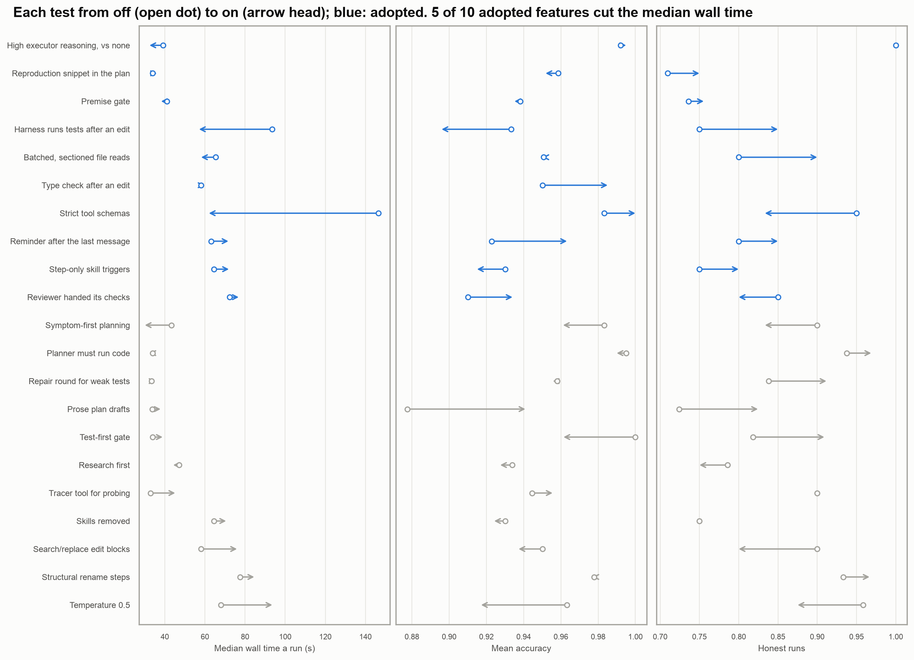
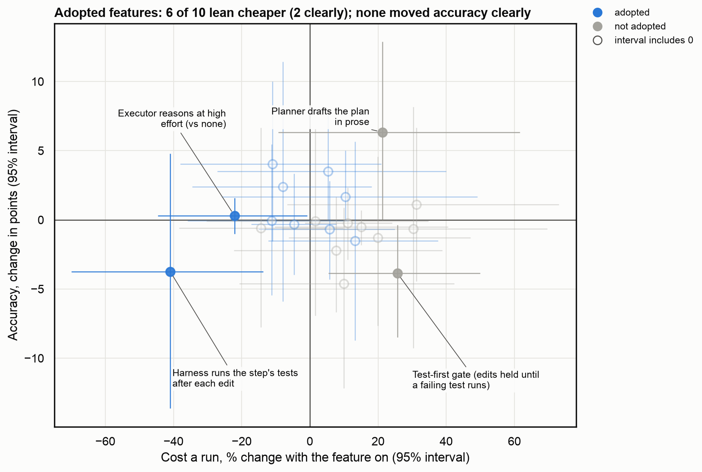

*Tables and figures behind [What my harness could and couldn't do for Mercury 2.5](../../posts/2026-take-the-work-away/index.qmd). A section number (§) refers to the project's [design log](https://github.com/whtowbin/mercury-harness/blob/main/DESIGN-LOG.md).*

## Changes adopted

<!-- gt:features-passed (generated by scripts/analysis/post_tables.py from docs/posts/tables/data/features-passed.csv; edit the CSV, not this block) -->
```{=html}
<div id="zpyvfmpujh" style="padding-left:0px;padding-right:0px;padding-top:10px;padding-bottom:10px;overflow-x:auto;overflow-y:auto;width:auto;height:auto;">
<table class="gt_table" style="font-family: -apple-system, BlinkMacSystemFont, 'Segoe UI', Roboto, Oxygen, Ubuntu, Cantarell, 'Helvetica Neue', 'Fira Sans', 'Droid Sans', Arial, sans-serif;-webkit-font-smoothing: antialiased;-moz-osx-font-smoothing: grayscale;display: table;border-collapse: collapse;line-height: normal;margin-left: auto;margin-right: auto;color: #0b0b0b;font-size: 13px;font-weight: normal;font-style: normal;background-color: #FFFFFF;border-top-style: solid;border-top-width: 2px;border-top-color: #0b0b0b;border-right-style: none;border-right-width: 2px;border-right-color: #D3D3D3;border-bottom-style: solid;border-bottom-width: 2px;border-bottom-color: #0b0b0b;border-left-style: none;border-left-width: 2px;border-left-color: #D3D3D3;table-layout: fixed;width: 100%" data-quarto-bootstrap="false" data-quarto-disable-processing="false">
<colgroup>
  <col style="width:22%;">
  <col style="width:42%;">
  <col style="width:24%;">
  <col style="width:12%;">
</colgroup>
<thead style="border-style: none;">
  <tr class="gt_heading" style="border-style: none;background-color: #FFFFFF;text-align: left;border-bottom-color: #FFFFFF;border-left-style: none;border-left-width: 1px;border-left-color: #D3D3D3;border-right-style: none;border-right-width: 1px;border-right-color: #D3D3D3;">
    <td class="gt_heading gt_title gt_font_normal" colspan="4" style="border-style: none;color: #0b0b0b;font-size: 15px;font-weight: normal;padding-top: 4px;padding-bottom: 4px;padding-left: 5px;padding-right: 5px;border-bottom-color: #FFFFFF;border-bottom-width: 0;background-color: #FFFFFF;text-align: left;border-left-style: none;border-left-width: 1px;border-left-color: #D3D3D3;border-right-style: none;border-right-width: 1px;border-right-color: #D3D3D3;">Changes that passed their rule</td>
  </tr>
  <tr class="gt_heading" style="border-style: none;background-color: #FFFFFF;text-align: left;border-bottom-color: #FFFFFF;border-left-style: none;border-left-width: 1px;border-left-color: #D3D3D3;border-right-style: none;border-right-width: 1px;border-right-color: #D3D3D3;">
    <td class="gt_heading gt_subtitle gt_font_normal gt_bottom_border" colspan="4" style="border-style: none;color: #0b0b0b;font-size: 12px;font-weight: normal;padding-top: 3px;padding-bottom: 5px;padding-left: 5px;padding-right: 5px;border-top-color: #FFFFFF;border-top-width: 0;background-color: #FFFFFF;text-align: left;border-bottom-color: #D3D3D3;border-left-style: none;border-left-width: 1px;border-left-color: #D3D3D3;border-right-style: none;border-right-width: 1px;border-right-color: #D3D3D3;border-bottom-style: solid;border-bottom-width: 2px;">Each against its own same-sweep control</td>
  </tr>
<tr class="gt_col_headings" style="border-style: none;background-color: transparent;border-top-style: solid;border-top-width: 2px;border-top-color: #D3D3D3;border-bottom-style: solid;border-bottom-width: 2px;border-bottom-color: #D3D3D3;border-left-style: none;border-left-width: 1px;border-left-color: #D3D3D3;border-right-style: none;border-right-width: 1px;border-right-color: #D3D3D3;">
  <th class="gt_col_heading gt_columns_bottom_border gt_left" id="Change" rowspan="1" colspan="1" scope="col" style="border-style: none;color: #0b0b0b;background-color: #f4f3ef;font-size: 100%;font-weight: bold;text-transform: inherit;border-left-style: none;border-left-width: 1px;border-left-color: #D3D3D3;border-right-style: none;border-right-width: 1px;border-right-color: #D3D3D3;vertical-align: bottom;padding-top: 5px;padding-bottom: 5px;padding-left: 5px;padding-right: 5px;overflow-x: hidden;text-align: left;">Change</th>
  <th class="gt_col_heading gt_columns_bottom_border gt_left" id="What-it-does" rowspan="1" colspan="1" scope="col" style="border-style: none;color: #0b0b0b;background-color: #f4f3ef;font-size: 100%;font-weight: bold;text-transform: inherit;border-left-style: none;border-left-width: 1px;border-left-color: #D3D3D3;border-right-style: none;border-right-width: 1px;border-right-color: #D3D3D3;vertical-align: bottom;padding-top: 5px;padding-bottom: 5px;padding-left: 5px;padding-right: 5px;overflow-x: hidden;text-align: left;">What it does</th>
  <th class="gt_col_heading gt_columns_bottom_border gt_left" id="What-moved" rowspan="1" colspan="1" scope="col" style="border-style: none;color: #0b0b0b;background-color: #f4f3ef;font-size: 100%;font-weight: bold;text-transform: inherit;border-left-style: none;border-left-width: 1px;border-left-color: #D3D3D3;border-right-style: none;border-right-width: 1px;border-right-color: #D3D3D3;vertical-align: bottom;padding-top: 5px;padding-bottom: 5px;padding-left: 5px;padding-right: 5px;overflow-x: hidden;text-align: left;">What moved</th>
  <th class="gt_col_heading gt_columns_bottom_border gt_left" id="Cost" rowspan="1" colspan="1" scope="col" style="border-style: none;color: #0b0b0b;background-color: #f4f3ef;font-size: 100%;font-weight: bold;text-transform: inherit;border-left-style: none;border-left-width: 1px;border-left-color: #D3D3D3;border-right-style: none;border-right-width: 1px;border-right-color: #D3D3D3;vertical-align: bottom;padding-top: 5px;padding-bottom: 5px;padding-left: 5px;padding-right: 5px;overflow-x: hidden;text-align: left;">Cost</th>
</tr>
</thead>
<tbody class="gt_table_body" style="border-style: none;border-top-style: solid;border-top-width: 2px;border-top-color: #D3D3D3;border-bottom-style: solid;border-bottom-width: 2px;border-bottom-color: #D3D3D3;">
  <tr style="border-style: none;background-color: transparent;">
    <td class="gt_row gt_left" style="border-style: none;padding-top: 5px;padding-bottom: 5px;padding-left: 5px;padding-right: 5px;margin: 10px;border-top-style: solid;border-top-width: 1px;border-top-color: #e6e5e0;border-left-style: none;border-left-width: 1px;border-left-color: #D3D3D3;border-right-style: none;border-right-width: 1px;border-right-color: #D3D3D3;vertical-align: middle;overflow-x: hidden;text-align: left;color: #0b0b0b;font-weight: bold">The harness runs a step's tests after each edit turn</td>
    <td class="gt_row gt_left" style="border-style: none;padding-top: 5px;padding-bottom: 5px;padding-left: 5px;padding-right: 5px;margin: 10px;border-top-style: solid;border-top-width: 1px;border-top-color: #e6e5e0;border-left-style: none;border-left-width: 1px;border-left-color: #D3D3D3;border-right-style: none;border-right-width: 1px;border-right-color: #D3D3D3;vertical-align: middle;overflow-x: hidden;text-align: left;color: #52514e;font-size: 12px">When the model edits code without running a test, the harness runs the step's test itself and attaches the result, saving a round trip</td>
    <td class="gt_row gt_left" style="border-style: none;padding-top: 5px;padding-bottom: 5px;padding-left: 5px;padding-right: 5px;margin: 10px;border-top-style: solid;border-top-width: 1px;border-top-color: #e6e5e0;border-left-style: none;border-left-width: 1px;border-left-color: #D3D3D3;border-right-style: none;border-right-width: 1px;border-right-color: #D3D3D3;vertical-align: middle;overflow-x: hidden;text-align: left;">model time −31%, cost −40%</td>
    <td class="gt_row gt_left" style="border-style: none;padding-top: 5px;padding-bottom: 5px;padding-left: 5px;padding-right: 5px;margin: 10px;border-top-style: solid;border-top-width: 1px;border-top-color: #e6e5e0;border-left-style: none;border-left-width: 1px;border-left-color: #D3D3D3;border-right-style: none;border-right-width: 1px;border-right-color: #D3D3D3;vertical-align: middle;overflow-x: hidden;text-align: left;">none</td>
  </tr>
  <tr style="border-style: none;background-color: transparent;">
    <td class="gt_row gt_left" style="border-style: none;padding-top: 5px;padding-bottom: 5px;padding-left: 5px;padding-right: 5px;margin: 10px;border-top-style: solid;border-top-width: 1px;border-top-color: #e6e5e0;border-left-style: none;border-left-width: 1px;border-left-color: #D3D3D3;border-right-style: none;border-right-width: 1px;border-right-color: #D3D3D3;vertical-align: middle;overflow-x: hidden;text-align: left;color: #0b0b0b;font-weight: bold">Every tool schema strict</td>
    <td class="gt_row gt_left" style="border-style: none;padding-top: 5px;padding-bottom: 5px;padding-left: 5px;padding-right: 5px;margin: 10px;border-top-style: solid;border-top-width: 1px;border-top-color: #e6e5e0;border-left-style: none;border-left-width: 1px;border-left-color: #D3D3D3;border-right-style: none;border-right-width: 1px;border-right-color: #D3D3D3;vertical-align: middle;overflow-x: hidden;text-align: left;color: #52514e;font-size: 12px">Each tool's argument schema is sent with <code>strict: true</code>, so the provider rejects malformed arguments such as a list sent as a double-escaped string</td>
    <td class="gt_row gt_left" style="border-style: none;padding-top: 5px;padding-bottom: 5px;padding-left: 5px;padding-right: 5px;margin: 10px;border-top-style: solid;border-top-width: 1px;border-top-color: #e6e5e0;border-left-style: none;border-left-width: 1px;border-left-color: #D3D3D3;border-right-style: none;border-right-width: 1px;border-right-color: #D3D3D3;vertical-align: middle;overflow-x: hidden;text-align: left;">malformed calls 9 of 524 to 0 of 432</td>
    <td class="gt_row gt_left" style="border-style: none;padding-top: 5px;padding-bottom: 5px;padding-left: 5px;padding-right: 5px;margin: 10px;border-top-style: solid;border-top-width: 1px;border-top-color: #e6e5e0;border-left-style: none;border-left-width: 1px;border-left-color: #D3D3D3;border-right-style: none;border-right-width: 1px;border-right-color: #D3D3D3;vertical-align: middle;overflow-x: hidden;text-align: left;">planner calls ~30% slower</td>
  </tr>
  <tr style="border-style: none;background-color: transparent;">
    <td class="gt_row gt_left" style="border-style: none;padding-top: 5px;padding-bottom: 5px;padding-left: 5px;padding-right: 5px;margin: 10px;border-top-style: solid;border-top-width: 1px;border-top-color: #e6e5e0;border-left-style: none;border-left-width: 1px;border-left-color: #D3D3D3;border-right-style: none;border-right-width: 1px;border-right-color: #D3D3D3;vertical-align: middle;overflow-x: hidden;text-align: left;color: #0b0b0b;font-weight: bold">Executor reasoning at high effort</td>
    <td class="gt_row gt_left" style="border-style: none;padding-top: 5px;padding-bottom: 5px;padding-left: 5px;padding-right: 5px;margin: 10px;border-top-style: solid;border-top-width: 1px;border-top-color: #e6e5e0;border-left-style: none;border-left-width: 1px;border-left-color: #D3D3D3;border-right-style: none;border-right-width: 1px;border-right-color: #D3D3D3;vertical-align: middle;overflow-x: hidden;text-align: left;color: #52514e;font-size: 12px">The executor's hidden reasoning is set to high rather than medium, low or off</td>
    <td class="gt_row gt_left" style="border-style: none;padding-top: 5px;padding-bottom: 5px;padding-left: 5px;padding-right: 5px;margin: 10px;border-top-style: solid;border-top-width: 1px;border-top-color: #e6e5e0;border-left-style: none;border-left-width: 1px;border-left-color: #D3D3D3;border-right-style: none;border-right-width: 1px;border-right-color: #D3D3D3;vertical-align: middle;overflow-x: hidden;text-align: left;">12.8 calls a run against 18.3 at none</td>
    <td class="gt_row gt_left" style="border-style: none;padding-top: 5px;padding-bottom: 5px;padding-left: 5px;padding-right: 5px;margin: 10px;border-top-style: solid;border-top-width: 1px;border-top-color: #e6e5e0;border-left-style: none;border-left-width: 1px;border-left-color: #D3D3D3;border-right-style: none;border-right-width: 1px;border-right-color: #D3D3D3;vertical-align: middle;overflow-x: hidden;text-align: left;">none</td>
  </tr>
  <tr style="border-style: none;background-color: transparent;">
    <td class="gt_row gt_left" style="border-style: none;padding-top: 5px;padding-bottom: 5px;padding-left: 5px;padding-right: 5px;margin: 10px;border-top-style: solid;border-top-width: 1px;border-top-color: #e6e5e0;border-left-style: none;border-left-width: 1px;border-left-color: #D3D3D3;border-right-style: none;border-right-width: 1px;border-right-color: #D3D3D3;vertical-align: middle;overflow-x: hidden;text-align: left;color: #0b0b0b;font-weight: bold">A 30 s cut on calls with no content</td>
    <td class="gt_row gt_left" style="border-style: none;padding-top: 5px;padding-bottom: 5px;padding-left: 5px;padding-right: 5px;margin: 10px;border-top-style: solid;border-top-width: 1px;border-top-color: #e6e5e0;border-left-style: none;border-left-width: 1px;border-left-color: #D3D3D3;border-right-style: none;border-right-width: 1px;border-right-color: #D3D3D3;vertical-align: middle;overflow-x: hidden;text-align: left;color: #52514e;font-size: 12px">A call that has produced no content after 30 seconds is canceled and sent again, instead of waiting about two minutes for the provider's timeout</td>
    <td class="gt_row gt_left" style="border-style: none;padding-top: 5px;padding-bottom: 5px;padding-left: 5px;padding-right: 5px;margin: 10px;border-top-style: solid;border-top-width: 1px;border-top-color: #e6e5e0;border-left-style: none;border-left-width: 1px;border-left-color: #D3D3D3;border-right-style: none;border-right-width: 1px;border-right-color: #D3D3D3;vertical-align: middle;overflow-x: hidden;text-align: left;">~29,700 s of stalls saved for ~3,000 s re-asked</td>
    <td class="gt_row gt_left" style="border-style: none;padding-top: 5px;padding-bottom: 5px;padding-left: 5px;padding-right: 5px;margin: 10px;border-top-style: solid;border-top-width: 1px;border-top-color: #e6e5e0;border-left-style: none;border-left-width: 1px;border-left-color: #D3D3D3;border-right-style: none;border-right-width: 1px;border-right-color: #D3D3D3;vertical-align: middle;overflow-x: hidden;text-align: left;">none</td>
  </tr>
  <tr style="border-style: none;background-color: transparent;">
    <td class="gt_row gt_left" style="border-style: none;padding-top: 5px;padding-bottom: 5px;padding-left: 5px;padding-right: 5px;margin: 10px;border-top-style: solid;border-top-width: 1px;border-top-color: #e6e5e0;border-left-style: none;border-left-width: 1px;border-left-color: #D3D3D3;border-right-style: none;border-right-width: 1px;border-right-color: #D3D3D3;vertical-align: middle;overflow-x: hidden;text-align: left;color: #0b0b0b;font-weight: bold">A 16,000-token output cap</td>
    <td class="gt_row gt_left" style="border-style: none;padding-top: 5px;padding-bottom: 5px;padding-left: 5px;padding-right: 5px;margin: 10px;border-top-style: solid;border-top-width: 1px;border-top-color: #e6e5e0;border-left-style: none;border-left-width: 1px;border-left-color: #D3D3D3;border-right-style: none;border-right-width: 1px;border-right-color: #D3D3D3;vertical-align: middle;overflow-x: hidden;text-align: left;color: #52514e;font-size: 12px">Every Mercury call carries <code>max_tokens</code> of 16,000, which stops rare calls that reason for minutes</td>
    <td class="gt_row gt_left" style="border-style: none;padding-top: 5px;padding-bottom: 5px;padding-left: 5px;padding-right: 5px;margin: 10px;border-top-style: solid;border-top-width: 1px;border-top-color: #e6e5e0;border-left-style: none;border-left-width: 1px;border-left-color: #D3D3D3;border-right-style: none;border-right-width: 1px;border-right-color: #D3D3D3;vertical-align: middle;overflow-x: hidden;text-align: left;">SciCode model time −30%</td>
    <td class="gt_row gt_left" style="border-style: none;padding-top: 5px;padding-bottom: 5px;padding-left: 5px;padding-right: 5px;margin: 10px;border-top-style: solid;border-top-width: 1px;border-top-color: #e6e5e0;border-left-style: none;border-left-width: 1px;border-left-color: #D3D3D3;border-right-style: none;border-right-width: 1px;border-right-color: #D3D3D3;vertical-align: middle;overflow-x: hidden;text-align: left;">none</td>
  </tr>
  <tr style="border-style: none;background-color: transparent;">
    <td class="gt_row gt_left" style="border-style: none;padding-top: 5px;padding-bottom: 5px;padding-left: 5px;padding-right: 5px;margin: 10px;border-top-style: solid;border-top-width: 1px;border-top-color: #e6e5e0;border-left-style: none;border-left-width: 1px;border-left-color: #D3D3D3;border-right-style: none;border-right-width: 1px;border-right-color: #D3D3D3;vertical-align: middle;overflow-x: hidden;text-align: left;color: #0b0b0b;font-weight: bold">Batched, sectioned file reads</td>
    <td class="gt_row gt_left" style="border-style: none;padding-top: 5px;padding-bottom: 5px;padding-left: 5px;padding-right: 5px;margin: 10px;border-top-style: solid;border-top-width: 1px;border-top-color: #e6e5e0;border-left-style: none;border-left-width: 1px;border-left-color: #D3D3D3;border-right-style: none;border-right-width: 1px;border-right-color: #D3D3D3;vertical-align: middle;overflow-x: hidden;text-align: left;color: #52514e;font-size: 12px">One read can fetch several line ranges or named functions, a too-narrow window is widened, and re-reading an unchanged file returns one line</td>
    <td class="gt_row gt_left" style="border-style: none;padding-top: 5px;padding-bottom: 5px;padding-left: 5px;padding-right: 5px;margin: 10px;border-top-style: solid;border-top-width: 1px;border-top-color: #e6e5e0;border-left-style: none;border-left-width: 1px;border-left-color: #D3D3D3;border-right-style: none;border-right-width: 1px;border-right-color: #D3D3D3;vertical-align: middle;overflow-x: hidden;text-align: left;">file reads −40%</td>
    <td class="gt_row gt_left" style="border-style: none;padding-top: 5px;padding-bottom: 5px;padding-left: 5px;padding-right: 5px;margin: 10px;border-top-style: solid;border-top-width: 1px;border-top-color: #e6e5e0;border-left-style: none;border-left-width: 1px;border-left-color: #D3D3D3;border-right-style: none;border-right-width: 1px;border-right-color: #D3D3D3;vertical-align: middle;overflow-x: hidden;text-align: left;">none</td>
  </tr>
  <tr style="border-style: none;background-color: transparent;">
    <td class="gt_row gt_left" style="border-style: none;padding-top: 5px;padding-bottom: 5px;padding-left: 5px;padding-right: 5px;margin: 10px;border-top-style: solid;border-top-width: 1px;border-top-color: #e6e5e0;border-left-style: none;border-left-width: 1px;border-left-color: #D3D3D3;border-right-style: none;border-right-width: 1px;border-right-color: #D3D3D3;vertical-align: middle;overflow-x: hidden;text-align: left;color: #0b0b0b;font-weight: bold">A type check after each edit</td>
    <td class="gt_row gt_left" style="border-style: none;padding-top: 5px;padding-bottom: 5px;padding-left: 5px;padding-right: 5px;margin: 10px;border-top-style: solid;border-top-width: 1px;border-top-color: #e6e5e0;border-left-style: none;border-left-width: 1px;border-left-color: #D3D3D3;border-right-style: none;border-right-width: 1px;border-right-color: #D3D3D3;vertical-align: middle;overflow-x: hidden;text-align: left;color: #52514e;font-size: 12px">After each edit the harness runs the type checker on the edited files and attaches any new errors</td>
    <td class="gt_row gt_left" style="border-style: none;padding-top: 5px;padding-bottom: 5px;padding-left: 5px;padding-right: 5px;margin: 10px;border-top-style: solid;border-top-width: 1px;border-top-color: #e6e5e0;border-left-style: none;border-left-width: 1px;border-left-color: #D3D3D3;border-right-style: none;border-right-width: 1px;border-right-color: #D3D3D3;vertical-align: middle;overflow-x: hidden;text-align: left;">runs ending with new type errors 6 of 8 to 1 of 8</td>
    <td class="gt_row gt_left" style="border-style: none;padding-top: 5px;padding-bottom: 5px;padding-left: 5px;padding-right: 5px;margin: 10px;border-top-style: solid;border-top-width: 1px;border-top-color: #e6e5e0;border-left-style: none;border-left-width: 1px;border-left-color: #D3D3D3;border-right-style: none;border-right-width: 1px;border-right-color: #D3D3D3;vertical-align: middle;overflow-x: hidden;text-align: left;">none</td>
  </tr>
  <tr style="border-style: none;background-color: transparent;">
    <td class="gt_row gt_left" style="border-style: none;padding-top: 5px;padding-bottom: 5px;padding-left: 5px;padding-right: 5px;margin: 10px;border-top-style: solid;border-top-width: 1px;border-top-color: #e6e5e0;border-left-style: none;border-left-width: 1px;border-left-color: #D3D3D3;border-right-style: none;border-right-width: 1px;border-right-color: #D3D3D3;vertical-align: middle;overflow-x: hidden;text-align: left;color: #0b0b0b;font-weight: bold">The batching rule repeated after the last message</td>
    <td class="gt_row gt_left" style="border-style: none;padding-top: 5px;padding-bottom: 5px;padding-left: 5px;padding-right: 5px;margin: 10px;border-top-style: solid;border-top-width: 1px;border-top-color: #e6e5e0;border-left-style: none;border-left-width: 1px;border-left-color: #D3D3D3;border-right-style: none;border-right-width: 1px;border-right-color: #D3D3D3;vertical-align: middle;overflow-x: hidden;text-align: left;color: #52514e;font-size: 12px">The step's goal, the rule to batch reads and edits, and the turns left are appended after the last message on every executor call, never saved into the history</td>
    <td class="gt_row gt_left" style="border-style: none;padding-top: 5px;padding-bottom: 5px;padding-left: 5px;padding-right: 5px;margin: 10px;border-top-style: solid;border-top-width: 1px;border-top-color: #e6e5e0;border-left-style: none;border-left-width: 1px;border-left-color: #D3D3D3;border-right-style: none;border-right-width: 1px;border-right-color: #D3D3D3;vertical-align: middle;overflow-x: hidden;text-align: left;">execute replies −21%</td>
    <td class="gt_row gt_left" style="border-style: none;padding-top: 5px;padding-bottom: 5px;padding-left: 5px;padding-right: 5px;margin: 10px;border-top-style: solid;border-top-width: 1px;border-top-color: #e6e5e0;border-left-style: none;border-left-width: 1px;border-left-color: #D3D3D3;border-right-style: none;border-right-width: 1px;border-right-color: #D3D3D3;vertical-align: middle;overflow-x: hidden;text-align: left;">none</td>
  </tr>
  <tr style="border-style: none;background-color: transparent;">
    <td class="gt_row gt_left" style="border-style: none;padding-top: 5px;padding-bottom: 5px;padding-left: 5px;padding-right: 5px;margin: 10px;border-top-style: solid;border-top-width: 1px;border-top-color: #e6e5e0;border-left-style: none;border-left-width: 1px;border-left-color: #D3D3D3;border-right-style: none;border-right-width: 1px;border-right-color: #D3D3D3;vertical-align: middle;overflow-x: hidden;text-align: left;color: #0b0b0b;font-weight: bold">The reviewer handed the checks already run</td>
    <td class="gt_row gt_left" style="border-style: none;padding-top: 5px;padding-bottom: 5px;padding-left: 5px;padding-right: 5px;margin: 10px;border-top-style: solid;border-top-width: 1px;border-top-color: #e6e5e0;border-left-style: none;border-left-width: 1px;border-left-color: #D3D3D3;border-right-style: none;border-right-width: 1px;border-right-color: #D3D3D3;vertical-align: middle;overflow-x: hidden;text-align: left;color: #52514e;font-size: 12px">The reviewer is given the results of the tests and checks the run already made, instead of re-running them</td>
    <td class="gt_row gt_left" style="border-style: none;padding-top: 5px;padding-bottom: 5px;padding-left: 5px;padding-right: 5px;margin: 10px;border-top-style: solid;border-top-width: 1px;border-top-color: #e6e5e0;border-left-style: none;border-left-width: 1px;border-left-color: #D3D3D3;border-right-style: none;border-right-width: 1px;border-right-color: #D3D3D3;vertical-align: middle;overflow-x: hidden;text-align: left;">review calls −58%</td>
    <td class="gt_row gt_left" style="border-style: none;padding-top: 5px;padding-bottom: 5px;padding-left: 5px;padding-right: 5px;margin: 10px;border-top-style: solid;border-top-width: 1px;border-top-color: #e6e5e0;border-left-style: none;border-left-width: 1px;border-left-color: #D3D3D3;border-right-style: none;border-right-width: 1px;border-right-color: #D3D3D3;vertical-align: middle;overflow-x: hidden;text-align: left;">none</td>
  </tr>
  <tr style="border-style: none;background-color: transparent;">
    <td class="gt_row gt_left" style="border-style: none;padding-top: 5px;padding-bottom: 5px;padding-left: 5px;padding-right: 5px;margin: 10px;border-top-style: solid;border-top-width: 1px;border-top-color: #e6e5e0;border-left-style: none;border-left-width: 1px;border-left-color: #D3D3D3;border-right-style: none;border-right-width: 1px;border-right-color: #D3D3D3;vertical-align: middle;overflow-x: hidden;text-align: left;color: #0b0b0b;font-weight: bold">A check that a rename plan covers every caller</td>
    <td class="gt_row gt_left" style="border-style: none;padding-top: 5px;padding-bottom: 5px;padding-left: 5px;padding-right: 5px;margin: 10px;border-top-style: solid;border-top-width: 1px;border-top-color: #e6e5e0;border-left-style: none;border-left-width: 1px;border-left-color: #D3D3D3;border-right-style: none;border-right-width: 1px;border-right-color: #D3D3D3;vertical-align: middle;overflow-x: hidden;text-align: left;color: #52514e;font-size: 12px">Before a rename plan is accepted, the harness finds every file that calls the renamed code and sends the plan back if one is missing</td>
    <td class="gt_row gt_left" style="border-style: none;padding-top: 5px;padding-bottom: 5px;padding-left: 5px;padding-right: 5px;margin: 10px;border-top-style: solid;border-top-width: 1px;border-top-color: #e6e5e0;border-left-style: none;border-left-width: 1px;border-left-color: #D3D3D3;border-right-style: none;border-right-width: 1px;border-right-color: #D3D3D3;vertical-align: middle;overflow-x: hidden;text-align: left;">plans missing a caller 6 of 40 to 0 of 40</td>
    <td class="gt_row gt_left" style="border-style: none;padding-top: 5px;padding-bottom: 5px;padding-left: 5px;padding-right: 5px;margin: 10px;border-top-style: solid;border-top-width: 1px;border-top-color: #e6e5e0;border-left-style: none;border-left-width: 1px;border-left-color: #D3D3D3;border-right-style: none;border-right-width: 1px;border-right-color: #D3D3D3;vertical-align: middle;overflow-x: hidden;text-align: left;">none</td>
  </tr>
  <tr style="border-style: none;background-color: transparent;">
    <td class="gt_row gt_left" style="border-style: none;padding-top: 5px;padding-bottom: 5px;padding-left: 5px;padding-right: 5px;margin: 10px;border-top-style: solid;border-top-width: 1px;border-top-color: #e6e5e0;border-left-style: none;border-left-width: 1px;border-left-color: #D3D3D3;border-right-style: none;border-right-width: 1px;border-right-color: #D3D3D3;vertical-align: middle;overflow-x: hidden;text-align: left;color: #0b0b0b;font-weight: bold">A reproduction snippet in the plan</td>
    <td class="gt_row gt_left" style="border-style: none;padding-top: 5px;padding-bottom: 5px;padding-left: 5px;padding-right: 5px;margin: 10px;border-top-style: solid;border-top-width: 1px;border-top-color: #e6e5e0;border-left-style: none;border-left-width: 1px;border-left-color: #D3D3D3;border-right-style: none;border-right-width: 1px;border-right-color: #D3D3D3;vertical-align: middle;overflow-x: hidden;text-align: left;color: #52514e;font-size: 12px">The planner writes a short snippet that should show the reported bug; the harness runs it and sends the plan back if the bug does not reproduce</td>
    <td class="gt_row gt_left" style="border-style: none;padding-top: 5px;padding-bottom: 5px;padding-left: 5px;padding-right: 5px;margin: 10px;border-top-style: solid;border-top-width: 1px;border-top-color: #e6e5e0;border-left-style: none;border-left-width: 1px;border-left-color: #D3D3D3;border-right-style: none;border-right-width: 1px;border-right-color: #D3D3D3;vertical-align: middle;overflow-x: hidden;text-align: left;">wrong-report honesty 37% to 53% (not significant)</td>
    <td class="gt_row gt_left" style="border-style: none;padding-top: 5px;padding-bottom: 5px;padding-left: 5px;padding-right: 5px;margin: 10px;border-top-style: solid;border-top-width: 1px;border-top-color: #e6e5e0;border-left-style: none;border-left-width: 1px;border-left-color: #D3D3D3;border-right-style: none;border-right-width: 1px;border-right-color: #D3D3D3;vertical-align: middle;overflow-x: hidden;text-align: left;">+0.13 calls</td>
  </tr>
  <tr style="border-style: none;background-color: transparent;">
    <td class="gt_row gt_left" style="border-style: none;padding-top: 5px;padding-bottom: 5px;padding-left: 5px;padding-right: 5px;margin: 10px;border-top-style: solid;border-top-width: 1px;border-top-color: #e6e5e0;border-left-style: none;border-left-width: 1px;border-left-color: #D3D3D3;border-right-style: none;border-right-width: 1px;border-right-color: #D3D3D3;vertical-align: middle;overflow-x: hidden;text-align: left;color: #0b0b0b;font-weight: bold">Skill triggers matched to the step's own files</td>
    <td class="gt_row gt_left" style="border-style: none;padding-top: 5px;padding-bottom: 5px;padding-left: 5px;padding-right: 5px;margin: 10px;border-top-style: solid;border-top-width: 1px;border-top-color: #e6e5e0;border-left-style: none;border-left-width: 1px;border-left-color: #D3D3D3;border-right-style: none;border-right-width: 1px;border-right-color: #D3D3D3;vertical-align: middle;overflow-x: hidden;text-align: left;color: #52514e;font-size: 12px">Reference notes are attached to a step only when their keywords match that step's own files and text, not the whole goal or the verify command</td>
    <td class="gt_row gt_left" style="border-style: none;padding-top: 5px;padding-bottom: 5px;padding-left: 5px;padding-right: 5px;margin: 10px;border-top-style: solid;border-top-width: 1px;border-top-color: #e6e5e0;border-left-style: none;border-left-width: 1px;border-left-color: #D3D3D3;border-right-style: none;border-right-width: 1px;border-right-color: #D3D3D3;vertical-align: middle;overflow-x: hidden;text-align: left;">skill tokens −17% (replay)</td>
    <td class="gt_row gt_left" style="border-style: none;padding-top: 5px;padding-bottom: 5px;padding-left: 5px;padding-right: 5px;margin: 10px;border-top-style: solid;border-top-width: 1px;border-top-color: #e6e5e0;border-left-style: none;border-left-width: 1px;border-left-color: #D3D3D3;border-right-style: none;border-right-width: 1px;border-right-color: #D3D3D3;vertical-align: middle;overflow-x: hidden;text-align: left;">none</td>
  </tr>
  <tr style="border-style: none;background-color: transparent;">
    <td class="gt_row gt_left" style="border-style: none;padding-top: 5px;padding-bottom: 5px;padding-left: 5px;padding-right: 5px;margin: 10px;border-top-style: solid;border-top-width: 1px;border-top-color: #e6e5e0;border-left-style: none;border-left-width: 1px;border-left-color: #D3D3D3;border-right-style: none;border-right-width: 1px;border-right-color: #D3D3D3;vertical-align: middle;overflow-x: hidden;text-align: left;color: #0b0b0b;font-weight: bold">A gate on edits that contradict the run's evidence</td>
    <td class="gt_row gt_left" style="border-style: none;padding-top: 5px;padding-bottom: 5px;padding-left: 5px;padding-right: 5px;margin: 10px;border-top-style: solid;border-top-width: 1px;border-top-color: #e6e5e0;border-left-style: none;border-left-width: 1px;border-left-color: #D3D3D3;border-right-style: none;border-right-width: 1px;border-right-color: #D3D3D3;vertical-align: middle;overflow-x: hidden;text-align: left;color: #52514e;font-size: 12px">Holds, once each, an edit made after the plan's reproduction already passed, and an edit that removes or weakens an existing test</td>
    <td class="gt_row gt_left" style="border-style: none;padding-top: 5px;padding-bottom: 5px;padding-left: 5px;padding-right: 5px;margin: 10px;border-top-style: solid;border-top-width: 1px;border-top-color: #e6e5e0;border-left-style: none;border-left-width: 1px;border-left-color: #D3D3D3;border-right-style: none;border-right-width: 1px;border-right-color: #D3D3D3;vertical-align: middle;overflow-x: hidden;text-align: left;">nothing measurable either way</td>
    <td class="gt_row gt_left" style="border-style: none;padding-top: 5px;padding-bottom: 5px;padding-left: 5px;padding-right: 5px;margin: 10px;border-top-style: solid;border-top-width: 1px;border-top-color: #e6e5e0;border-left-style: none;border-left-width: 1px;border-left-color: #D3D3D3;border-right-style: none;border-right-width: 1px;border-right-color: #D3D3D3;vertical-align: middle;overflow-x: hidden;text-align: left;">none</td>
  </tr>
</tbody>
</table>
</div>
```
<!-- /gt:features-passed -->

## Changes not adopted

<!-- gt:features-not (generated by scripts/analysis/post_tables.py from docs/posts/tables/data/features-not.csv; edit the CSV, not this block) -->
```{=html}
<div id="fdpyrqjbdm" style="padding-left:0px;padding-right:0px;padding-top:10px;padding-bottom:10px;overflow-x:auto;overflow-y:auto;width:auto;height:auto;">
<table class="gt_table" style="font-family: -apple-system, BlinkMacSystemFont, 'Segoe UI', Roboto, Oxygen, Ubuntu, Cantarell, 'Helvetica Neue', 'Fira Sans', 'Droid Sans', Arial, sans-serif;-webkit-font-smoothing: antialiased;-moz-osx-font-smoothing: grayscale;display: table;border-collapse: collapse;line-height: normal;margin-left: auto;margin-right: auto;color: #0b0b0b;font-size: 13px;font-weight: normal;font-style: normal;background-color: #FFFFFF;border-top-style: solid;border-top-width: 2px;border-top-color: #0b0b0b;border-right-style: none;border-right-width: 2px;border-right-color: #D3D3D3;border-bottom-style: solid;border-bottom-width: 2px;border-bottom-color: #0b0b0b;border-left-style: none;border-left-width: 2px;border-left-color: #D3D3D3;table-layout: fixed;width: 100%" data-quarto-bootstrap="false" data-quarto-disable-processing="false">
<colgroup>
  <col style="width:22%;">
  <col style="width:48%;">
  <col style="width:30%;">
</colgroup>
<thead style="border-style: none;">
  <tr class="gt_heading" style="border-style: none;background-color: #FFFFFF;text-align: left;border-bottom-color: #FFFFFF;border-left-style: none;border-left-width: 1px;border-left-color: #D3D3D3;border-right-style: none;border-right-width: 1px;border-right-color: #D3D3D3;">
    <td class="gt_heading gt_title gt_font_normal" colspan="3" style="border-style: none;color: #0b0b0b;font-size: 15px;font-weight: normal;padding-top: 4px;padding-bottom: 4px;padding-left: 5px;padding-right: 5px;border-bottom-color: #FFFFFF;border-bottom-width: 0;background-color: #FFFFFF;text-align: left;border-left-style: none;border-left-width: 1px;border-left-color: #D3D3D3;border-right-style: none;border-right-width: 1px;border-right-color: #D3D3D3;">Changes that did not</td>
  </tr>
  <tr class="gt_heading" style="border-style: none;background-color: #FFFFFF;text-align: left;border-bottom-color: #FFFFFF;border-left-style: none;border-left-width: 1px;border-left-color: #D3D3D3;border-right-style: none;border-right-width: 1px;border-right-color: #D3D3D3;">
    <td class="gt_heading gt_subtitle gt_font_normal gt_bottom_border" colspan="3" style="border-style: none;color: #0b0b0b;font-size: 12px;font-weight: normal;padding-top: 3px;padding-bottom: 5px;padding-left: 5px;padding-right: 5px;border-top-color: #FFFFFF;border-top-width: 0;background-color: #FFFFFF;text-align: left;border-bottom-color: #D3D3D3;border-left-style: none;border-left-width: 1px;border-left-color: #D3D3D3;border-right-style: none;border-right-width: 1px;border-right-color: #D3D3D3;border-bottom-style: solid;border-bottom-width: 2px;">Each against its own same-sweep control</td>
  </tr>
<tr class="gt_col_headings" style="border-style: none;background-color: transparent;border-top-style: solid;border-top-width: 2px;border-top-color: #D3D3D3;border-bottom-style: solid;border-bottom-width: 2px;border-bottom-color: #D3D3D3;border-left-style: none;border-left-width: 1px;border-left-color: #D3D3D3;border-right-style: none;border-right-width: 1px;border-right-color: #D3D3D3;">
  <th class="gt_col_heading gt_columns_bottom_border gt_left" id="Change" rowspan="1" colspan="1" scope="col" style="border-style: none;color: #0b0b0b;background-color: #f4f3ef;font-size: 100%;font-weight: bold;text-transform: inherit;border-left-style: none;border-left-width: 1px;border-left-color: #D3D3D3;border-right-style: none;border-right-width: 1px;border-right-color: #D3D3D3;vertical-align: bottom;padding-top: 5px;padding-bottom: 5px;padding-left: 5px;padding-right: 5px;overflow-x: hidden;text-align: left;">Change</th>
  <th class="gt_col_heading gt_columns_bottom_border gt_left" id="What-it-does" rowspan="1" colspan="1" scope="col" style="border-style: none;color: #0b0b0b;background-color: #f4f3ef;font-size: 100%;font-weight: bold;text-transform: inherit;border-left-style: none;border-left-width: 1px;border-left-color: #D3D3D3;border-right-style: none;border-right-width: 1px;border-right-color: #D3D3D3;vertical-align: bottom;padding-top: 5px;padding-bottom: 5px;padding-left: 5px;padding-right: 5px;overflow-x: hidden;text-align: left;">What it does</th>
  <th class="gt_col_heading gt_columns_bottom_border gt_left" id="Result" rowspan="1" colspan="1" scope="col" style="border-style: none;color: #0b0b0b;background-color: #f4f3ef;font-size: 100%;font-weight: bold;text-transform: inherit;border-left-style: none;border-left-width: 1px;border-left-color: #D3D3D3;border-right-style: none;border-right-width: 1px;border-right-color: #D3D3D3;vertical-align: bottom;padding-top: 5px;padding-bottom: 5px;padding-left: 5px;padding-right: 5px;overflow-x: hidden;text-align: left;">Result</th>
</tr>
</thead>
<tbody class="gt_table_body" style="border-style: none;border-top-style: solid;border-top-width: 2px;border-top-color: #D3D3D3;border-bottom-style: solid;border-bottom-width: 2px;border-bottom-color: #D3D3D3;">
  <tr style="border-style: none;background-color: transparent;">
    <td class="gt_row gt_left" style="border-style: none;padding-top: 5px;padding-bottom: 5px;padding-left: 5px;padding-right: 5px;margin: 10px;border-top-style: solid;border-top-width: 1px;border-top-color: #e6e5e0;border-left-style: none;border-left-width: 1px;border-left-color: #D3D3D3;border-right-style: none;border-right-width: 1px;border-right-color: #D3D3D3;vertical-align: middle;overflow-x: hidden;text-align: left;color: #0b0b0b;font-weight: bold">A test-first gate</td>
    <td class="gt_row gt_left" style="border-style: none;padding-top: 5px;padding-bottom: 5px;padding-left: 5px;padding-right: 5px;margin: 10px;border-top-style: solid;border-top-width: 1px;border-top-color: #e6e5e0;border-left-style: none;border-left-width: 1px;border-left-color: #D3D3D3;border-right-style: none;border-right-width: 1px;border-right-color: #D3D3D3;vertical-align: middle;overflow-x: hidden;text-align: left;color: #52514e;font-size: 12px">Holds a step's first edit to source code until a test has been run, so a failing test exists before the fix</td>
    <td class="gt_row gt_left" style="border-style: none;padding-top: 5px;padding-bottom: 5px;padding-left: 5px;padding-right: 5px;margin: 10px;border-top-style: solid;border-top-width: 1px;border-top-color: #e6e5e0;border-left-style: none;border-left-width: 1px;border-left-color: #D3D3D3;border-right-style: none;border-right-width: 1px;border-right-color: #D3D3D3;vertical-align: middle;overflow-x: hidden;text-align: left;">red-first steps 3% to 48%; accuracy −3.9 points</td>
  </tr>
  <tr style="border-style: none;background-color: transparent;">
    <td class="gt_row gt_left" style="border-style: none;padding-top: 5px;padding-bottom: 5px;padding-left: 5px;padding-right: 5px;margin: 10px;border-top-style: solid;border-top-width: 1px;border-top-color: #e6e5e0;border-left-style: none;border-left-width: 1px;border-left-color: #D3D3D3;border-right-style: none;border-right-width: 1px;border-right-color: #D3D3D3;vertical-align: middle;overflow-x: hidden;text-align: left;color: #0b0b0b;font-weight: bold">Symptom-first planning</td>
    <td class="gt_row gt_left" style="border-style: none;padding-top: 5px;padding-bottom: 5px;padding-left: 5px;padding-right: 5px;margin: 10px;border-top-style: solid;border-top-width: 1px;border-top-color: #e6e5e0;border-left-style: none;border-left-width: 1px;border-left-color: #D3D3D3;border-right-style: none;border-right-width: 1px;border-right-color: #D3D3D3;vertical-align: middle;overflow-x: hidden;text-align: left;color: #52514e;font-size: 12px">The planner is told to describe and confirm the reported symptom before naming a fix</td>
    <td class="gt_row gt_left" style="border-style: none;padding-top: 5px;padding-bottom: 5px;padding-left: 5px;padding-right: 5px;margin: 10px;border-top-style: solid;border-top-width: 1px;border-top-color: #e6e5e0;border-left-style: none;border-left-width: 1px;border-left-color: #D3D3D3;border-right-style: none;border-right-width: 1px;border-right-color: #D3D3D3;vertical-align: middle;overflow-x: hidden;text-align: left;">honest 83% against 90%; the first, sequential read of +12 points was provider drift</td>
  </tr>
  <tr style="border-style: none;background-color: transparent;">
    <td class="gt_row gt_left" style="border-style: none;padding-top: 5px;padding-bottom: 5px;padding-left: 5px;padding-right: 5px;margin: 10px;border-top-style: solid;border-top-width: 1px;border-top-color: #e6e5e0;border-left-style: none;border-left-width: 1px;border-left-color: #D3D3D3;border-right-style: none;border-right-width: 1px;border-right-color: #D3D3D3;vertical-align: middle;overflow-x: hidden;text-align: left;color: #0b0b0b;font-weight: bold">Planner drafts in prose</td>
    <td class="gt_row gt_left" style="border-style: none;padding-top: 5px;padding-bottom: 5px;padding-left: 5px;padding-right: 5px;margin: 10px;border-top-style: solid;border-top-width: 1px;border-top-color: #e6e5e0;border-left-style: none;border-left-width: 1px;border-left-color: #D3D3D3;border-right-style: none;border-right-width: 1px;border-right-color: #D3D3D3;vertical-align: middle;overflow-x: hidden;text-align: left;color: #52514e;font-size: 12px">The planner writes its draft plan in full sentences, with code sketches, instead of terse notes</td>
    <td class="gt_row gt_left" style="border-style: none;padding-top: 5px;padding-bottom: 5px;padding-left: 5px;padding-right: 5px;margin: 10px;border-top-style: solid;border-top-width: 1px;border-top-color: #e6e5e0;border-left-style: none;border-left-width: 1px;border-left-color: #D3D3D3;border-right-style: none;border-right-width: 1px;border-right-color: #D3D3D3;vertical-align: middle;overflow-x: hidden;text-align: left;">named tests 1.68 to 1.71; +1.8 calls</td>
  </tr>
  <tr style="border-style: none;background-color: transparent;">
    <td class="gt_row gt_left" style="border-style: none;padding-top: 5px;padding-bottom: 5px;padding-left: 5px;padding-right: 5px;margin: 10px;border-top-style: solid;border-top-width: 1px;border-top-color: #e6e5e0;border-left-style: none;border-left-width: 1px;border-left-color: #D3D3D3;border-right-style: none;border-right-width: 1px;border-right-color: #D3D3D3;vertical-align: middle;overflow-x: hidden;text-align: left;color: #0b0b0b;font-weight: bold">A goal loop judged by a second model</td>
    <td class="gt_row gt_left" style="border-style: none;padding-top: 5px;padding-bottom: 5px;padding-left: 5px;padding-right: 5px;margin: 10px;border-top-style: solid;border-top-width: 1px;border-top-color: #e6e5e0;border-left-style: none;border-left-width: 1px;border-left-color: #D3D3D3;border-right-style: none;border-right-width: 1px;border-right-color: #D3D3D3;vertical-align: middle;overflow-x: hidden;text-align: left;color: #52514e;font-size: 12px">After a run, a second model judges whether the goal was met and, if not, re-runs it with a refined goal</td>
    <td class="gt_row gt_left" style="border-style: none;padding-top: 5px;padding-bottom: 5px;padding-left: 5px;padding-right: 5px;margin: 10px;border-top-style: solid;border-top-width: 1px;border-top-color: #e6e5e0;border-left-style: none;border-left-width: 1px;border-left-color: #D3D3D3;border-right-style: none;border-right-width: 1px;border-right-color: #D3D3D3;vertical-align: middle;overflow-x: hidden;text-align: left;">worse on all 3 django tasks</td>
  </tr>
  <tr style="border-style: none;background-color: transparent;">
    <td class="gt_row gt_left" style="border-style: none;padding-top: 5px;padding-bottom: 5px;padding-left: 5px;padding-right: 5px;margin: 10px;border-top-style: solid;border-top-width: 1px;border-top-color: #e6e5e0;border-left-style: none;border-left-width: 1px;border-left-color: #D3D3D3;border-right-style: none;border-right-width: 1px;border-right-color: #D3D3D3;vertical-align: middle;overflow-x: hidden;text-align: left;color: #0b0b0b;font-weight: bold">The batching rule moved to the end of the system prompt</td>
    <td class="gt_row gt_left" style="border-style: none;padding-top: 5px;padding-bottom: 5px;padding-left: 5px;padding-right: 5px;margin: 10px;border-top-style: solid;border-top-width: 1px;border-top-color: #e6e5e0;border-left-style: none;border-left-width: 1px;border-left-color: #D3D3D3;border-right-style: none;border-right-width: 1px;border-right-color: #D3D3D3;vertical-align: middle;overflow-x: hidden;text-align: left;color: #52514e;font-size: 12px">The batch-your-reads-and-edits rule, with worked examples, moved from the middle to the end of the system prompt</td>
    <td class="gt_row gt_left" style="border-style: none;padding-top: 5px;padding-bottom: 5px;padding-left: 5px;padding-right: 5px;margin: 10px;border-top-style: solid;border-top-width: 1px;border-top-color: #e6e5e0;border-left-style: none;border-left-width: 1px;border-left-color: #D3D3D3;border-right-style: none;border-right-width: 1px;border-right-color: #D3D3D3;vertical-align: middle;overflow-x: hidden;text-align: left;">no change</td>
  </tr>
  <tr style="border-style: none;background-color: transparent;">
    <td class="gt_row gt_left" style="border-style: none;padding-top: 5px;padding-bottom: 5px;padding-left: 5px;padding-right: 5px;margin: 10px;border-top-style: solid;border-top-width: 1px;border-top-color: #e6e5e0;border-left-style: none;border-left-width: 1px;border-left-color: #D3D3D3;border-right-style: none;border-right-width: 1px;border-right-color: #D3D3D3;vertical-align: middle;overflow-x: hidden;text-align: left;color: #0b0b0b;font-weight: bold">Research first, with a findings hold</td>
    <td class="gt_row gt_left" style="border-style: none;padding-top: 5px;padding-bottom: 5px;padding-left: 5px;padding-right: 5px;margin: 10px;border-top-style: solid;border-top-width: 1px;border-top-color: #e6e5e0;border-left-style: none;border-left-width: 1px;border-left-color: #D3D3D3;border-right-style: none;border-right-width: 1px;border-right-color: #D3D3D3;vertical-align: middle;overflow-x: hidden;text-align: left;color: #52514e;font-size: 12px">Before planning, the planner looks up the installed libraries' APIs, then reference notes, then the web, and records its findings; the plan is held once if they decide nothing</td>
    <td class="gt_row gt_left" style="border-style: none;padding-top: 5px;padding-bottom: 5px;padding-left: 5px;padding-right: 5px;margin: 10px;border-top-style: solid;border-top-width: 1px;border-top-color: #e6e5e0;border-left-style: none;border-left-width: 1px;border-left-color: #D3D3D3;border-right-style: none;border-right-width: 1px;border-right-color: #D3D3D3;vertical-align: middle;overflow-x: hidden;text-align: left;">+1.7 SciCode problems, then not replicated</td>
  </tr>
  <tr style="border-style: none;background-color: transparent;">
    <td class="gt_row gt_left" style="border-style: none;padding-top: 5px;padding-bottom: 5px;padding-left: 5px;padding-right: 5px;margin: 10px;border-top-style: solid;border-top-width: 1px;border-top-color: #e6e5e0;border-left-style: none;border-left-width: 1px;border-left-color: #D3D3D3;border-right-style: none;border-right-width: 1px;border-right-color: #D3D3D3;vertical-align: middle;overflow-x: hidden;text-align: left;color: #0b0b0b;font-weight: bold">A numeric self-check</td>
    <td class="gt_row gt_left" style="border-style: none;padding-top: 5px;padding-bottom: 5px;padding-left: 5px;padding-right: 5px;margin: 10px;border-top-style: solid;border-top-width: 1px;border-top-color: #e6e5e0;border-left-style: none;border-left-width: 1px;border-left-color: #D3D3D3;border-right-style: none;border-right-width: 1px;border-right-color: #D3D3D3;vertical-align: middle;overflow-x: hidden;text-align: left;color: #52514e;font-size: 12px">The executor is asked to run its function on a case with a known answer before finishing; a gate holds the finish after an untested Python edit</td>
    <td class="gt_row gt_left" style="border-style: none;padding-top: 5px;padding-bottom: 5px;padding-left: 5px;padding-right: 5px;margin: 10px;border-top-style: solid;border-top-width: 1px;border-top-color: #e6e5e0;border-left-style: none;border-left-width: 1px;border-left-color: #D3D3D3;border-right-style: none;border-right-width: 1px;border-right-color: #D3D3D3;vertical-align: middle;overflow-x: hidden;text-align: left;">+13 sub-steps, then −2</td>
  </tr>
  <tr style="border-style: none;background-color: transparent;">
    <td class="gt_row gt_left" style="border-style: none;padding-top: 5px;padding-bottom: 5px;padding-left: 5px;padding-right: 5px;margin: 10px;border-top-style: solid;border-top-width: 1px;border-top-color: #e6e5e0;border-left-style: none;border-left-width: 1px;border-left-color: #D3D3D3;border-right-style: none;border-right-width: 1px;border-right-color: #D3D3D3;vertical-align: middle;overflow-x: hidden;text-align: left;color: #0b0b0b;font-weight: bold">A stronger model auditing the plan</td>
    <td class="gt_row gt_left" style="border-style: none;padding-top: 5px;padding-bottom: 5px;padding-left: 5px;padding-right: 5px;margin: 10px;border-top-style: solid;border-top-width: 1px;border-top-color: #e6e5e0;border-left-style: none;border-left-width: 1px;border-left-color: #D3D3D3;border-right-style: none;border-right-width: 1px;border-right-color: #D3D3D3;vertical-align: middle;overflow-x: hidden;text-align: left;color: #52514e;font-size: 12px">GLM reads Mercury's plan against the goal in one call and may correct it before execution</td>
    <td class="gt_row gt_left" style="border-style: none;padding-top: 5px;padding-bottom: 5px;padding-left: 5px;padding-right: 5px;margin: 10px;border-top-style: solid;border-top-width: 1px;border-top-color: #e6e5e0;border-left-style: none;border-left-width: 1px;border-left-color: #D3D3D3;border-right-style: none;border-right-width: 1px;border-right-color: #D3D3D3;vertical-align: middle;overflow-x: hidden;text-align: left;">dropped after repeats</td>
  </tr>
  <tr style="border-style: none;background-color: transparent;">
    <td class="gt_row gt_left" style="border-style: none;padding-top: 5px;padding-bottom: 5px;padding-left: 5px;padding-right: 5px;margin: 10px;border-top-style: solid;border-top-width: 1px;border-top-color: #e6e5e0;border-left-style: none;border-left-width: 1px;border-left-color: #D3D3D3;border-right-style: none;border-right-width: 1px;border-right-color: #D3D3D3;vertical-align: middle;overflow-x: hidden;text-align: left;color: #0b0b0b;font-weight: bold">Requiring the planner to run code</td>
    <td class="gt_row gt_left" style="border-style: none;padding-top: 5px;padding-bottom: 5px;padding-left: 5px;padding-right: 5px;margin: 10px;border-top-style: solid;border-top-width: 1px;border-top-color: #e6e5e0;border-left-style: none;border-left-width: 1px;border-left-color: #D3D3D3;border-right-style: none;border-right-width: 1px;border-right-color: #D3D3D3;vertical-align: middle;overflow-x: hidden;text-align: left;color: #52514e;font-size: 12px">The planner gets a Python tool in a throwaway copy of the workspace, and its first plan is held until it has run something</td>
    <td class="gt_row gt_left" style="border-style: none;padding-top: 5px;padding-bottom: 5px;padding-left: 5px;padding-right: 5px;margin: 10px;border-top-style: solid;border-top-width: 1px;border-top-color: #e6e5e0;border-left-style: none;border-left-width: 1px;border-left-color: #D3D3D3;border-right-style: none;border-right-width: 1px;border-right-color: #D3D3D3;vertical-align: middle;overflow-x: hidden;text-align: left;">+2.0 calls, honesty n.s.</td>
  </tr>
  <tr style="border-style: none;background-color: transparent;">
    <td class="gt_row gt_left" style="border-style: none;padding-top: 5px;padding-bottom: 5px;padding-left: 5px;padding-right: 5px;margin: 10px;border-top-style: solid;border-top-width: 1px;border-top-color: #e6e5e0;border-left-style: none;border-left-width: 1px;border-left-color: #D3D3D3;border-right-style: none;border-right-width: 1px;border-right-color: #D3D3D3;vertical-align: middle;overflow-x: hidden;text-align: left;color: #0b0b0b;font-weight: bold">Structural edit tools and a plan block for renames</td>
    <td class="gt_row gt_left" style="border-style: none;padding-top: 5px;padding-bottom: 5px;padding-left: 5px;padding-right: 5px;margin: 10px;border-top-style: solid;border-top-width: 1px;border-top-color: #e6e5e0;border-left-style: none;border-left-width: 1px;border-left-color: #D3D3D3;border-right-style: none;border-right-width: 1px;border-right-color: #D3D3D3;vertical-align: middle;overflow-x: hidden;text-align: left;color: #52514e;font-size: 12px">An ast-grep search-and-rewrite tool for renames, and planner instructions to plan renames as one structural step</td>
    <td class="gt_row gt_left" style="border-style: none;padding-top: 5px;padding-bottom: 5px;padding-left: 5px;padding-right: 5px;margin: 10px;border-top-style: solid;border-top-width: 1px;border-top-color: #e6e5e0;border-left-style: none;border-left-width: 1px;border-left-color: #D3D3D3;border-right-style: none;border-right-width: 1px;border-right-color: #D3D3D3;vertical-align: middle;overflow-x: hidden;text-align: left;">0 calls in 60 runs</td>
  </tr>
  <tr style="border-style: none;background-color: transparent;">
    <td class="gt_row gt_left" style="border-style: none;padding-top: 5px;padding-bottom: 5px;padding-left: 5px;padding-right: 5px;margin: 10px;border-top-style: solid;border-top-width: 1px;border-top-color: #e6e5e0;border-left-style: none;border-left-width: 1px;border-left-color: #D3D3D3;border-right-style: none;border-right-width: 1px;border-right-color: #D3D3D3;vertical-align: middle;overflow-x: hidden;text-align: left;color: #0b0b0b;font-weight: bold">Search-and-replace edit blocks</td>
    <td class="gt_row gt_left" style="border-style: none;padding-top: 5px;padding-bottom: 5px;padding-left: 5px;padding-right: 5px;margin: 10px;border-top-style: solid;border-top-width: 1px;border-top-color: #e6e5e0;border-left-style: none;border-left-width: 1px;border-left-color: #D3D3D3;border-right-style: none;border-right-width: 1px;border-right-color: #D3D3D3;vertical-align: middle;overflow-x: hidden;text-align: left;color: #52514e;font-size: 12px">A second batch-edit format: the model writes SEARCH and REPLACE text blocks instead of line edits</td>
    <td class="gt_row gt_left" style="border-style: none;padding-top: 5px;padding-bottom: 5px;padding-left: 5px;padding-right: 5px;margin: 10px;border-top-style: solid;border-top-width: 1px;border-top-color: #e6e5e0;border-left-style: none;border-left-width: 1px;border-left-color: #D3D3D3;border-right-style: none;border-right-width: 1px;border-right-color: #D3D3D3;vertical-align: middle;overflow-x: hidden;text-align: left;">used for 55% of edits; calls and edit turns unchanged</td>
  </tr>
  <tr style="border-style: none;background-color: transparent;">
    <td class="gt_row gt_left" style="border-style: none;padding-top: 5px;padding-bottom: 5px;padding-left: 5px;padding-right: 5px;margin: 10px;border-top-style: solid;border-top-width: 1px;border-top-color: #e6e5e0;border-left-style: none;border-left-width: 1px;border-left-color: #D3D3D3;border-right-style: none;border-right-width: 1px;border-right-color: #D3D3D3;vertical-align: middle;overflow-x: hidden;text-align: left;color: #0b0b0b;font-weight: bold">Web-research aids</td>
    <td class="gt_row gt_left" style="border-style: none;padding-top: 5px;padding-bottom: 5px;padding-left: 5px;padding-right: 5px;margin: 10px;border-top-style: solid;border-top-width: 1px;border-top-color: #e6e5e0;border-left-style: none;border-left-width: 1px;border-left-color: #D3D3D3;border-right-style: none;border-right-width: 1px;border-right-color: #D3D3D3;vertical-align: middle;overflow-x: hidden;text-align: left;color: #52514e;font-size: 12px">A web-research skill, a nudge to open a result instead of searching again, and a narrower trigger for the documentation notes</td>
    <td class="gt_row gt_left" style="border-style: none;padding-top: 5px;padding-bottom: 5px;padding-left: 5px;padding-right: 5px;margin: 10px;border-top-style: solid;border-top-width: 1px;border-top-color: #e6e5e0;border-left-style: none;border-left-width: 1px;border-left-color: #D3D3D3;border-right-style: none;border-right-width: 1px;border-right-color: #D3D3D3;vertical-align: middle;overflow-x: hidden;text-align: left;">the target moved 11%, the rule needed 30%</td>
  </tr>
  <tr style="border-style: none;background-color: transparent;">
    <td class="gt_row gt_left" style="border-style: none;padding-top: 5px;padding-bottom: 5px;padding-left: 5px;padding-right: 5px;margin: 10px;border-top-style: solid;border-top-width: 1px;border-top-color: #e6e5e0;border-left-style: none;border-left-width: 1px;border-left-color: #D3D3D3;border-right-style: none;border-right-width: 1px;border-right-color: #D3D3D3;vertical-align: middle;overflow-x: hidden;text-align: left;color: #0b0b0b;font-weight: bold">A tracer for probing code</td>
    <td class="gt_row gt_left" style="border-style: none;padding-top: 5px;padding-bottom: 5px;padding-left: 5px;padding-right: 5px;margin: 10px;border-top-style: solid;border-top-width: 1px;border-top-color: #e6e5e0;border-left-style: none;border-left-width: 1px;border-left-color: #D3D3D3;border-right-style: none;border-right-width: 1px;border-right-color: #D3D3D3;vertical-align: middle;overflow-x: hidden;text-align: left;color: #52514e;font-size: 12px">A tool that records a function's execution line by line in one call, to replace repeated print-and-run probing</td>
    <td class="gt_row gt_left" style="border-style: none;padding-top: 5px;padding-bottom: 5px;padding-left: 5px;padding-right: 5px;margin: 10px;border-top-style: solid;border-top-width: 1px;border-top-color: #e6e5e0;border-left-style: none;border-left-width: 1px;border-left-color: #D3D3D3;border-right-style: none;border-right-width: 1px;border-right-color: #D3D3D3;vertical-align: middle;overflow-x: hidden;text-align: left;">0 calls in 15 runs</td>
  </tr>
  <tr style="border-style: none;background-color: transparent;">
    <td class="gt_row gt_left" style="border-style: none;padding-top: 5px;padding-bottom: 5px;padding-left: 5px;padding-right: 5px;margin: 10px;border-top-style: solid;border-top-width: 1px;border-top-color: #e6e5e0;border-left-style: none;border-left-width: 1px;border-left-color: #D3D3D3;border-right-style: none;border-right-width: 1px;border-right-color: #D3D3D3;vertical-align: middle;overflow-x: hidden;text-align: left;color: #0b0b0b;font-weight: bold">Forcing the diagnosing skill</td>
    <td class="gt_row gt_left" style="border-style: none;padding-top: 5px;padding-bottom: 5px;padding-left: 5px;padding-right: 5px;margin: 10px;border-top-style: solid;border-top-width: 1px;border-top-color: #e6e5e0;border-left-style: none;border-left-width: 1px;border-left-color: #D3D3D3;border-right-style: none;border-right-width: 1px;border-right-color: #D3D3D3;vertical-align: middle;overflow-x: hidden;text-align: left;color: #52514e;font-size: 12px">Always attaching the bug-diagnosis notes to the first step of a bug-fix task (tested by replaying recorded runs)</td>
    <td class="gt_row gt_left" style="border-style: none;padding-top: 5px;padding-bottom: 5px;padding-left: 5px;padding-right: 5px;margin: 10px;border-top-style: solid;border-top-width: 1px;border-top-color: #e6e5e0;border-left-style: none;border-left-width: 1px;border-left-color: #D3D3D3;border-right-style: none;border-right-width: 1px;border-right-color: #D3D3D3;vertical-align: middle;overflow-x: hidden;text-align: left;">no more honest runs (replay of 1,012)</td>
  </tr>
  <tr style="border-style: none;background-color: transparent;">
    <td class="gt_row gt_left" style="border-style: none;padding-top: 5px;padding-bottom: 5px;padding-left: 5px;padding-right: 5px;margin: 10px;border-top-style: solid;border-top-width: 1px;border-top-color: #e6e5e0;border-left-style: none;border-left-width: 1px;border-left-color: #D3D3D3;border-right-style: none;border-right-width: 1px;border-right-color: #D3D3D3;vertical-align: middle;overflow-x: hidden;text-align: left;color: #0b0b0b;font-weight: bold">Temperature 0.5</td>
    <td class="gt_row gt_left" style="border-style: none;padding-top: 5px;padding-bottom: 5px;padding-left: 5px;padding-right: 5px;margin: 10px;border-top-style: solid;border-top-width: 1px;border-top-color: #e6e5e0;border-left-style: none;border-left-width: 1px;border-left-color: #D3D3D3;border-right-style: none;border-right-width: 1px;border-right-color: #D3D3D3;vertical-align: middle;overflow-x: hidden;text-align: left;color: #52514e;font-size: 12px">Asking for temperature 0.5, inside the range Inception accepts, instead of the 1.0 every call had been running at</td>
    <td class="gt_row gt_left" style="border-style: none;padding-top: 5px;padding-bottom: 5px;padding-left: 5px;padding-right: 5px;margin: 10px;border-top-style: solid;border-top-width: 1px;border-top-color: #e6e5e0;border-left-style: none;border-left-width: 1px;border-left-color: #D3D3D3;border-right-style: none;border-right-width: 1px;border-right-color: #D3D3D3;vertical-align: middle;overflow-x: hidden;text-align: left;">not distinguishable, leaned worse</td>
  </tr>
  <tr style="border-style: none;background-color: transparent;">
    <td class="gt_row gt_left" style="border-style: none;padding-top: 5px;padding-bottom: 5px;padding-left: 5px;padding-right: 5px;margin: 10px;border-top-style: solid;border-top-width: 1px;border-top-color: #e6e5e0;border-left-style: none;border-left-width: 1px;border-left-color: #D3D3D3;border-right-style: none;border-right-width: 1px;border-right-color: #D3D3D3;vertical-align: middle;overflow-x: hidden;text-align: left;color: #0b0b0b;font-weight: bold">A repair round for weak tests</td>
    <td class="gt_row gt_left" style="border-style: none;padding-top: 5px;padding-bottom: 5px;padding-left: 5px;padding-right: 5px;margin: 10px;border-top-style: solid;border-top-width: 1px;border-top-color: #e6e5e0;border-left-style: none;border-left-width: 1px;border-left-color: #D3D3D3;border-right-style: none;border-right-width: 1px;border-right-color: #D3D3D3;vertical-align: middle;overflow-x: hidden;text-align: left;color: #52514e;font-size: 12px">When an audit finds the run's new tests would pass on the old code, one extra round shows the model its diff and asks for better tests</td>
    <td class="gt_row gt_left" style="border-style: none;padding-top: 5px;padding-bottom: 5px;padding-left: 5px;padding-right: 5px;margin: 10px;border-top-style: solid;border-top-width: 1px;border-top-color: #e6e5e0;border-left-style: none;border-left-width: 1px;border-left-color: #D3D3D3;border-right-style: none;border-right-width: 1px;border-right-color: #D3D3D3;vertical-align: middle;overflow-x: hidden;text-align: left;">honest +6 points, n.s., at +4 calls</td>
  </tr>
  <tr style="border-style: none;background-color: transparent;">
    <td class="gt_row gt_left" style="border-style: none;padding-top: 5px;padding-bottom: 5px;padding-left: 5px;padding-right: 5px;margin: 10px;border-top-style: solid;border-top-width: 1px;border-top-color: #e6e5e0;border-left-style: none;border-left-width: 1px;border-left-color: #D3D3D3;border-right-style: none;border-right-width: 1px;border-right-color: #D3D3D3;vertical-align: middle;overflow-x: hidden;text-align: left;color: #0b0b0b;font-weight: bold">Clarify questions shown the code first</td>
    <td class="gt_row gt_left" style="border-style: none;padding-top: 5px;padding-bottom: 5px;padding-left: 5px;padding-right: 5px;margin: 10px;border-top-style: solid;border-top-width: 1px;border-top-color: #e6e5e0;border-left-style: none;border-left-width: 1px;border-left-color: #D3D3D3;border-right-style: none;border-right-width: 1px;border-right-color: #D3D3D3;vertical-align: middle;overflow-x: hidden;text-align: left;color: #52514e;font-size: 12px">Before asking the person anything, the question step sees the code's symbols, the README and how tests run, and is told to ask only what the code cannot answer</td>
    <td class="gt_row gt_left" style="border-style: none;padding-top: 5px;padding-bottom: 5px;padding-left: 5px;padding-right: 5px;margin: 10px;border-top-style: solid;border-top-width: 1px;border-top-color: #e6e5e0;border-left-style: none;border-left-width: 1px;border-left-color: #D3D3D3;border-right-style: none;border-right-width: 1px;border-right-color: #D3D3D3;vertical-align: middle;overflow-x: hidden;text-align: left;">−37.5% code-answerable questions against a 40% rule (later turned on by choice)</td>
  </tr>
  <tr style="border-style: none;background-color: transparent;">
    <td class="gt_row gt_left" style="border-style: none;padding-top: 5px;padding-bottom: 5px;padding-left: 5px;padding-right: 5px;margin: 10px;border-top-style: solid;border-top-width: 1px;border-top-color: #e6e5e0;border-left-style: none;border-left-width: 1px;border-left-color: #D3D3D3;border-right-style: none;border-right-width: 1px;border-right-color: #D3D3D3;vertical-align: middle;overflow-x: hidden;text-align: left;color: #0b0b0b;font-weight: bold">Skills at all</td>
    <td class="gt_row gt_left" style="border-style: none;padding-top: 5px;padding-bottom: 5px;padding-left: 5px;padding-right: 5px;margin: 10px;border-top-style: solid;border-top-width: 1px;border-top-color: #e6e5e0;border-left-style: none;border-left-width: 1px;border-left-color: #D3D3D3;border-right-style: none;border-right-width: 1px;border-right-color: #D3D3D3;vertical-align: middle;overflow-x: hidden;text-align: left;color: #52514e;font-size: 12px">Reference notes on tools and practices (uv, Ruff, testing, debugging) attached to prompts by keyword</td>
    <td class="gt_row gt_left" style="border-style: none;padding-top: 5px;padding-bottom: 5px;padding-left: 5px;padding-right: 5px;margin: 10px;border-top-style: solid;border-top-width: 1px;border-top-color: #e6e5e0;border-left-style: none;border-left-width: 1px;border-left-color: #D3D3D3;border-right-style: none;border-right-width: 1px;border-right-color: #D3D3D3;vertical-align: middle;overflow-x: hidden;text-align: left;">no measurable difference in three tests (kept by choice)</td>
  </tr>
</tbody>
</table>
</div>
```
<!-- /gt:features-not -->



*Each test from the two tables, from the arm without the feature to the arm with it: median wall
time a run and mean accuracy. Positions differ between sweeps (different tasks and days), so read
the arrows.*

{fig-alt="Cost change against accuracy change for each harness feature tested"}

## Mistakes the method caught

Each would have changed a decision.

<!-- gt:mistakes (generated by scripts/analysis/post_tables.py from docs/posts/tables/data/mistakes.csv; edit the CSV, not this block) -->
```{=html}
<div id="xlodbpwvxn" style="padding-left:0px;padding-right:0px;padding-top:10px;padding-bottom:10px;overflow-x:auto;overflow-y:auto;width:auto;height:auto;">
<table class="gt_table" style="font-family: -apple-system, BlinkMacSystemFont, 'Segoe UI', Roboto, Oxygen, Ubuntu, Cantarell, 'Helvetica Neue', 'Fira Sans', 'Droid Sans', Arial, sans-serif;-webkit-font-smoothing: antialiased;-moz-osx-font-smoothing: grayscale;display: table;border-collapse: collapse;line-height: normal;margin-left: auto;margin-right: auto;color: #0b0b0b;font-size: 13px;font-weight: normal;font-style: normal;background-color: #FFFFFF;border-top-style: solid;border-top-width: 2px;border-top-color: #0b0b0b;border-right-style: none;border-right-width: 2px;border-right-color: #D3D3D3;border-bottom-style: solid;border-bottom-width: 2px;border-bottom-color: #0b0b0b;border-left-style: none;border-left-width: 2px;border-left-color: #D3D3D3;table-layout: fixed;width: 100%" data-quarto-bootstrap="false" data-quarto-disable-processing="false">
<colgroup>
  <col style="width:40%;">
  <col style="width:60%;">
</colgroup>
<thead style="border-style: none;">
  <tr class="gt_heading" style="border-style: none;background-color: #FFFFFF;text-align: left;border-bottom-color: #FFFFFF;border-left-style: none;border-left-width: 1px;border-left-color: #D3D3D3;border-right-style: none;border-right-width: 1px;border-right-color: #D3D3D3;">
    <td class="gt_heading gt_title gt_font_normal" colspan="2" style="border-style: none;color: #0b0b0b;font-size: 15px;font-weight: normal;padding-top: 4px;padding-bottom: 4px;padding-left: 5px;padding-right: 5px;border-bottom-color: #FFFFFF;border-bottom-width: 0;background-color: #FFFFFF;text-align: left;border-left-style: none;border-left-width: 1px;border-left-color: #D3D3D3;border-right-style: none;border-right-width: 1px;border-right-color: #D3D3D3;">Mistakes the method caught</td>
  </tr>
  <tr class="gt_heading" style="border-style: none;background-color: #FFFFFF;text-align: left;border-bottom-color: #FFFFFF;border-left-style: none;border-left-width: 1px;border-left-color: #D3D3D3;border-right-style: none;border-right-width: 1px;border-right-color: #D3D3D3;">
    <td class="gt_heading gt_subtitle gt_font_normal gt_bottom_border" colspan="2" style="border-style: none;color: #0b0b0b;font-size: 12px;font-weight: normal;padding-top: 3px;padding-bottom: 5px;padding-left: 5px;padding-right: 5px;border-top-color: #FFFFFF;border-top-width: 0;background-color: #FFFFFF;text-align: left;border-bottom-color: #D3D3D3;border-left-style: none;border-left-width: 1px;border-left-color: #D3D3D3;border-right-style: none;border-right-width: 1px;border-right-color: #D3D3D3;border-bottom-style: solid;border-bottom-width: 2px;">Each would have changed a decision</td>
  </tr>
<tr class="gt_col_headings" style="border-style: none;background-color: transparent;border-top-style: solid;border-top-width: 2px;border-top-color: #D3D3D3;border-bottom-style: solid;border-bottom-width: 2px;border-bottom-color: #D3D3D3;border-left-style: none;border-left-width: 1px;border-left-color: #D3D3D3;border-right-style: none;border-right-width: 1px;border-right-color: #D3D3D3;">
  <th class="gt_col_heading gt_columns_bottom_border gt_left" id="What-looked-true" rowspan="1" colspan="1" scope="col" style="border-style: none;color: #0b0b0b;background-color: #f4f3ef;font-size: 100%;font-weight: bold;text-transform: inherit;border-left-style: none;border-left-width: 1px;border-left-color: #D3D3D3;border-right-style: none;border-right-width: 1px;border-right-color: #D3D3D3;vertical-align: bottom;padding-top: 5px;padding-bottom: 5px;padding-left: 5px;padding-right: 5px;overflow-x: hidden;text-align: left;">What looked true</th>
  <th class="gt_col_heading gt_columns_bottom_border gt_left" id="What-it-was" rowspan="1" colspan="1" scope="col" style="border-style: none;color: #0b0b0b;background-color: #f4f3ef;font-size: 100%;font-weight: bold;text-transform: inherit;border-left-style: none;border-left-width: 1px;border-left-color: #D3D3D3;border-right-style: none;border-right-width: 1px;border-right-color: #D3D3D3;vertical-align: bottom;padding-top: 5px;padding-bottom: 5px;padding-left: 5px;padding-right: 5px;overflow-x: hidden;text-align: left;">What it was</th>
</tr>
</thead>
<tbody class="gt_table_body" style="border-style: none;border-top-style: solid;border-top-width: 2px;border-top-color: #D3D3D3;border-bottom-style: solid;border-bottom-width: 2px;border-bottom-color: #D3D3D3;">
  <tr style="border-style: none;background-color: transparent;">
    <td class="gt_row gt_left" style="border-style: none;padding-top: 5px;padding-bottom: 5px;padding-left: 5px;padding-right: 5px;margin: 10px;border-top-style: solid;border-top-width: 1px;border-top-color: #e6e5e0;border-left-style: none;border-left-width: 1px;border-left-color: #D3D3D3;border-right-style: none;border-right-width: 1px;border-right-color: #D3D3D3;vertical-align: middle;overflow-x: hidden;text-align: left;color: #0b0b0b;font-weight: bold">102 runs wrong while green</td>
    <td class="gt_row gt_left" style="border-style: none;padding-top: 5px;padding-bottom: 5px;padding-left: 5px;padding-right: 5px;margin: 10px;border-top-style: solid;border-top-width: 1px;border-top-color: #e6e5e0;border-left-style: none;border-left-width: 1px;border-left-color: #D3D3D3;border-right-style: none;border-right-width: 1px;border-right-color: #D3D3D3;vertical-align: middle;overflow-x: hidden;text-align: left;">65 were one fixture that asked for one thing and tested another</td>
  </tr>
  <tr style="border-style: none;background-color: transparent;">
    <td class="gt_row gt_left" style="border-style: none;padding-top: 5px;padding-bottom: 5px;padding-left: 5px;padding-right: 5px;margin: 10px;border-top-style: solid;border-top-width: 1px;border-top-color: #e6e5e0;border-left-style: none;border-left-width: 1px;border-left-color: #D3D3D3;border-right-style: none;border-right-width: 1px;border-right-color: #D3D3D3;vertical-align: middle;overflow-x: hidden;text-align: left;color: #0b0b0b;font-weight: bold">The weakest task at 49%</td>
    <td class="gt_row gt_left" style="border-style: none;padding-top: 5px;padding-bottom: 5px;padding-left: 5px;padding-right: 5px;margin: 10px;border-top-style: solid;border-top-width: 1px;border-top-color: #e6e5e0;border-left-style: none;border-left-width: 1px;border-left-color: #D3D3D3;border-right-style: none;border-right-width: 1px;border-right-color: #D3D3D3;vertical-align: middle;overflow-x: hidden;text-align: left;">42 unscored plan-only runs counted as zeros</td>
  </tr>
  <tr style="border-style: none;background-color: transparent;">
    <td class="gt_row gt_left" style="border-style: none;padding-top: 5px;padding-bottom: 5px;padding-left: 5px;padding-right: 5px;margin: 10px;border-top-style: solid;border-top-width: 1px;border-top-color: #e6e5e0;border-left-style: none;border-left-width: 1px;border-left-color: #D3D3D3;border-right-style: none;border-right-width: 1px;border-right-color: #D3D3D3;vertical-align: middle;overflow-x: hidden;text-align: left;color: #0b0b0b;font-weight: bold">django at $0.096 a run</td>
    <td class="gt_row gt_left" style="border-style: none;padding-top: 5px;padding-bottom: 5px;padding-left: 5px;padding-right: 5px;margin: 10px;border-top-style: solid;border-top-width: 1px;border-top-color: #e6e5e0;border-left-style: none;border-left-width: 1px;border-left-color: #D3D3D3;border-right-style: none;border-right-width: 1px;border-right-color: #D3D3D3;vertical-align: middle;overflow-x: hidden;text-align: left;">the totals event counted twice; $0.048</td>
  </tr>
  <tr style="border-style: none;background-color: transparent;">
    <td class="gt_row gt_left" style="border-style: none;padding-top: 5px;padding-bottom: 5px;padding-left: 5px;padding-right: 5px;margin: 10px;border-top-style: solid;border-top-width: 1px;border-top-color: #e6e5e0;border-left-style: none;border-left-width: 1px;border-left-color: #D3D3D3;border-right-style: none;border-right-width: 1px;border-right-color: #D3D3D3;vertical-align: middle;overflow-x: hidden;text-align: left;color: #0b0b0b;font-weight: bold">A stronger planner resolving 8 of 10</td>
    <td class="gt_row gt_left" style="border-style: none;padding-top: 5px;padding-bottom: 5px;padding-left: 5px;padding-right: 5px;margin: 10px;border-top-style: solid;border-top-width: 1px;border-top-color: #e6e5e0;border-left-style: none;border-left-width: 1px;border-left-color: #D3D3D3;border-right-style: none;border-right-width: 1px;border-right-color: #D3D3D3;vertical-align: middle;overflow-x: hidden;text-align: left;">two of its four gains fetched the upstream fix from the web</td>
  </tr>
  <tr style="border-style: none;background-color: transparent;">
    <td class="gt_row gt_left" style="border-style: none;padding-top: 5px;padding-bottom: 5px;padding-left: 5px;padding-right: 5px;margin: 10px;border-top-style: solid;border-top-width: 1px;border-top-color: #e6e5e0;border-left-style: none;border-left-width: 1px;border-left-color: #D3D3D3;border-right-style: none;border-right-width: 1px;border-right-color: #D3D3D3;vertical-align: middle;overflow-x: hidden;text-align: left;color: #0b0b0b;font-weight: bold">GAIA down by a third</td>
    <td class="gt_row gt_left" style="border-style: none;padding-top: 5px;padding-bottom: 5px;padding-left: 5px;padding-right: 5px;margin: 10px;border-top-style: solid;border-top-width: 1px;border-top-color: #e6e5e0;border-left-style: none;border-left-width: 1px;border-left-color: #D3D3D3;border-right-style: none;border-right-width: 1px;border-right-color: #D3D3D3;vertical-align: middle;overflow-x: hidden;text-align: left;">the search engines behind it blocked, for every harness version</td>
  </tr>
  <tr style="border-style: none;background-color: transparent;">
    <td class="gt_row gt_left" style="border-style: none;padding-top: 5px;padding-bottom: 5px;padding-left: 5px;padding-right: 5px;margin: 10px;border-top-style: solid;border-top-width: 1px;border-top-color: #e6e5e0;border-left-style: none;border-left-width: 1px;border-left-color: #D3D3D3;border-right-style: none;border-right-width: 1px;border-right-color: #D3D3D3;vertical-align: middle;overflow-x: hidden;text-align: left;color: #0b0b0b;font-weight: bold">edit blocks saving nothing</td>
    <td class="gt_row gt_left" style="border-style: none;padding-top: 5px;padding-bottom: 5px;padding-left: 5px;padding-right: 5px;margin: 10px;border-top-style: solid;border-top-width: 1px;border-top-color: #e6e5e0;border-left-style: none;border-left-width: 1px;border-left-color: #D3D3D3;border-right-style: none;border-right-width: 1px;border-right-color: #D3D3D3;vertical-align: middle;overflow-x: hidden;text-align: left;">two other mechanisms did not know they were edits (0 of 23 checked)</td>
  </tr>
  <tr style="border-style: none;background-color: transparent;">
    <td class="gt_row gt_left" style="border-style: none;padding-top: 5px;padding-bottom: 5px;padding-left: 5px;padding-right: 5px;margin: 10px;border-top-style: solid;border-top-width: 1px;border-top-color: #e6e5e0;border-left-style: none;border-left-width: 1px;border-left-color: #D3D3D3;border-right-style: none;border-right-width: 1px;border-right-color: #D3D3D3;vertical-align: middle;overflow-x: hidden;text-align: left;color: #0b0b0b;font-weight: bold">Other agents resolving 20-22 of 30</td>
    <td class="gt_row gt_left" style="border-style: none;padding-top: 5px;padding-bottom: 5px;padding-left: 5px;padding-right: 5px;margin: 10px;border-top-style: solid;border-top-width: 1px;border-top-color: #e6e5e0;border-left-style: none;border-left-width: 1px;border-left-color: #D3D3D3;border-right-style: none;border-right-width: 1px;border-right-color: #D3D3D3;vertical-align: middle;overflow-x: hidden;text-align: left;">eleven wins read the fix from git history or the answer key</td>
  </tr>
</tbody>
</table>
</div>
```
<!-- /gt:mistakes -->

## How the setup with Claude changed

| Date | Change | Why |
|--------|-------------------------|--------------|
| 19 Sep | `build-the-tool` and `growing-docs-hygiene` skills | The design log was too long to read, and the same analyses were being redone by hand |
| 23 Sep | A session audit; CLAUDE.md cut from 148 always-loaded lines to 47, the rest loading by path; git hooks enforced; project commands moved into the repo | Long context was most of the cost |
| 24 Sep | `verify-before-claiming`, `debug-root-cause`, `design-before-building`, `plan-then-execute` | Mercury's two failures, in Claude |
| 26 Sep | A global CLAUDE.md, with the testing and Python rules taken from this repo | The rules applied to every project |
| 1 Oct | `humanizer` | Drafts that read as written by a model |
| 2 Oct | Several sessions in parallel, passing messages, with a code freeze for the release sweep | One session could not run the benchmarks and keep building |

## What the Claude Code sessions cost

From `harness sessions report`, which reads Claude Code's own transcripts and makes no model call,
over 220 sessions and 16,238 API responses, run 4 October:

| Measure | Value |
|----------------------------|------------|
| Share of cost that is reading the cache | 68% |
| Turns run at more than 400K tokens of context | 48% of turns, 71% of cost |
| Estimated cost with context compacted at 200K | 41-51% of actual |
| Share of context, by tokens times turns carried, that is shell output | 74% |
| Whole-suite test runs, sequential and parallel | 835 (770 min) and 220 (135 min) |

## Running other agents safely

To compare my harness with other agents, I ran four open agents locally on the same benchmarks.
Each had its own workspace, a spending cap and a list of denied websites, but only Codex ran under
an operating-system sandbox, and its mode limits writes, not reads. mini-swe-agent, in runs with
three different models, listed my home folder and sent the listing to its model provider as part
of its context; nothing was opened, copied or uploaded, and none of these logs is published.
Agents with a shell also found later commits in django's git history and read the fixes, and
eleven wins were voided (§118). The setup procedure was written for my own agent, not for four
others added late in the project. When the scope of a project grows, the safety assumptions need
checking again, and an agent that runs shell commands should start in a sandbox whatever it is
for. Every external-agent run since 5 October is sandboxed.

## Where the numbers come from

Method §45.4, §46, §56, §61, §112. After-edit check §99. Strict schemas §63.1. Reasoning §53.2.
Stall cut §69. Output cap §95.1. Read assists and type check §105.2. Reminder §106.2. Reviewer
§108.2. Call-site check §66.1. Reproduction §54.2. Skill triggers §117. Premise gate §57.1.
TDD gate §49.1. Prose drafts §60.1. Goal loop §72. Rule placement §82.1. Findings hold §87.2,
§88.6. Numeric check §89.4, §89.6. Plan audit §77.2. Planner probe §54.1. Structural tools §62.1.
Edit blocks §107.3. Web research §116.1. Tracer §43.1. Diagnosing skill §64. Temperature §82.2.
Weak-test repair §46.8. Clarify §92, §101. Skills §117.2. Stronger models §127-127.7, §127.9, §129.4.
Mistakes §47, FINDINGS row 15, §107.1, §79.1, §112.1, §106.1, §118. Session numbers
`harness sessions report`, 4 Oct; the earlier audit §50. UI tests §27-28. The watchdog §51.
Agent exposure: item 2.8 of [`TODO.md`](https://github.com/whtowbin/mercury-harness/blob/main/docs/posts/TODO.md) in the repository.
