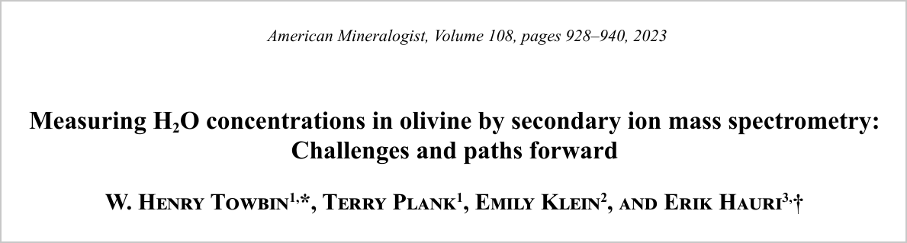

This post walks through [Towbin, Plank, Klein and Hauri (2023), Measuring H2O Concentrations in Olivine by Secondary Ion Mass Spectrometry: Challenges and Paths Forward](https://doi.org/10.2138/am-2022-8247), published in *American Mineralogist*. The two sets of standards that most labs use to calibrate water measurements in olivine disagree by about 50%. We traced the offset to their reference values and proposed a calibration that avoids it.

[{fig-alt="Title block of the paper: Measuring H2O concentrations in olivine by secondary ion mass spectrometry: Challenges and paths forward, by W. Henry Towbin, Terry Plank, Emily Klein and Erik Hauri, American Mineralogist volume 108, 2023"}](https://doi.org/10.2138/am-2022-8247)

## The measurement problem

Olivine, the most common mineral in the upper mantle, holds only tens of parts per million of water. That small amount still matters: it changes how easily the mantle flows and melts, and how much water the planet stores at depth.

Measuring it is hard. The two common methods, FTIR spectroscopy and secondary ion mass spectrometry (SIMS), are both relative. Each needs calibration against standards whose water content was measured some other way. For olivine, almost every lab relies on one of two standard sets: the olivines of Bell et al. (2003), whose water was measured by nuclear reaction analysis, and those of Withers et al. (2012), measured by elastic recoil detection. FTIR calibrations based on the two sets disagree by about 40%, and it was not clear why.

## What we did

We measured olivines from both standard sets in the same SIMS session, so the instrument conditions were identical, and compared each set against its own reference values.

The two sets fall on calibration lines with very different slopes. The Withers et al. line has about half the slope of the Bell et al. line, so the same SIMS signal reads as roughly twice as much water if you calibrate with the Bell et al. olivines. That offset of about 50% is close to the 40% already seen in FTIR. The Bell et al. olivines were also less reproducible: repeat measurements of the same crystal varied by more than 40%, which fits earlier reports that some of them contain tiny hydrous inclusions.

![SIMS calibration lines from one session. The Bell et al. olivines (light green circles, water measured by nuclear reaction analysis) define a line about twice as steep as the Withers et al. olivines (blue hexagons, measured by elastic recoil detection). Repeat analyses of KLV23 spread widely along the x-axis at a single reference value. The orthopyroxene standards (dark green) fall between the two, and the dashed line is the orthopyroxene calibration after we revised its reference values. Shaded bands are 95% confidence intervals from bootstrap resampling; the inset (b) shows the full concentration range. Figure 2 from Towbin et al. (2023), *American Mineralogist*.](bell-withers-offset.png){fig-alt="Calibration plot of H2O concentration against SIMS ion ratio. The light green Bell olivine line is about twice as steep as the blue Withers olivine line, with orthopyroxene lines between them"}

An offset like this could come from the reference values or from the two sets of olivines absorbing infrared light differently. The SIMS signal does not depend on how the hydrogen is bonded in the crystal, while infrared absorption can. So we plotted infrared absorbance against the SIMS signal for the same olivines, which leaves the reference values out entirely. Once the infrared spectra exclude the bands from hydrous inclusions, both sets fall on one line. That puts the disagreement in the reference water contents, the nuclear reaction and elastic recoil analyses.

{fig-alt="Scatter plot of integrated IR absorbance against SIMS ion ratio, with best-fit lines and confidence bands for Bell, Carnegie and Withers olivines"}

## Fitting lines when both axes are uncertain

Calibration data have uncertainty on both axes: the SIMS signal and the reference concentration. Ordinary least squares assumes all the error is in y, which biases the slope. I fit the calibration lines with orthogonal distance regression and estimated their uncertainty by bootstrap resampling; those are the lines and shaded bands in the calibration figure above. I later cleaned up that code and released it as a Python package, [odr_bootstrap](https://github.com/whtowbin/odr_bootstrap_package).

## Recommendations

- The Withers et al. olivines gave the tightest calibration line, but very little of that material exists.
- Orthopyroxene standards make a practical substitute for SIMS: their calibration slope is similar to olivine's. After we revised their reference values, the orthopyroxene line falls within 12% of the Withers olivine line, inside the long-term uncertainty of the measurements.
- With that calibration, the partition coefficient for water between olivine and melt comes out at 0.0009 ± 0.0003. That brings experiments and natural melt-inclusion studies into closer agreement.

{fig-alt="Two scatter plots of partition coefficient against water in glass, before and after recalibration"}

*Figures reproduced from Towbin, Plank, Klein and Hauri (2023), American Mineralogist, published by the Mineralogical Society of America.*
