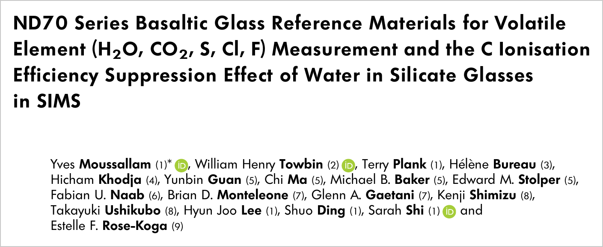
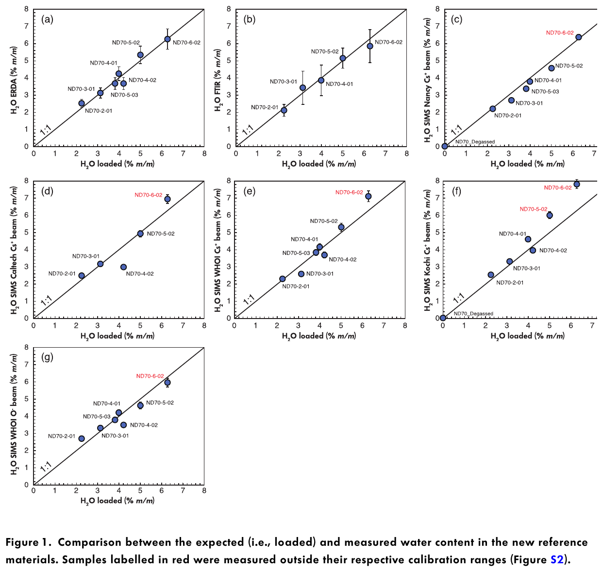
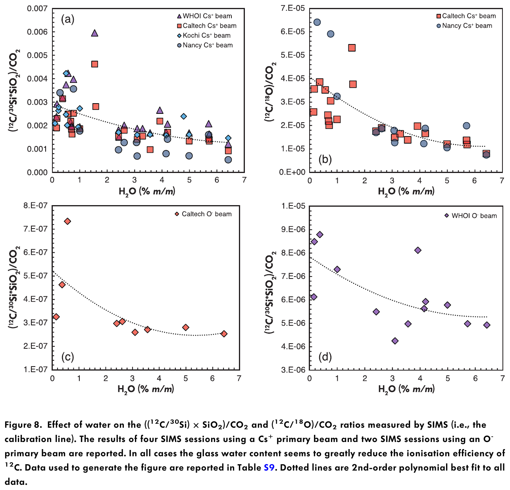

Our paper on the ND70 reference glasses came out in *Geostandards and Geoanalytical Research*: [Moussallam, Towbin, Plank et al. (2024)](https://doi.org/10.1111/ggr.12572). It describes a set of basaltic glasses with known amounts of water, CO₂, sulfur, chlorine and fluorine, made so that labs can calibrate their instruments over the full range found in nature.

[{fig-alt="Title block of the paper: ND70 Series Basaltic Glass Reference Materials for Volatile Element (H2O, CO2, S, Cl, F) Measurement and the C Ionisation Efficiency Suppression Effect of Water in Silicate Glasses in SIMS, by Yves Moussallam, William Henry Towbin, Terry Plank and co-authors"}](https://doi.org/10.1111/ggr.12572)

## A gap in the calibration data

Much of what we know about volcanic gases comes from tiny glass inclusions trapped in crystals, measured with an ion probe (SIMS). SIMS is a relative method: it only gives concentrations if you calibrate it against glasses whose composition is already known.

The available basaltic standards did not cover the range of real samples. Water calibrations above about 1 wt% were extrapolated, and the CO₂ standards stopped near a few hundred ppm, well below many natural melts. Any measurement outside that range depended on a straight line drawn past the last data point.

## Making the glasses

The ND70 series was made to fill that gap. We started from a single basalt, added known amounts of water, CO₂, sulfur, chlorine and fluorine, and melted each mix at 1 to 1.5 GPa in a piston-cylinder press so the gases stayed dissolved. The series spans 0 to 6 wt% water, 0 to 1.6 wt% CO₂, and 0 to 1 wt% sulfur, chlorine and fluorine. Older standards from earlier studies were included so the labs could cross-check them against the new ones.

Labs in the US, France and Japan then measured the glasses by several independent methods: elastic recoil detection, nuclear reaction analysis, an elemental analyzer, infrared spectroscopy, electron microprobe, and SIMS at four different ion-probe facilities.

{fig-alt="Seven scatter plots of measured water content against loaded water content, each close to a one-to-one line"}

## What we found

The amounts we loaded and the amounts measured agree well across methods and labs, so the glasses can serve as reference materials.

We also found a problem with how SIMS measures carbon. The more water a glass contains, the weaker its carbon signal. Measuring a glass with 4 wt% water against standards with less than 2 wt% water could underestimate its CO₂ two- to three-fold, and the reverse mismatch overestimates it. The fix is to calibrate with standards whose water content matches the samples, which the ND70 series now makes possible.

{fig-alt="Four scatter plots showing the SIMS carbon calibration ratio decreasing as water content increases, with dotted best-fit curves"}

## Where the glasses are now

Pieces of each glass went to ion-probe labs in the US, Europe and Japan. The rest are held at the Smithsonian National Museum of Natural History, where any researcher can borrow them.

I helped start the project after finding gaps in the basaltic glass standards available for calibrating water and CO₂ by SIMS and FTIR. I ran the piston-cylinder experiments at Lamont-Doherty and helped coordinate the analyses across the labs. 

*Figures reproduced unchanged from Moussallam et al. (2024), [Geostandards and Geoanalytical Research 48(3), 637–660](https://doi.org/10.1111/ggr.12572), under a [CC BY-NC-ND 4.0](https://creativecommons.org/licenses/by-nc-nd/4.0/) license.*
