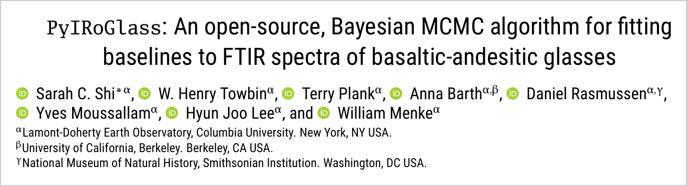
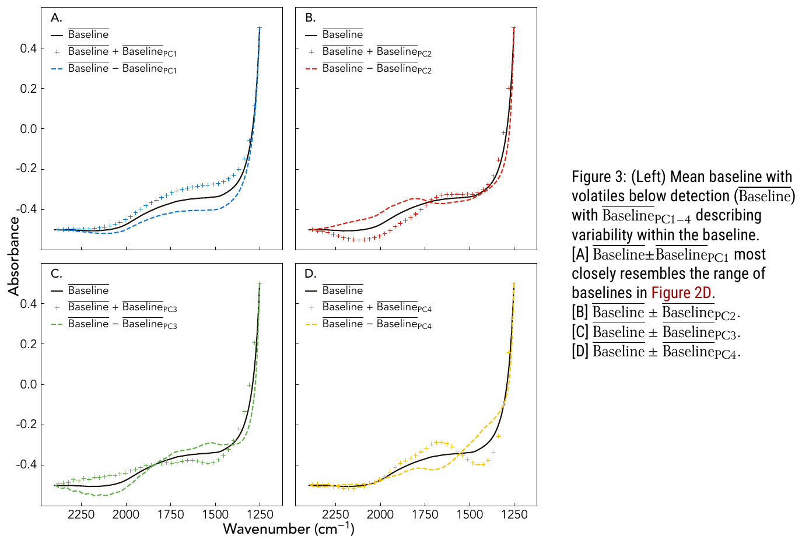

[PyIRoGlass](https://doi.org/10.30909/vol.07.02.471501) is an open-source Python package that measures water and carbon dioxide in volcanic glass from infrared spectra, with uncertainties. Our paper describing it is in *Volcanica*, and this post explains the idea behind it.

[{fig-alt="Title block of the paper: PyIRoGlass: An open-source, Bayesian MCMC algorithm for fitting baselines to FTIR spectra of basaltic-andesitic glasses, by Sarah C. Shi, W. Henry Towbin, Terry Plank, Anna Barth, Daniel Rasmussen, Yves Moussallam, Hyun Joo Lee and William Menke, Volcanica 2024"}](https://doi.org/10.30909/vol.07.02.471501)

## Drawing the baseline

Volcanologists measure water and CO₂ in tiny pockets of glass trapped inside crystals (melt inclusions) to work out how deep magma was stored and how much gas it carried. Infrared (FTIR) spectroscopy is the most common way to do it. Each dissolved species absorbs at its own wavenumber, and the height of its peak gives the concentration.

The hard part is the baseline. The carbonate peaks that record CO₂ sit on a curved background next to a water peak, and the shape of that background changes from sample to sample. For decades most people drew the baseline by hand. That is slow, it differs between analysts, and it gives no uncertainty on the result.

## Learning what baselines look like

Instead of guessing the baseline for each spectrum, we learned it from data. We collected spectra of melt inclusions from the Aleutians and of back-arc basin glasses with no detectable CO₂. Some of them still had a water peak at 1635 cm⁻¹, so we first described the shape of that peak with its own principal component analysis (PCA) and subtracted it, leaving spectra that are baseline only. PCA on that set gives a mean baseline plus a few components that describe how real baselines vary.

{fig-alt="Four panels of absorbance against wavenumber, each showing a mean baseline curve with dashed curves for plus and minus one principal component"}

Each new spectrum is then fit as a combination of those baseline components plus the peaks. A Bayesian sampler (Markov chain Monte Carlo) explores all the combinations that fit the data, so every concentration comes with an uncertainty instead of a single number.

{fig-alt="Multi-panel figure showing an FTIR spectrum with fitted baselines, fitted water and carbonate peaks, and the fit residual"}

## Results

PyIRoGlass results agree with independent analyses of experimentally devolatilized glasses within 6%, and with interlaboratory standards within 10% for water and 6% for CO₂. The paper also updates the molar absorptivities (the constants that convert peak height to concentration) for basaltic glasses, with their uncertainties. The code is open source and on [GitHub](https://github.com/sarahshi/PyIRoGlass).

The project began with my idea of learning the baseline shape with PCA, and I did the first PCA analysis. Daniel Rasmussen provided most of the spectra, and Sarah Shi, the lead author, carried the project forward and built PyIRoGlass into the finished tool.

*Figures reproduced from Shi, Towbin, Plank, Barth, Rasmussen, Moussallam, Lee and Menke (2024), [Volcanica 7(2), 471–501](https://doi.org/10.30909/vol.07.02.471501), under a [CC BY 4.0](https://creativecommons.org/licenses/by/4.0/) license.*
