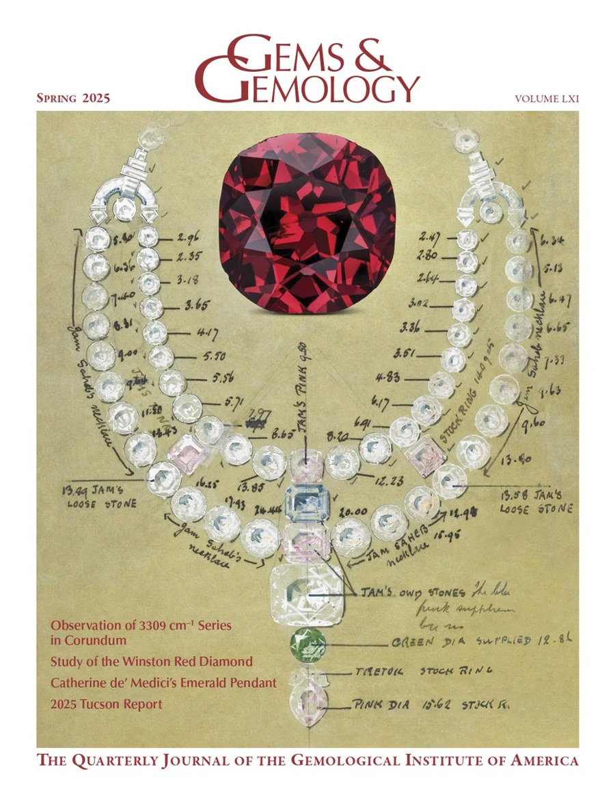
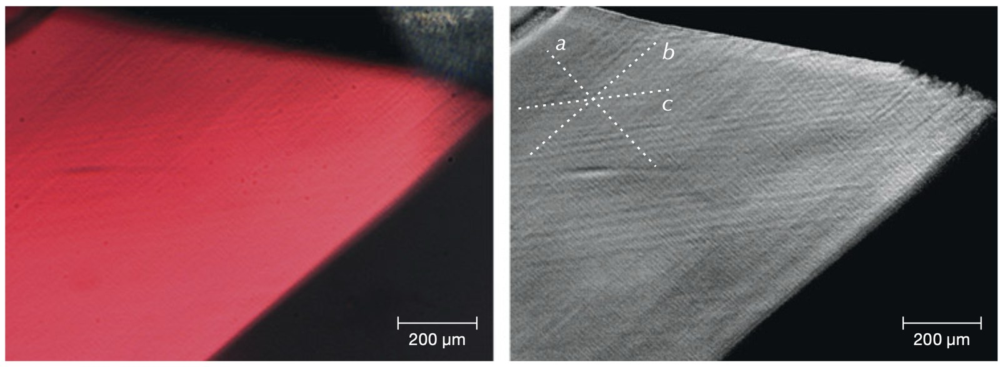

The Winston Red is a 2.33-carat red diamond that went on display at the Smithsonian's National Museum of Natural History in April 2025. A team from the Smithsonian and the Gemological Institute of America (GIA) studied it before the unveiling, and our paper is in *Gems & Gemology*: [A Study of the Winston Red: The Smithsonian's New Fancy Red Diamond](https://www.gia.edu/gems-gemology/spring-2025-winston-red-diamond).

{width="60%" fig-align="center" fig-alt="Cover of Gems & Gemology, Spring 2025, showing the red diamond above a hand-annotated drawing of a diamond necklace"}

## A very rare stone

Red is the rarest diamond color. Of more than a million colored diamonds GIA has examined, about 0.07% were red, and only about two dozen unmodified Fancy red diamonds over one carat are known. The Winston Red is the fifth-largest known Fancy red. It has an old-style cut, and its history goes back at least to 1938, when Cartier sold it to the Maharaja of Nawanagar. Ronald Winston later acquired it and donated it to the Smithsonian in 2023.

## A lab in a museum

We packed a truck with spectrometers and microscopes at GIA's lab in Manhattan, drove it to Washington, and set up a temporary lab at the Smithsonian to study the diamond there.

{fig-alt="Three photomicrographs of the red diamond's pavilion: a chipped facet edge, the octagonal culet with labeled facets, and a side view showing fine parallel color bands"}

## Where the red comes from

The red is linked to deformation. Deep in the earth the crystal was squeezed hard enough to slip along planes in its structure, leaving fine bands of color ("graining") in three directions, spaced about 9 to 33 micrometers apart. Under crossed polarizers the graining shows up clearly, along with a "Rose channel," a hollow tube that forms where two sets of deformation twins cross.

{fig-alt="Left: red facet with faint parallel bands. Right: the same view in grayscale with three crossing sets of bands marked a, b and c"}

Cathodoluminescence images show the dislocations arranged in a cellular network, a pattern typical of deformed diamonds with little nitrogen. The color itself comes from an absorption band near 550 nm, the band that makes pink and red diamonds pink and red. It is associated with deformation, but its atomic structure is still unknown. In the Winston Red that band is strong enough, and balanced well enough with the nitrogen-related absorptions, to produce a pure red.

The infrared spectra show about 83 ppm nitrogen, mostly in its most aggregated form, and no "platelets," a defect that heating or strong deformation can destroy.

## Where it came from

The stone's origin is not recorded, so we compared its nitrogen content and aggregation state with those of 399 Fancy red diamonds measured by FTIR at GIA. Those measurements and its color pattern place it in Group 1, the pink and red diamonds that formed in Proterozoic cratons, continental cores 0.5 to 2.5 billion years old. That rules out the sources of the other group, such as South Africa, Russia, Tanzania and Canada. Argyle in Australia, the largest source of Group 1 reds, was not discovered until 1979, four decades after Cartier sold the stone, and no red diamonds have been reported from India. The most likely sources left are the river deposits of Venezuela and Brazil, which were producing diamonds before 1938.

*Images from Farfan et al. (2025), [Gems & Gemology 61(1)](https://www.gia.edu/gems-gemology/spring-2025-winston-red-diamond), © GIA.*
