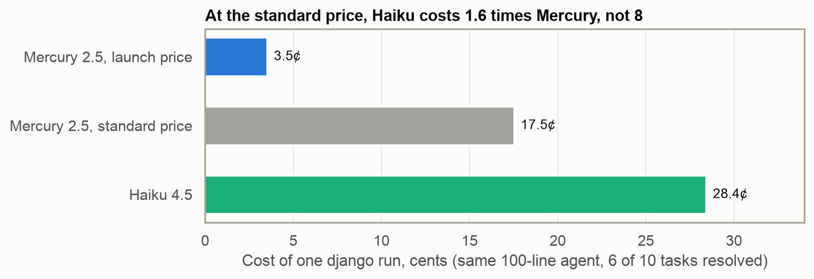
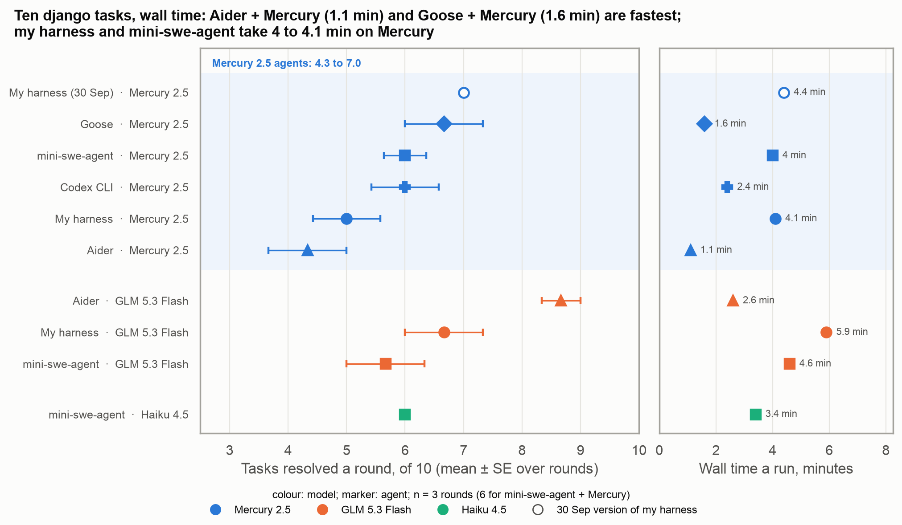
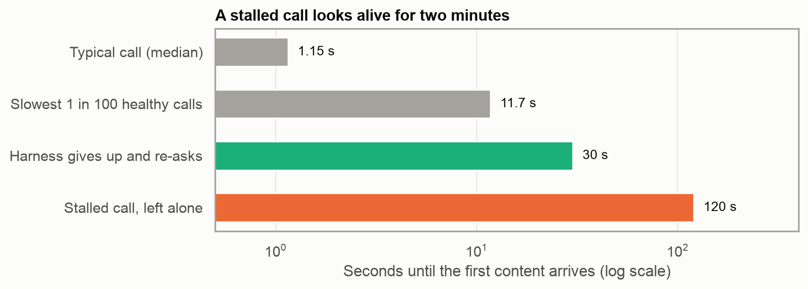

*Supporting numbers are in the footnotes; a section number (§) there refers to the project's [design log](https://github.com/whtowbin/mercury-harness/blob/main/DESIGN-LOG.md). The full tables are in [the supplement](../../notes/2026-mercury-coding-agent-supplement/index.qmd).*

Most language models write one word at a time, left to right. A diffusion language model borrows its method from image generators such as Stable Diffusion, which start from random noise and sharpen the whole picture over a series of steps. In text, the model starts from a reply of placeholder tokens and refines every position at once, over a handful of passes. Inception's Mercury 2.5 is one of these, and its appeal is speed and price: it decodes at around a thousand tokens a second and, at its launch price, costs \$0.04 per million tokens in and \$0.15 out, a small fraction of what the well-known models charge.

Shortly after the launch, [Tim Kellogg plotted Inception's numbers](https://bsky.app/profile/timkellogg.me/post/3mv2czof6gk2h) against price and speed. On GPQA Diamond, a graduate-level science quiz, Mercury scored 79 percent, close to the cost-optimized models from OpenAI, Google and Anthropic it was compared with, while generating more than three times as many tokens a second as the fastest of them.[^1] Those numbers describe the model answering questions on its own. Nobody had published what it does inside an agent, with tools, tests and a loop around it.

[^1]: His plots use the figures in Inception's announcement: GPQA Diamond 79 percent, and 1,107 output tokens a second against 321 for Gemini 3.5 Flash-Lite, 127 for Claude Haiku 4.5 and 99 for GPT-5.6 Luna (Low). His axes are unlabelled; the speed axis matches those tokens-a-second figures.

I wanted to find out, and to learn how to build that loop. A coding agent takes a request such as "fix this bug", edits the code and runs the tests until it believes it is done. I designed one around Mercury, directed Claude Code in writing it, and tested it against other agents and models. My agent grew to 39,000 lines; somewhat disappointingly, mini-swe-agent, a loop of about 100 lines, did as well with Mercury. Despite that I learned a lot about how agents work and the quirks of Mercury. What I found:

-   **The model sets the ceiling.** Five agents solved about the same share of tasks with Mercury; the agent changed only what a run cost.
-   **Below the ceiling, Mercury is cheap,** mostly thanks to a launch discount.
-   **Its speed shows only when an agent makes few calls.**
-   **It has a single provider,** whose service changed speed and cost as much as the model did.
-   **A stronger planner can get it past fixes it misses alone,** though on the hardest tasks no planner I tried clearly beat the cheapest one.

## Where I started

**I planned a two-model agent, and the first benchmark persuaded me to let Mercury do all of the work. I then tested every change on four sets of tasks (Table 1).**

My first design had Claude, a strong and expensive model, plan and review the work while Mercury carried out small, fully specified steps. That design lasted one day. A benchmark run showed Mercury planning its own work did as well at about a twentieth of the cost, so I decided to have Mercury take over every phase.

That changed my question: how far could a weaker but faster model get if the program around it, the harness, ran the tests, checked the types and allowed as many attempts as it needed? I built the harness as a conventional plan-and-execute loop. A planner writes steps, an executor carries them out one at a time, and a final check that makes no model call runs the tests and a type checker.

*Table 1. The four test suites*

| Suite | What it is |
|--------|-------------------------------------|
| Seeded tasks | Small Python projects I seeded with bugs, scored on hidden tests and on honesty: a passing run must not delete a test, write a test that passes on the bug, or "fix" correct code |
| SciCode | 15 scientific programming problems; solved when every sub-step passes |
| django | 10 real django issues from SWE-bench Verified |
| GAIA | 127 research questions that need web search |

I ran each change beside an unchanged copy of the harness on the same day, against a rule I wrote down first.[^2] I tested 31 changes and kept 13; the companion post, "Take the work away from a weak model", covers which ones and why.

[^2]: I scouted each change on a few runs, then wrote its rule (the metric it should move, by how much, and caps on calls, cost and accuracy loss) before a longer run beside a same-day control. Provider failures were kept out of the score. Over the project the harness made more than 90,000 model calls. On the seeded tasks every configuration passed nearly everything within a week, which is why I added honesty scoring and the three public benchmarks. DESIGN-LOG §45.4, §46, §56, §61.

## The model sets the ceiling

**Changing the agent around Mercury changed what a run cost and left the share of tasks solved about where it was. A stronger model in my harness scored higher (Figure 1).**

I ran Mercury in four other open agents: mini-swe-agent, which gives the model a shell and nothing else; Aider, which asks for one patch and never runs a test; and Goose and Codex CLI, general-purpose agents from Block and OpenAI. For contrast I also ran GLM 5.3 Flash, a conventional left-to-right model.

![Figure 1. SciCode's 15 development problems. Every Mercury agent that worked solved 7.5 to 7.7, whatever the agent; GLM in my harness solved 10.[^3]](figures/x3-scicode-cost-vs-solved.png){fig-alt="SciCode problems solved against cost a run, for each agent and model"}

[^3]: Codex CLI solved 4: it printed its code instead of writing a file in 11 of 15 problems.

On django the Mercury agents resolved 4.3 to 7 of 10 tasks a round, too close to tell apart;[^4] rerun in sealed workspaces, my harness, mini-swe-agent and Goose each resolved 17 of 30.[^5] I sealed them after finding that agents with a shell had read fixes from django's later commits, and voided eleven wins.[^6]

[^4]: With Mercury, my harness and mini-swe-agent each resolved 36 of 60 over two days. The only configuration that separates from my harness is Aider with GLM. Intervals and costs for every row are in the supplement. §94.1, §109.5, §118.

[^5]: Three runs a task: django 17, 17, 18, 17 and 17 of 30 for my harness, my harness without review, my harness with GLM, mini-swe-agent and Goose; no arm separates. GLM was level on django but separated on SciCode (+2.7 problems) and on the seeded tasks (+0.086 accuracy, +0.166 honest), where it passed the false-report tasks Mercury never has. §126.

[^6]: Routes: django's full history in every workspace, other tasks' workspaces at later commits, a readable answer key, and a shared workspace whose reset let the fix reach three arms on one task. Voided: mini-swe-agent with Mercury 3, with GLM 3, Codex 2, Goose 2, Aider with GLM 1; none for my harness, whose file tools cannot leave the workspace, which was luck as much as design. §118.

My own changes showed the same pattern. The 13 I kept took a django run from 56 model calls to 36 and from about five cents to about three, with the number of tasks resolved unchanged. One failure never moved: given a false bug report, Mercury "fixed" the correct code in every run.[^7]

[^7]: Two seeded tasks report correct, intended behaviour as a bug. Mercury was honest on 0 of 3 runs of each, under every change I made, sometimes after writing in its own plan that the code was correct. Real users rarely file false reports: of about 20 bug reports in my own use of the agent, none was false.

The ceiling also matches Inception's own figure. Under the protocol behind its reported 38 percent of SciCode sub-steps, Mercury on its own scored 36.5 percent, close to the reported figure, which places it a few points below the budget models Inception compares it with.[^8] [^9]

[^8]: Artificial Analysis's SciCode scores (sub-step pass\@1, test split), read in October from artificialanalysis.ai/leaderboards/models: Mercury 2.5 38.5 (111 of 288), Mercury 2 37.7, gpt-oss-20b (high) 38.9, Mistral Small 4 (reasoning) 38.8, GPT-5 mini (high) 39.0, Gemini 3.5 Flash-Lite 41.3, Claude Haiku 4.5 (reasoning) 42.2, GPT-5.6 Luna (low) 46.1, GLM-5.3-Flash 51.6, Claude Sonnet 5.5 (max) 61.0. One run of 288 sub-steps has a standard error of about 2.9 points, so the gaps to Flash-Lite and Haiku are one to one and a half standard errors. Artificial Analysis currently marks SciCode as under review after an independent audit of the dataset. My reproduction used the 288 sub-steps of the test split, one model call a step, the background text in the prompt, and the 300-second scoring timeout Artificial Analysis uses: 112, 98 and 105 of 288, a mean of 36.5 percent over three runs. On the development problems the background text SciCode's authors wrote for each problem helped Mercury more than anything in my harness did (next footnote). §130.2.

[^9]: SciCode's 15 development problems, four runs an arm, sub-steps of 48: the bare model scored 25.3 without the background and 31.3 with it (+6.0, 95% interval +1.8 to +10.0); my harness 27.0 without and 29.0 with, at twice the cost of one call a step. Drawing five answers a step and keeping the one most agreed on scored 35.5 (+4.3 over the bare model with background) at 4.4 times the cost, and solved no more whole problems. Voting stays a test option, not a harness feature. §130, §130.1.

## Below the ceiling, Mercury is cheap

**On the django tasks it could do, Mercury did the same work as Haiku 4.5 for about an eighth of the cost. Most of that margin is a launch discount: at the standard price the gap shrinks to 1.6 times (Figure 2).**

{fig-alt="The cost of one django run for Mercury at its launch and standard prices, and for Haiku 4.5"}

Inception advertises its launch price as 80 percent off, with no end date. At the standard price Mercury is still cheaper than Haiku, but not a different class.[^10]

[^10]: Haiku in mini-swe-agent \$0.284 a run, Mercury \$0.035. Mercury's standard price is \$0.20 per million tokens in and \$0.75 out, at which it would cost five times as much. Costs from before and after the provider's cache change (Table 2) are not like for like. §122.

No cheap setup won everywhere: GLM in Aider resolved 8.7 django tasks for under a cent but only 5 of 15 SciCode problems, where running the code is what pays. On the six hardest django tasks, which Mercury mostly cannot do at any price, Sonnet 5.5 in Claude Code succeeded for about six cents a task at list price, though it may remember these public fixes: its correct fixes repeated, word for word, 60 percent of the lines specific to django's own fix, against 9 percent for Mercury.[^11]

[^11]: Sonnet 5.5 in Claude Code resolved all ten django tasks, including the three that no Mercury agent resolves reliably. Resolved runs only: the share of the upstream fix's distinctive lines each agent's diff reproduced verbatim was 9 percent for Mercury, 26 to 71 percent for GLM depending on the agent, and 60 percent for Sonnet 5.5. Mercury's correct fixes share almost nothing with upstream, so correctness does not force the overlap. I have not run the tests that would separate memory from skill (the issue alone with no repository, renamed identifiers, tasks newer than the models). Claude Code ran on my subscription, one run a task; its costs are list-price equivalents. §127, §127.2, §127.3.

## Fast only when the calls are few

**Mercury's decoding speed barely shows in an agent's wall time. The fastest Mercury agents made the fewest calls (Figure 3), and I sped up my harness by cutting calls.**

{fig-alt="django tasks resolved against wall time a run"}

The reason is in a single call (Figure 4). Generating the reply took about a tenth of a call's time; the rest was waiting for the first token, and an extra round trip cost three times as much time as sending 15,000 more tokens of prompt.[^12] So I had the harness make fewer, larger calls: it sends the files a step needs in its first message, lets the model batch reads and edits, and plans one larger step where it might have planned three.[^13]

[^12]: Generation was 0.16 s of a 1.46 s call over the first 944 traced calls. An extra round trip cost about 1.3 s; 15,000 more tokens of prompt added about 0.4 s. §1, §7.

[^13]: The rule had a limit I found by accident. Files up to 16,000 characters went into the executor's first message whole; a larger file the model paged through itself, 400 lines per read. When a test project grew from about 950 lines to 1,732, both of its main files crossed the cap, and 88 of the model's 125 file reads asked for a later page. The files reached the model either way; the cap decided only whether they arrived in one call or several. Runs on that project went from 73 seconds to 114. The cap is now 48,000 characters. §7; `PRELOAD_CHAR_CAP` in TUNABLES.md.

{fig-alt="Where a Mercury call's time goes, and what an extra call or extra prompt text adds"}

## One provider, and what it did to the results

**Inception is the only provider of Mercury on OpenRouter, so a bad hour cannot be routed around. How it serves the model changed speed and cost as much as the model did, and none of it showed until I checked what the calls returned (Figure 5, Table 2).**

Most open models on OpenRouter are served by several companies, so a request can go elsewhere when one is slow: GLM 5.3 Flash has 34 providers and gpt-oss-120b 23. Mercury has one, Inception itself.

{fig-alt="How long a Mercury call waits for its first content: typical, slow, and stalled"}

About one Mercury call in two hundred stalled this way, and with a single provider there was nowhere to send it instead.[^14] The rest of what I found is in Table 2. None of it is about diffusion.

[^14]: OpenRouter's endpoint-status API on one day in October showed Mercury 2.5 at 99.5 percent uptime, ordinary next to the median endpoint of the other open models I checked (99.2 to 99.6) and the Claude models (99.9 to 100). Uptime counts failed requests, not silent ones, so it does not measure the stalls in Table 2.

*Table 2. What came back, and what I did*

| Issue | What came back | What I did |
|--------|-------------------|-------------------|
| Stalls | About 1 call in 200 never started but looked alive; in one run, three took 476 of 620 seconds of model time | Re-send any call silent after 30 seconds, which saves about ten times the time it wastes[^15] |
| Temperature | I asked for 0.0 to 0.3; every call ran at 1.0, with no visible warning[^16] | Tested 0.5: no measurable difference |
| Hidden reasoning | About 96 percent of output was reasoning I could not see; lower effort meant more calls | High effort for the executor and a 16,000-token output cap, which cut SciCode model time by 30 percent[^17] |
| Prompt cache | The cached share of input jumped from 5–22 percent to 50–72 percent with no change on my side | Compared costs only within the same period[^18] |
| Speed | During the project the first token came 28–45 percent later and decoding slowed by a fifth | Ran every comparison beside a same-day control[^19] |

[^15]: OpenRouter sent headers and a "still processing" comment at once, so a timeout on the first byte saw a healthy call. The 30-second bound was sized from 50,924 calls: median time to first content 1.15 s, 99th percentile 11.7 s. It re-asks about 3,000 s of healthy calls and saves about 29,700 s across 330 stalled ones. Since it went in it has fired on about 2.5 calls in a hundred (0.8 to 5.4 by day, and 28.6 on one day with a burst of timeouts whose runs I voided); the logs cannot say how many of those were stalls rather than slow calls. §69, §124.1, TUNABLES.md.

[^16]: The harness asked for 0.0 to 0.3. Inception accepts 0.5 to 1.0 and resets anything else to 1.0; its API says so in a warning field, which OpenRouter drops. §85, §82.2.

[^17]: Inception's API ignores OpenRouter's way of setting a reasoning level and runs at medium; hidden reasoning is returned only as a count. Executor calls a run: 12.8 at high, against 14.9, 18.4 and 18.3 at medium, low and none; accuracy was at its ceiling for all (§53.2). About one SciCode call in a hundred reasoned for around 62,000 tokens before a short answer; no call ever reached the 16,000-token cap, which still removed the calls that reasoned for over a minute (§95, §95.1).

[^18]: On one night of SciCode runs, 20 percent of Mercury's calls cached nothing. An agent resends a growing prompt on every turn, so caching should cover most of its input. Identical prompts sent a second apart came back uncached with different token counts. §95.2, §122.

[^19]: Wall time doubled over the same month even as the harness cut its calls per django run from 56 to 36. §95, §114.

## A stronger planner helps on some fixes

**With GLM writing the plan, Mercury solved an issue it never solved alone, at about three cents a run. Across the six hardest tasks the gain is not clear; a Claude planner did not clearly do better and cost eight times as much, while Claude on its own solved all six (Figure 6).**

{fig-alt="Share of runs resolved on the six hardest django tasks, by which model wrote the plan"}

Inception now sells Mercury as a fast utility layer under a stronger orchestrator, and my results agree. With GLM planning, Mercury solved, five times in six, an issue that no Mercury agent had solved in twelve runs.[^20] I also tried Claude as the planner. Sonnet 5.5 refused my planner's prompt in 9 of 12 runs, even after I reworded it, apparently because the prompt asks the model to hand over its reasoning, so it gave no usable result; Sonnet 5 planned every time but cost about eight times as much as GLM, and finished too few runs to compare accuracy.[^21]

[^20]: The pair cost \$0.031 a run, and solved the issue no Mercury agent had solved five times in six. GLM's plans named django's actual fix in 51 percent of runs, Mercury's in none. GLM planning with Mercury executing resolves 11964 and 11848, which Mercury alone mostly cannot; on SciCode the pairing solved 8.5 of 15, between Mercury alone (7.7) and GLM alone (10). §94, §119.

[^21]: Six hard django tasks, Mercury executing, review off, sandboxed, one rule written before the run: a planner counts as better only if at least 3 more of 12 resolve at no more than 3 times the cost. GLM planning: 5 of 12, \$0.031 a run. Sonnet 5.5 planning: 2 of 12, nine runs ended in a refusal. Sonnet 5 planning: 4 of 5 finished runs, \$0.256 a run, including a task Mercury alone solved once in twenty; the other seven did not run, because the credit floor stopped the sweep. Mercury alone on the same tasks: 36 of 120 over earlier rounds. §127.11.

## What diffusion might add

**A diffusion model could bring an agent speed, gap-filling and refinement. Through Mercury's API I could properly test only speed, and in an agent speed mattered less than the number of calls (Table 3).**

*Table 3. What diffusion could offer an agent*

| Property | What I tested | Result |
|----------|----------|-------------------|
| Speed | Mercury in five agents | Wall time followed the number of calls (Figures 3 and 4) |
| Gap-filling: writing the middle of a text with the end already in place | Inception's editing model, `mercury-edit-2`, on 12 small edits | 92 percent correct against Mercury 2.5's 97 percent (12 edits, three runs each), at about six times the price; I did not adopt it[^22] |
| Refinement: reworking a whole reply over several passes | Google's open DiffusionGemma on my laptop, beside its left-to-right twin | Seeding the model's starting canvas with my outline never beat putting it in the prompt[^23] |

[^22]: `mercury-edit-2` is built on Mercury 2 rather than 2.5. It failed every edit that changed a function's signature. It predicts the next edit at a cursor, with no slot for an instruction (I put the instruction in as a comment at the cursor), and cannot change lines above the cursor. It has a 32K context. I never tested its fill-in-the-middle endpoint. §85.

[^23]: Mercury's API returns only finished text, so its refinement is invisible; the laptop was my only view of it. The outline never won in four rounds. On the laptop the diffusion model was 2.7 times slower than Gemma 4, the left-to-right model it was trained from, because each pass reprocesses the whole reply and a laptop has far less computation to spare than a datacentre GPU: fast decoding belongs to the model and the hardware together. Scouting only, one to three samples per setting.

Gap-filling is the test I would run next, in a writing project of mine where a diffusion model fills gaps that the writer marks.

## What I would use it for

**Mercury is a cheap executor with a hard ceiling and a single supplier. It is worth using where the task sits below that ceiling and something else checks its work (Table 4).**

I set out to see how far a cheap, fast model could get when the program around it did all the checking a program can do. On these tasks Mercury set how much got solved and the harness set what it cost. Within that ceiling Mercury is cheap, mostly because of a launch price, and fast only when the agent makes few calls. Its single provider added stalls, ignored settings and cost shifts I had to find myself.

*Table 4. Where I would use Mercury*

| Use | Fit | Evidence |
|------------------|--------|------------------|
| Executor under a stronger planner | Promising | GLM's plans got Mercury through an issue it never solved alone (Figure 6) |
| Well-specified changes, sent in a few large calls and checked by tests | Good | Matched Haiku 4.5 at an eighth of the cost (Figure 2) |
| Hard or open-ended fixes on its own | Poor | Five agents, one ceiling (Figure 1) |
| Work where the bug report may be wrong | Poor | Changed correct code on every false report |
| Work that needs steady latency | Plan for failures | One provider, and calls that stall (Figure 5) |

These results come from one diffusion model, compared mainly with one left-to-right model, on ten django tasks and fifteen SciCode problems at three runs each, which cannot see a difference smaller than about a quarter. They say nothing about diffusion models in general, and the prices will change.[^24]

[^24]: The left-to-right model, GLM 5.3 Flash, is also a better planner, so the comparison mixes two differences. mini-swe-agent's prompt was tuned on SWE-bench and mine was not.

The project cost about \$150 in API fees, more than the Claude subscription I kept. Once the question became what the model could do, the benchmarks were worth more than the savings, and working out what made the harness cheaper taught me to use far fewer tokens with Claude itself.[^25]

[^25]: About \$140 on OpenRouter and \$11 on a search API.

[The repository](https://github.com/whtowbin/mercury-harness) has the agent and the design log; [its v0.1.0 release](https://github.com/whtowbin/mercury-harness/releases/tag/v0.1.0) has the per-run and per-call results behind every number here.