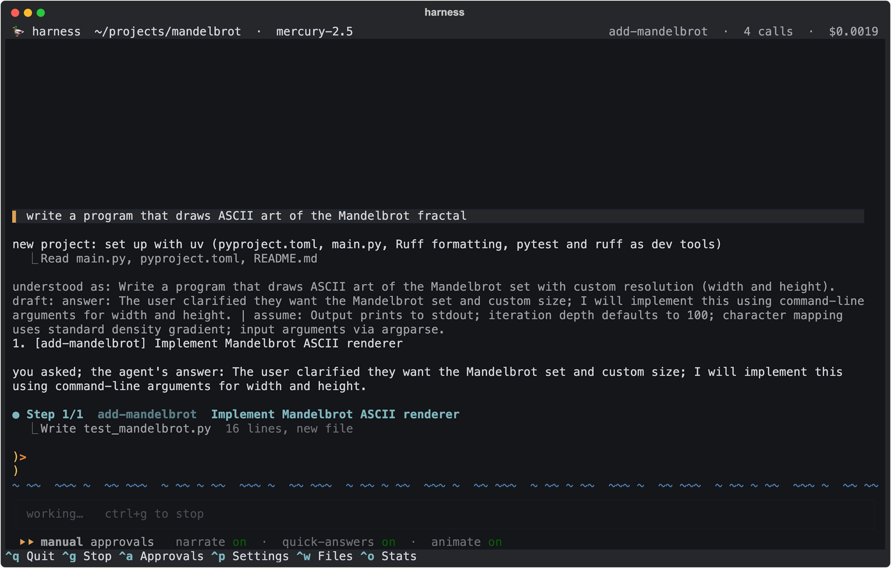
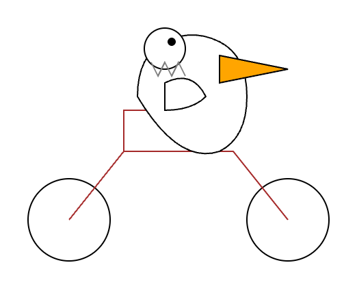
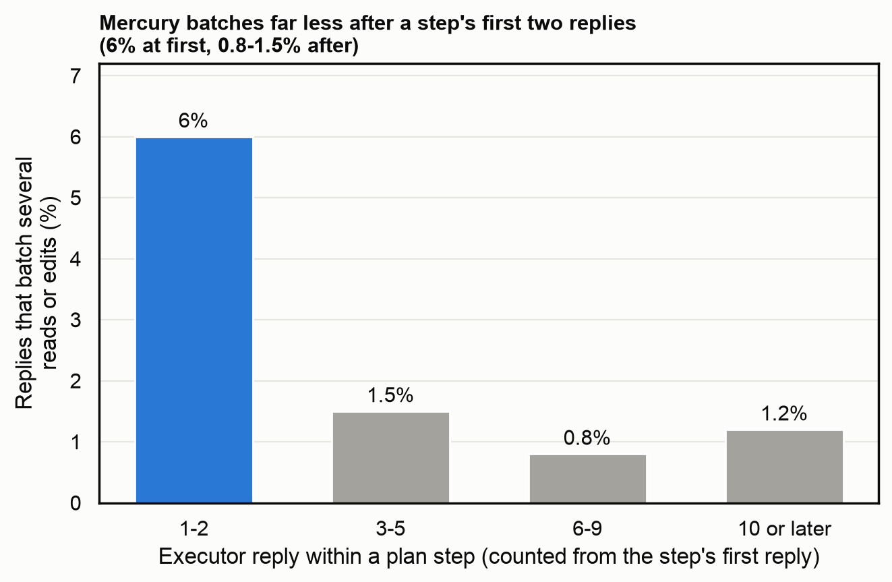

*The companion to [Mercury 2.5: a cheap diffusion LLM with a hard ceiling](../2026-mercury-coding-agent/index.qmd). Supporting numbers are in the footnotes; a section number (§) there refers to the project's [design log](https://github.com/whtowbin/mercury-harness/blob/main/DESIGN-LOG.md). The full tables are in [the supplement](../../notes/2026-take-the-work-away-supplement/index.qmd).*

In September I built a coding agent around Mercury 2.5, a cheap and very fast diffusion language model from Inception. I hoped speed could make up for strength. A model that answers in about a second can afford to check its work again and again, as long as the program around it, the harness, does the checking: it decides what the model sees, which tools it can call, and when the work counts as finished. Mine writes a plan, carries it out one step at a time, and ends with a check that makes no model call.

On a small project it worked well. One afternoon's session, an illustration rather than a benchmark: I asked it to "write a program that draws ASCII art of the Mandelbrot fractal", then to save the output, to add an option that blanks out the background, and finally to draw an SVG of a pelican riding a bicycle, the informal test Simon Willison gives new models. Each request took 72 to 95 seconds, each ended with the harness's final check passing, and the four together cost about two cents.[^example] On work like this Mercury held its own against far more expensive models: in the first post's benchmarks it matched Anthropic's Haiku 4.5 on real bug fixes for about an eighth of the cost.

{fig-alt="The dashboard while Mercury works on the Mandelbrot request: the plan, the first step under way, and the waiting ducks crossing the screen"}

<figure style="margin: 1rem 0;">

<figcaption class="figure-caption">Figure 2. The program's Mandelbrot output in a terminal, and the pelican. The pelican is recognizable, though its beak grows out of its body rather than its head.</figcaption>
</figure>

On harder work the picture changed. The first post covers the benchmarks: on real django bug fixes and scientific programming problems, Mercury had a ceiling that no harness I built or borrowed moved, and past a point it was not worth working around when I could switch models. This post is the post-mortem of the harness itself, from what it did for Mercury to what I would do differently. All of it is about one model, Mercury 2.5, in my harness on these tasks. Other models and other harnesses may do better, and my own numbers show the harness mattered more for another model.

## What the harness could do

**Moving a job from the model into the harness worked. I tested 31 changes against an unchanged copy of the harness and kept 13; 11 of the 13 took work away from the model or changed what the harness sent it. Together they made runs cheaper at the same success rate. None raised the share of tasks Mercury solved (Figure 3).**

The biggest saving came from looking at what Mercury spent its calls on. More than half of its edits were followed by a turn that did nothing but run the tests, a whole round trip to learn something the harness could have told it. So I had the harness run the step's test after every edit and attach the result. Test-only turns fell from 78 percent of edits to 33, model time by 31 percent and the cost of a run by 40 percent, with accuracy unchanged. Running the type checker after each edit did the same for type errors: runs that ended with new ones fell from 6 of 8 to 1 of 8.

The other kept changes were of the same kind. The harness cut and re-sent any call that stayed silent for 30 seconds, capped the length of a reply, and had the provider enforce each tool's argument format, which took malformed tool calls from 9 of 524 to none.[^kept]

{fig-alt="Each harness change's effect on the cost of a run against its effect on accuracy, with 95% intervals, adopted changes above and rejected changes below"}

Each change ran beside an unchanged copy on the same day, against a rule I wrote down before the run: the metric it should move, by how much, and limits on calls, cost and lost accuracy. My first test set was small Python projects I had seeded with bugs and scored with hidden tests. Because accuracy on those seeded tasks hit its ceiling within a week, I also scored honesty: a run that passes must not delete a test, write a test that passes on the bug, or "fix" code that was correct.[^method]

## What it couldn't do

**For Mercury on these tasks, breaking the work into small checked steps did not lift its ceiling. The specialized tools I built went unused, and the one written rule I measured faded unless the harness re-sent it.**

This was the result I least expected. I thought a harness that split a big task into well-scoped steps, with a deterministic check after each one, would carry a cheap model through problems it could not solve in one go. It made the runs cheaper, and the share of tasks solved stayed where it was. The harness did matter for another model. GLM 5.3 Flash, a conventional model that writes left to right, solved 10 of 15 SciCode problems in my harness and 5 in Aider, an agent that never runs code; on django it resolved 8.7 of 10 tasks a round (three tries at each task) in Aider and 6.7 in my harness.[^glm] The limit I hit looks like Mercury's on these tasks.

I had also hoped specialized tools would help Mercury with bigger problems. Inception advertises tool calling, and Mercury did use its standard tools reliably: reading and editing files, running shell commands, finishing a step. In 4,300 runs it never called a tool that did not exist. It never chose the tools I built for it. A structural search-and-replace for renames was called 0 times in 60 runs, even after 22 reminders timed for the moment a rename was needed, and a tracer for debugging was called 0 times in 15. I revised how the tools were described and how the prompt encouraged them several times, and nothing changed.[^tools] Another model, or tools offered another way, might do better.

The one rule I tracked closely had a shorter life than I expected. The executor, the part of the harness that carries out each step, is told to batch its work, reading several files or making several edits in one call. Early in a step it did, in about 6 percent of replies; a few turns later, in about 1 percent. Inception's own guide says Mercury weights recent context heavily, which fits a rule sitting at the top of the prompt. Moving it to the end of the system prompt changed nothing. Having the harness repeat it after the last message on every call cut the executor's replies by about a fifth at the same accuracy (Figure 4).[^reminder]

{fig-alt="How often Mercury batched its reads or edits, by reply number within a plan step"}

The changes I rejected were mostly attempts to make the model work differently, by telling it in the prompt or by holding its work until it complied. A gate that held the first edit until a test had run got Mercury writing failing tests first in 48 percent of steps instead of 3, and cost 3.9 points of accuracy. Having the planner research the libraries before planning gained 1.7 SciCode problems on its first run and did not repeat. The full list is in the supplement.

## What a better planner could and couldn't do

**A stronger model writing the plan got Mercury through a fix it could not find alone. But on the hardest tasks no planner I tried clearly beat the cheapest one, and stronger models cost more inside my harness than in Claude Code.**

My first design had a strong model plan and Mercury carry out the steps, and I came back to it at the end. With GLM 5.3 Flash writing the plan, Mercury solved, five times in six, a django issue that no Mercury agent had solved in twelve runs. Across the six hardest tasks, though, GLM planning resolved 5 of 12 runs, against 30 percent for Mercury alone, too close to call. Sonnet 5 as the planner resolved 4 of the 5 runs that finished before my credit ran out, at about eight times GLM's cost a run. Sonnet 5.5 refused my planner's prompt in most runs.[^planner] The first post has the chart.

Putting a stronger model in every seat of the harness was expensive. On the same six tasks, my harness cost 2.6 times as much as Claude Code with Sonnet 5 and 3.4 times as much with Haiku 4.5, for about the same number solved; Haiku spent 64 calls and about a dollar a task looping through plans and fixes.[^strong] For Mercury I kept the planner, which is meant to catch false bug reports, and turned the review phase off, which cut the bill to 61 to 73 percent of the default with no loss I could measure.[^review] For a stronger model I would keep the plan and the final check and put a hard limit on how long a model can loop inside them, which I have not built or measured.

## What would change the picture

**I still think cheap, fast models like Mercury have a place for basic tasks like the Mandelbrot project. Two improvements would widen it: choosing the specialized tools it is offered, and less waiting per call.**

The speed I was counting on mostly did not show. A Mercury call in my early traces took about 1.5 seconds, and generating the reply was about a tenth of that; the rest was waiting for the first token.[^latency] My agent made dozens of calls a task, so its wall time followed the number of calls. If that wait fell, fast decoding would start to matter, most of all in interactive tools where a person is waiting on each answer.

## What I would do differently

**I would find external benchmarks sooner.**

My seeded tasks were saturated within a week: every configuration passed nearly all of them, so they could no longer tell a good change from a bad one. I kept building harder tasks with Claude, and they kept saturating too. For most of the project I could only compare changes with each other, on benchmarks that kept changing, which says little about how good the agent is in absolute terms. Public benchmarks (ten django issues from SWE-bench Verified, SciCode's scientific problems and GAIA's research questions) came late.[^mistakes]

## Working with Claude

**Claude Code made Mercury's two most common mistakes: saying work was done before checking it, and fixing problems that were not there. With Claude, though, a short written rule usually stopped a mistake from coming back, and asking it to write its own scripts, skills and tools worked well.**

This was one of my first projects with Claude; I had moved from Copilot after it ran through money quickly. Most of my rules began as an incident (Table 1).

*Table 1. Mistakes Claude Code made while building the harness, and the rule I added to its standing instructions after each*

| What went wrong | The rule I added |
|--------------------------|--------------|
| Claude built a timer to cut off model calls that stall, and reported it working. It never fired: its only test used a stand-in for the network, so the test passed without a real connection. Once fixed, a stall cost a run 3 minutes instead of about 15. | Test code that talks to the network, other programs or files against a real local version of them, not only a stand-in. |
| The code that reads the type checker's report passed every project for days, because its test was written with the report in the wrong format and never checked the real one. | The same rule, and check that a test's input looks like the real input. |
| A request to Claude Sonnet spent its whole output allowance on hidden reasoning and came back empty, and the code treated the empty answer as a normal reply. | Always set the reasoning effort and the output limit, and stop with an error when a model returns nothing. |
| Over the project Claude wrote about 790 throwaway Python scripts, each answering one question about the run logs. | Answer questions about the logs with a database query tool (DuckDB), and turn any analysis done by hand twice into a reusable tool. |
| Development felt slow, and I suggested ways to speed it up: more work in parallel and more batching. | Treat my suggestions as ideas to test: measure where the time goes before changing anything. |

The rule I repeat most is the last one. I asked Claude more than once to push back on my ideas, and what worked was asking for a measurement before an opinion. The first time, the measurement found one file of interface tests taking 67 percent of the test suite's time, and running the suite in parallel took it from 87 seconds to about 10. Slowness came back more than once with a different cause each time, and finding each one took repeated pushing on my part.

Short skills that load only when they apply did the rest: verify before claiming something works, find the root cause before patching, and build a tool the second time an analysis is done by hand. Mercury never chose the tools I built for it, while Claude, asked to write its own, built the trace queries and benchmark reports this project runs on. Before a big rewrite, like this post, I ask Claude to interview me first.

The harness also taught me to read Claude's costs. A report over 220 of this project's sessions found that turns run with more than 400,000 tokens of context were about half of all turns and 71 percent of the cost, and about three quarters of that context was output from shell commands. I cut the instructions loaded into every session from 148 lines to 47, moved the rest into files that load only where they apply, and started a fresh session for each piece of work.[^sessions]

## What I'd keep

What worked for me was matching the model and its tools to the task. With Mercury, that meant putting the checks and the tools in the harness, so the model never had to choose them: run the tests after each edit, enforce the tool formats, and re-send the rule that matters on every call. With Claude, it meant short written rules and asking it to build its own tools. For either, I would end every run with a check that makes no model call, since neither model's own report that it was done proved anything. A harness built around one model's failures did not suit the stronger ones I tried, and switching models was sometimes the better fix.

**Postscript, added after benchmarking Mercury 3.** Inception released Mercury 3 while this post was waiting to go out, and I ran it through the same harness and benchmarks; [the next post has the details](../2026-testing-mercury-3/index.qmd). Two of the conclusions above held, and one prediction came half true. The ceiling did turn out to be the model's: in the same harness, Mercury 3 resolved 25 of 29 django runs against Mercury 2.5's 15 of 30, and 10.3 SciCode problems a round against 7.3, and my harness now helped more than mini-swe-agent did. It also used the tools better, with one failed edit or read in 30 runs against Mercury 2.5's 12, and it reached for the batch-read and git-history tools that Mercury 2.5 rarely touched. As I wrote above, a harness built around one model's failures held the better one back: a check I had added for Mercury 2.5 kept redoing Mercury 3's finished steps until I removed it. What did not change was the waiting. Mercury 3 spends most of each call reasoning before it writes, so a task took longer, not shorter.[^ps3]

[^example]: Six requests on 2 October, Mercury 2.5 in every phase: four that built something (72, 84, 95 and 85 seconds; \$0.0043, \$0.0044, \$0.0043 and \$0.0069) and two questions answered directly in 2 to 3 seconds. The SVG uses `stroke_width` where SVG needs `stroke-width`, so its line widths are ignored. The first request is shown with my typos fixed.

[^kept]: The after-edit test run (§99.2-99.4), the type check (§105.2), the 30-second cut (about 29,700 seconds of stalls saved for about 3,000 re-sent; §69), the 16,000-token output cap (SciCode model time −30%; §95.1) and strict tool schemas (§63.1, at the cost of planner calls about 30 percent slower). The planner's plan-submitting call had failed in 12 percent of runs because a list of steps sent as a JSON string needs every quote escaped twice. The two kept changes that asked Mercury to behave differently were a snippet that reproduces the reported bug before planning a fix, which has not reached significance, and a gate on edits that contradict the run's own evidence.

[^method]: I scouted each change on two runs a task first, read the failures before the numbers, dropped tasks that every version passed or failed, and kept provider failures out of the score. §45.4, §46, §56, §61.

[^glm]: django: ten tasks, three rounds each, after voiding wins that read the fix from django's later history (§118); GLM in mini-swe-agent resolved 5.7 a round. SciCode: 15 development problems, two runs in my harness and one in Aider. Intervals and costs are in the first post's supplement. §94.1, §109.5, §118.

[^tools]: Structural edit tools §62.1, tracer §43.1. In 4,300 runs Mercury never called a tool that did not exist; its tool failures were malformed arguments, which strict schemas fixed (§63.1).

[^reminder]: Batching was 6.0 percent of replies on turns 0-1, then 1.5, 0.8 and 1.2 percent later (§82). The reminder holds the step's goal, the batching rule and the turns left, and is never saved into the conversation, so the cached part of the prompt stays the same. Executor replies 8.75 to 6.93 a run; about a quarter fewer on django. §82.1-82.2, §106.2, §107.3.

[^planner]: The issue Mercury could not solve alone was solved five times in six with GLM planning; GLM's plans named django's actual upstream fix in 51 percent of runs, so recall may explain part of that (§119), and Mercury alone later solved it once in 20. Six hard django tasks, Mercury executing, rule written before the run (a planner counts as better only if at least 3 more of 12 resolve at no more than 3 times the cost). GLM planning: 5 of 12, \$0.031 a run. Sonnet 5 planning: 4 of 5 finished runs, \$0.256 a run. Sonnet 5.5 refused the planner's prompt in 9 of 12 runs. Mercury alone on the same tasks: 36 of 120 over earlier rounds. §119, §127.11.

[^strong]: One run a task. Sonnet 5: 5 of 6, 32 calls, \$0.97, against Claude Code's 6 of 6, 26 calls, \$0.38. Haiku 4.5: 3 of 6, 64 calls, \$1.04, against 2 of 6, 46 calls, \$0.30. My harness's costs are billed; Claude Code's are list-price equivalents of a subscription. Claude Code took 97 percent of its input from cache, the harness 65 percent, so caching explains part of the gap. The strong models may also remember fixes to these public tasks. §127.2, §127.3, §127.6, §127.7.

[^review]: Review off: 61 to 73 percent of the default's cost (review itself was about a fifth of spend; without it, fewer fix rounds followed), with no loss on django, SciCode or the seeded tasks. No planner: 58 to 65 percent of the cost at about equal accuracy, but honest runs on the seeded tasks fell from 42 to 39 of 48, mostly on the false bug reports the planner's checks exist for. §124.10, §129.2, §129.8.

[^latency]: Generation was 0.16 seconds of a 1.46-second call over the first 944 traced calls. §1, §7.

[^mistakes]: The method also caught mistakes that would each have changed a decision: 65 of 102 runs that were "wrong while their tests passed" came from one task that asked for one thing and tested another, and eleven wins by other agents had read the fix from django's later history or from another task's workspace. The full list is in the supplement. §47, §107.1, §79.1, §112.1, §106.1, §118, FINDINGS row 15.

[^sessions]: `harness sessions report`, run 4 October over 220 sessions and 16,238 API responses: 68 percent of cost was reading the cache; context compacted at 200,000 tokens would have cost an estimated 41 to 51 percent of the actual.

[^ps3]: Mercury 2.5 and Mercury 3 in the same version of my harness on 20 October, ten django tasks three times each (one Mercury 3 run voided for reading django's newer code online) and three SciCode rounds. Failed edit or read calls from the run traces; batch reads 19 calls against 3, git history 13 against 0. The removed check retried a step marked verified without a stated expected result; removing it raised Mercury 3's perfect runs on my private tasks from 24 to 30 of 31. A django task took 2.5 minutes against 1.4, and about 84 percent of Mercury 3's time in model calls went to writing tokens, nearly all of them reasoning. §131.9, §131.13, §131.14.
