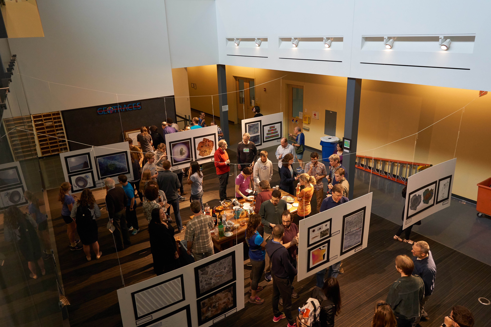
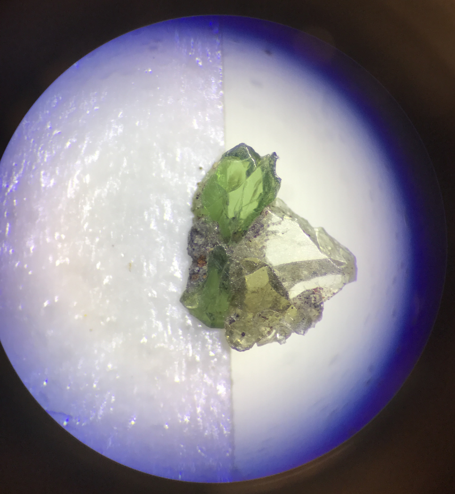

{width=60% group="my-gallery"}  

Lamont-Doherty Earth Observatory's Annual Research as Art exhibition showcases the many creative talents of our community and links, either deliberate or incidental, between our work and art.

{width=60% group="my-gallery"}  

Anna Barth showing off her sculptures of infrared spectra from experiments to determine the diffusivity of hydrogen in magmatic olivine.

{width=60% group="my-gallery"}  

{width=60% group="my-gallery"}  
My own submission: a cluster of pyroxene and olivine crystals mounted for infrared spectroscopy. I took the photo with a cellphone through the microscope eyepiece before the analysis, to record how the sample was oriented.

<!-- <meta property="og:image" content="/images/Henry_Logo.jpg"/>
<meta property="og:title” content=“Henry Towbin”/> -->
